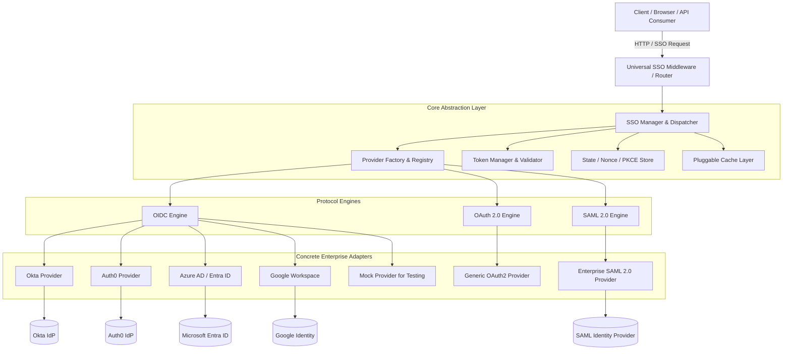
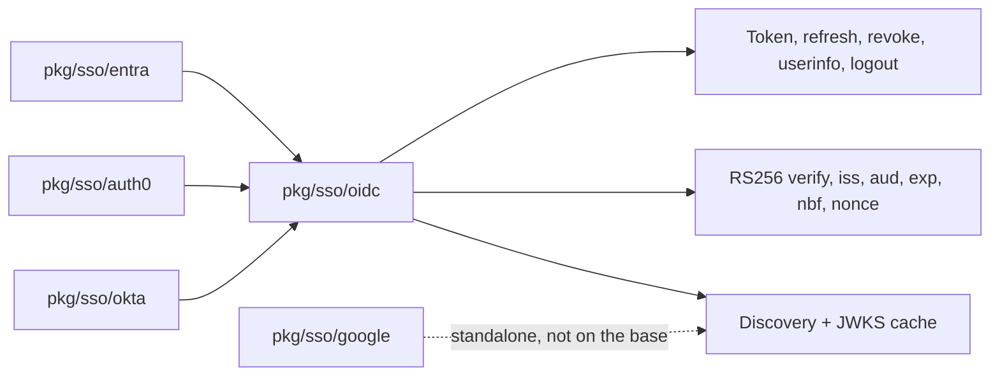

# Universal SSO Connector System: Technical Specification & Architecture

## 1. Executive Summary & Architecture Overview

The **Universal SSO Connector System** (`universal-sso`) is a modular, high-performance, enterprise-grade Single Sign-On (SSO) gateway and SDK written in **Go**. It enables applications to integrate seamlessly with diverse identity providers (IdPs) across modern and legacy protocols—including **OpenID Connect (OIDC)**, **OAuth 2.0**, and **SAML 2.0**—through a single, unified abstraction layer.

### Modular Design Principles

1. **Protocol & Provider Decoupling**: Application code only interacts with the high-level `Provider` or `Manager` interface. Protocol details (e.g. SAML XML signatures vs OIDC JWT verification) are isolated inside protocol adapters.
2. **Factory & Registry Pattern**: Providers are dynamically registered and instantiated via named drivers with strict configuration validation.
3. **Pluggable Cache & State Store**: Supports In-Memory (LRU/TTL) and Distributed (Redis/Memcached/Custom) session, token, and PKCE/state storage.
4. **Security-First Architecture**: Mandatory PKCE (S256), cryptographic nonce verification, state tampering protection via HMAC, clock skew tolerance, and strict cryptographic signature verification.
5. **Zero-Lock-In Integration**: Can be embedded directly as a Go library / HTTP middleware, or deployed standalone as an identity proxy / auth sidecar.



---

## 2. Supported Protocols & Enterprise Providers

| Provider / Protocol | Protocol Family | Auth Flow | Key Features Supported |
|---|---|---|---|
| **Okta** | OIDC / OAuth2 / SAML2 | Authorization Code + PKCE | Auto-discovery (`.well-known`), groups claim, organization tenancy, userinfo endpoint |
| **Auth0** | OIDC / OAuth2 | Authorization Code + PKCE | Audience validation, custom namespace claims, refresh rotation |
| **Azure AD (Entra ID)** | OIDC / SAML2 | Authorization Code + PKCE | Multi-tenant (`common`/`organizations`) & single-tenant, v2.0 endpoint, roles/groups |
| **Google Workspace** | OIDC / OAuth2 | Authorization Code + PKCE | Hosted domain (`hd`) filtering, offline access refresh tokens, profile info |
| **Generic OAuth 2.0** (implemented, `pkg/sso/oauth2`) | OAuth 2.0 (RFC 6749) | Authorization Code + PKCE (S256) | Configured endpoints, `basic` or `post` client authentication, profile endpoint as the identity source, refresh, optional RFC 7009 revocation. No ID token, no nonce, no logout |
| **Generic SAML 2.0** (planned) | SAML 2.0 HTTP-Redirect / POST | SP-Initiated (IdP-Initiated is refused) | Metadata XML parsing, X.509 cert validation, assertion decryption, AuthnRequest signing |
| **Mock Provider** | In-Memory Simulation | Synthetic Auth Flow | Full cryptographic simulation for CI/CD and offline testing |

Setup guides: [Google](Google-SSO-Setup.md), [Azure AD / Entra ID](Azure-AD-SSO-Setup.md), [Okta](Okta-SSO-Setup.md), [Auth0](Auth0-SSO-Setup.md) and [Generic OAuth 2.0](OAuth2-SSO-Setup.md) are implemented. [Generic SAML 2.0](SAML-SSO-Setup.md) is a planned adapter.

### Generic OAuth 2.0 adapter

`pkg/sso/oauth2` is for providers that are not OpenID Connect (for example a GitHub-style API). You configure the authorization, token and profile URLs yourself. Because plain OAuth 2.0 has no ID token, the trust anchor is the access token received over HTTPS from the configured token URL and used against the configured profile URL. Neither URL ever comes from request data. `EmailVerified` is always false, because the profile endpoint gives no verified-email guarantee.

Security properties, each covered by a unit test: PKCE S256 is mandatory, the token reply must be JSON with a bearer `token_type`, an `error` member is honoured even at HTTP 200, the authorization code is single use, and responses are capped at 1 MiB.

### OIDC vendor adapters

Okta, Auth0 and Entra ID are thin wrappers over one generic OIDC provider, `pkg/sso/oidc`. The base owns discovery, JWKS caching and rotation, the authorization code flow with PKCE (S256), token exchange, and ID token verification. A wrapper only supplies vendor rules through hooks.



| Vendor | Gateway id | What the wrapper adds |
|---|---|---|
| Okta | `okta` | `groups` and `preferred_username` claims; org or custom authorization server issuer |
| Auth0 | `auth0` | trailing-slash issuer, `audience` parameter, roles claim, `/v2/logout` URL |
| Entra ID | `azure` | tenant pinning, `tid` based issuer check for multi-tenant endpoints, `AllowedTenants`, `roles` and `groups` |

Security properties, each covered by a unit test: only RS256 is accepted (`none`, HS256 and other algorithms are rejected before key lookup), the nonce is bound to the login, the PKCE verifier is required, the discovery issuer must equal the configured issuer, an unknown `kid` triggers at most one JWKS refresh per minute, and responses are capped at 1 MiB.

### Verification boundary

`pkg/sso/oidc/oidctest` and `pkg/sso/oauth2/oauth2test` are in-process fake servers. The unit tests and `tests/e2e.sh` (the gateway built with `-tags e2e`, all five example clients, five providers) run against them. That proves the code, not a live tenant or provider. See [Examples.md](Examples.md#end-to-end-check).

Example gateway clients (Rust, Go, Python, Java, C#) are described in [Examples.md](Examples.md). The validation gates and documentation status are summarised in the generated [Documentation-Audit.html](Documentation-Audit.html).

---

## 3. Abstraction Layers and Interfaces

### Core Interfaces

```go
type Provider interface {
    ID() string
    Name() string
    Protocol() ProtocolType
    GetAuthURL(ctx context.Context, req AuthURLRequest) (*AuthURLResponse, error)
    HandleCallback(ctx context.Context, req CallbackRequest) (*IdentityResult, error)
    ValidateToken(ctx context.Context, tokenString string) (*Claims, error)
    RefreshToken(ctx context.Context, refreshToken string) (*TokenResponse, error)
    RevokeToken(ctx context.Context, tokenString string) error
    GetLogoutURL(ctx context.Context, req LogoutRequest) (*LogoutURLResponse, error)
    FetchUserInfo(ctx context.Context, accessToken string) (*UserInfo, error)
}
```

---

## 4. Configuration Management Strategy

Configuration is loaded from multiple layers with deterministic precedence:
1. Explicit Code / Options Override (highest precedence)
2. Environment Variables (`SSO_PROVIDERS_OKTA_CLIENT_ID`, etc.)
3. YAML / JSON Config Files (`config.yaml`, `config.json`)
4. Dynamic Provider Discovery (`.well-known/openid-configuration`, SAML Metadata XML)
5. Built-in Defaults (lowest precedence)

---

## 5. Security Architecture & Threat Mitigation

| Threat Vector | Mitigation Strategy |
|---|---|
| **CSRF / State Manipulation** | Cryptographically secure signed HMAC state parameters with expiration timestamps and one-time nonce checks. |
| **Authorization Code Interception** | Mandatory PKCE (`code_challenge_method=S256`) on all OIDC/OAuth2 flows. |
| **Replay Attacks** | In-flight request ID & SAML assertion ID tracking with short TTL cache. |
| **Token Forgery / Tampering** | Asymmetric signature verification using JWKS (RS256, ES256, EdDSA) with automatic key rotation and caching. |
| **Signature Wrapping (SAML)** | Strict XML schema validation, X.509 certificate path verification, and root assertion digest validation. |
| **Clock Skew** | Configurable validation leeway (default: ±60 seconds). |

---

## 6. Deployment & Integration Patterns

1. **Embedded Go Library**: Directly plugged into standard `http.Handler`, Gin, Echo, Fiber, or Chi via built-in middleware.
2. **Reverse Proxy / Auth Sidecar**: Run as a containerized standalone proxy stripping/injecting JWT claims in upstream headers (`X-User-ID`, `X-User-Email`, `X-User-Roles`).
3. **Multi-Tenant Gateway**: Dynamically routes authentication requests to different identity providers based on domain, path, query param, or HTTP header.
