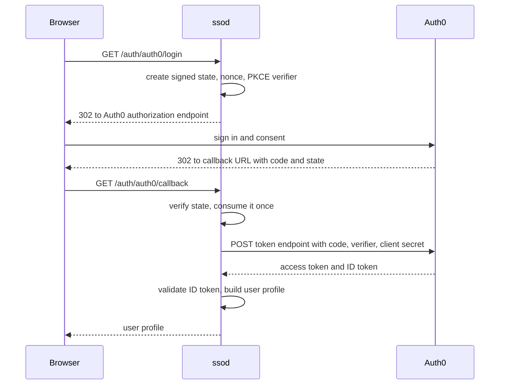

# Auth0 SSO Setup Guide

Step-by-step instructions for configuring **Auth0's side** of the SSO integration (tenant, Regular Web Application, connections, callback URLs) and wiring the resulting values into Universal SSO.

> **Project status.** The Auth0 provider is **implemented** (`pkg/sso/auth0`, built on the generic OIDC provider in `pkg/sso/oidc`) and `ssod` registers it as `auth0` once `SSO_PROVIDERS_AUTH0_CLIENT_ID` and `SSO_PROVIDERS_AUTH0_CLIENT_SECRET` are set to real values. It is verified against an in-process **fake** OIDC server (`bash tests/e2e.sh`, unit tests), **not against a live Auth0 tenant**: that needs your tenant and a browser, which is what section 5.6 is for. Everything on **Auth0's side** (sections 1 to 3 and the manual checks in section 5) is worth finishing first, because it proves your tenant, client and secret are correct independently of any code. The `make google-*` helpers are Google-only, so this guide uses `curl` and `python3` instead.

Auth0's dashboard and documentation change over time. This guide follows the current **Auth0 Dashboard** layout (Applications, Authentication, Monitoring). If a label differs in your dashboard, use the linked Auth0 pages as the source of truth.

## Contents

0. [Start here: stuck? Read this first](#start-here-stuck-read-this-first)
1. [How the pieces fit](#1-how-the-pieces-fit)
2. [Auth0 tenant and application setup](#2-auth0-tenant-and-application-setup)
3. [Client credentials and callback URLs](#3-client-credentials-and-callback-urls)
4. [Configuration values](#4-configuration-values)
5. [Verification and testing](#5-verification-and-testing)
6. [Security best practices](#6-security-best-practices)
7. [Troubleshooting](#7-troubleshooting)
8. [References](#8-references)

---

## Start here: stuck? Read this first

### Where people get stuck

| # | Symptom | Cause | Go to |
|---|---|---|---|
| 1 | `/auth/auth0/login` returns 404 | The provider is not registered: its client id is empty or still the `.env.example` sample, or `ssod` was not restarted | [7.7](#77-errors-returned-by-this-project) |
| 2 | "Callback URL mismatch" | The URL in **Allowed Callback URLs** differs from the one sent by one character | [7.1](#71-callback-url-mismatch) |
| 3 | The issuer check fails by one character | Auth0's issuer **ends with a slash**: `https://<tenant>.auth0.com/` | [S2 below](#s2-domain-and-issuer-url) |
| 4 | `Grant type 'authorization_code' not allowed for the client` or `invalid_client` | The application type is wrong (for example *Single Page Application*), or the grant is off | [7.2](#72-invalid_client-and-grant-type-not-allowed) |
| 5 | "Which application type?" | Use **Regular Web Applications** | [2.2](#22-create-the-application), [S1 below](#s1-dashboard-navigation) |
| 6 | Login page shows no way to sign in, or `no connections enabled` | No connection is enabled for the application | [7.5](#75-access_denied-no-connection-and-sign-up-problems) |
| 7 | "I never see the client secret" | It is hidden by default on the **Settings** tab | [3.1](#31-find-the-client-id-and-client-secret) |
| 8 | `.env` still has placeholders | `.env` was copied from `.env.example` and never filled in | [4.3](#43-env-layout) |

### Fastest path (about 10 minutes)

Run each step and stop at the first one that fails.

```bash
# 0. One-time: create your private config and lock it down.
cp -n .env.example .env && chmod 600 .env
sed -i.bak "s|^SSO_STATE_SECRET=.*|SSO_STATE_SECRET=$(openssl rand -base64 48)|" .env && rm -f .env.bak

# 1. In the Auth0 Dashboard (steps S1 and S2 below), create a Regular Web Application and note:
#    Domain, Client ID, Client Secret.

# 2. Check that Auth0 publishes the discovery document (section 5.1).
DOMAIN=<your-tenant>.<region>.auth0.com
curl -s "https://$DOMAIN/.well-known/openid-configuration" \
  | python3 -c "import sys,json; d=json.load(sys.stdin); print(d['issuer']); print(d['authorization_endpoint'])"

# 3. Open the sign-in URL from section 5.2 in a browser and sign in.
# 4. Auth0 redirects to localhost:8080. Copy the code from the address bar and
#    exchange it with the curl command in section 5.3.
```

A successful token exchange (section 5.3) means everything on Auth0's side is done. The last step, the end-to-end test through `ssod` (section 5.6), needs the `auth0` provider enabled in `.env` (see section 6).

### S1. Dashboard navigation

Sign in to the [Auth0 Dashboard](https://manage.auth0.com/) and select your tenant in the top-left tenant menu. The search box at the top is more reliable than menu paths, which Auth0 reorganizes.

| You need | Navigate or search for | Notes |
|---|---|---|
| Create the app | **Applications > Applications > Create Application** | Choose **Regular Web Applications** |
| Domain, Client ID, Client Secret | Your app > **Settings** tab | See 3.1 |
| Callback URLs | Your app > **Settings** > **Application URIs** | See 3.2 |
| Grant types | Your app > **Settings** > **Advanced Settings** > **Grant Types** | See 2.4 |
| Client authentication method | Your app > **Credentials** tab | See 2.4 |
| Enabled connections | Your app > **Connections** tab | See 2.5 |
| Users | **User Management > Users** | Create test users here |
| Logs | **Monitoring > Logs** | The first place to look when sign-in fails |

Expected values for local development:

| Field | Value |
|---|---|
| Name | `Universal SSO (dev)` |
| Application type | **Regular Web Applications** |
| Allowed Callback URLs | `http://localhost:8080/auth/auth0/callback` |
| Allowed Logout URLs | Leave empty (this project does not use RP-initiated logout yet) |
| Allowed Web Origins, Allowed Origins (CORS) | Leave empty (server-side flow) |
| Grant types | **Authorization Code** (add **Refresh Token** only if you need it) |

### S2. Domain and issuer URL

The **Domain** is shown at the top of the app's **Settings** tab, for example `<tenant>.<region>.auth0.com` (or a **custom domain** you configured). The two values you need are different:

| Value | Looks like | Notes |
|---|---|---|
| Domain | `<tenant>.<region>.auth0.com` | No scheme, no slash |
| Issuer (`iss` claim, `SSO_PROVIDERS_AUTH0_ISSUER_URL`) | `https://<tenant>.<region>.auth0.com/` | **With a trailing slash.** Auth0 includes it in every ID token. A comparison without the slash fails |

If you use a custom domain, use that domain for both the login URL and the issuer, and make sure the tokens you receive carry the same value in `iss`.

### S3. No client secret

The secret is hidden behind an eye icon on the **Settings** tab. Unlike some providers, Auth0 lets you view it again later while you have tenant access. To replace it, open **Settings > Client Secret** and use **Rotate** (rotating invalidates the old secret). Update `.env` straight away.

### S4. The browser shows "This site can't be reached" after sign-in

This is expected when `ssod` is not handling `/auth/auth0/callback` (for example `ssod` is not running, or the provider is not enabled): the page at `localhost:8080` has no server behind it, or the server answers `404 PROVIDER_NOT_FOUND`. The code you need is in the **address bar**. Copy the whole URL, including `?code=...&state=...`, and use it in section 5.3.

### S5. Connections and test users

A brand-new tenant has a **Username-Password-Authentication** database connection and, often, a Google social connection that uses Auth0's development keys. Enable at least one under your app's **Connections** tab, then create a test user under **User Management > Users > Create User**. Auth0's social connection with development keys is for testing only and shows a warning. Do not use it in production.

---

## 1. How the pieces fit

Auth0 is an OpenID Connect (OIDC) provider. Universal SSO will use the **authorization code flow with PKCE (S256)**: the server redirects the user to Auth0, Auth0 redirects back with a one-time `code`, and the server exchanges that code (plus the PKCE verifier and the client secret) for an ID token.



What you configure on Auth0's side maps to exactly three things:

| You create in Auth0 | Why the application needs it |
|---|---|
| A **Regular Web Application** | Gives you the Client ID and Client Secret |
| An **Allowed Callback URL** | Must exactly match the callback the server sends to Auth0 |
| An enabled **connection** | Decides how users sign in (database, social, enterprise) |

Auth0 endpoints (replace `<domain>` with your tenant domain):

| Purpose | URL |
|---|---|
| Issuer (`iss` claim) | `https://<domain>/` (trailing slash) |
| Discovery document | `https://<domain>/.well-known/openid-configuration` |
| Authorization | `https://<domain>/authorize` |
| Token | `https://<domain>/oauth/token` |
| Signing keys (JWKS) | `https://<domain>/.well-known/jwks.json` |
| UserInfo | `https://<domain>/userinfo` |
| Revocation | `https://<domain>/oauth/revoke` |
| Logout | `https://<domain>/oidc/logout` (also `https://<domain>/v2/logout`) |

---

## 2. Auth0 tenant and application setup

### 2.1 Prerequisites

- An Auth0 tenant. A free tenant is enough. Sign up at [auth0.com](https://auth0.com/).
- A dashboard account with the **Admin** role (or one that can manage applications and connections).
- Use **one tenant (or at least one application) per environment**. Auth0 recommends separate tenants for development, staging and production, because tenant settings, rules and users are tenant-wide.

### 2.2 Create the application

1. Open the Dashboard and go to **Applications > Applications**.
2. Click **Create Application**.
3. **Name**: for example `Universal SSO (dev)`.
4. **Application type**: choose **Regular Web Applications**. This is a confidential client, which is what a server holding a client secret requires. Do not pick *Single Page Application* or *Native*, which are public clients without a secret.
5. Click **Create**.
6. Open the **Settings** tab (see 3.1 and 3.2).

### 2.3 Application settings to review

| Setting | Value | Reason |
|---|---|---|
| Application Login URI | Leave empty, or `http://localhost:8080/auth/auth0/login` | Used only when Auth0 starts a login on behalf of the app (for example from an email link). Must be HTTPS in production |
| Allowed Callback URLs | See 3.2 | The only URLs Auth0 will redirect to after login |
| Allowed Logout URLs | Empty for now | Used by logout redirects |
| Allowed Web Origins | Empty | Only for silent authentication from a browser |
| Allowed Origins (CORS) | Empty | Only for browser-side calls (section 7.9) |

### 2.4 Grant types and client authentication

Open **Settings > Advanced Settings > Grant Types**:

| Grant | Setting | Reason |
|---|---|---|
| Authorization Code | **On** | The flow this project uses |
| Refresh Token | On only if you need long-lived sessions | Also needs `offline_access` in the request (2.6) |
| Implicit | **Off** | Not needed. Adds risk |
| Client Credentials, Password | Off | Not part of an interactive login |

Open the **Credentials** tab and check **Authentication Method**:

| Method | Notes |
|---|---|
| **Client Secret (Post)** | Secret in the request body. Auth0's default for Regular Web Applications |
| **Client Secret (Basic)** | Secret in the `Authorization: Basic` header. Preferred by RFC 6749 |
| **Private Key JWT** | Stronger option for production. A possible later extension |
| **None** | For public clients only. Do not use here |

The adapter sends the secret in the request body (`Client Secret (Post)`), and the `basic` method is supported by the code as well, so either Auth0 setting works. The manual check in 5.3 uses the body form.

### 2.5 Enable a connection

1. Open your application > **Connections** tab.
2. Turn on at least one connection, for example **Username-Password-Authentication**.
3. If you want only invited users, open **Authentication > Database > <connection> > Settings** and turn on **Disable Sign Ups**. Then add users manually under **User Management > Users**.

Without an enabled connection, Auth0 shows an error instead of a login form.

### 2.6 Scopes, audience and claims

| Scope | Purpose |
|---|---|
| `openid` | Required for an ID token |
| `profile` | `name`, `nickname`, `picture`, `updated_at` |
| `email` | `email`, `email_verified` |
| `offline_access` | Refresh token. Needs the **Refresh Token** grant, and **Allow Offline Access** on the API when you use a custom `audience` |

This project needs only `openid profile email`.

**Audience.** If the authorization request has no `audience`, the access token is **opaque** and valid only for `/userinfo`. If you add the identifier of a custom API as `audience`, the access token becomes a JWT for that API. Sign-in does not need it, so leave `audience` out for now. Decisions are made on the ID token.

**Custom claims.** To add roles or other data to the ID token, use a **post-login Action** (Dashboard > **Actions > Library > Build Custom**, trigger **Login / Post Login**). Custom claim names **must be namespaced** with an HTTP(S) URI that is not an Auth0 domain, for example `api.idToken.setCustomClaim('https://example.com/roles', roles)`. Claims without a namespace are dropped.

---

## 3. Client credentials and callback URLs

### 3.1 Find the Client ID and Client Secret

1. Open your app > **Settings** tab.
2. Copy **Domain** and **Client ID**.
3. Click the eye icon next to **Client Secret** to reveal it, and copy it.

> **Rotate when in doubt.** Use **Rotate** next to the Client Secret to create a new one. Rotation invalidates the old secret immediately, so deploy the new value in the same maintenance window. Auth0 tenants also support a **secondary secret** for some flows. Check your dashboard for the exact controls available.

### 3.2 Callback URLs

This project serves the callback at:

```text
GET {SSO_SERVER_BASE_URL}/auth/{provider}/callback
```

With the provider ID `auth0`, enter these in **Allowed Callback URLs** (a comma-separated list, or one per line depending on the dashboard version):

| Environment | Callback URL to register |
|---|---|
| Local development | `http://localhost:8080/auth/auth0/callback` |
| Staging | `https://sso-staging.<your-domain>/auth/auth0/callback` |
| Production | `https://sso.<your-domain>/auth/auth0/callback` |

Matching is **exact** (case-sensitive), against the `redirect_uri` the application sends. Register every environment's URL on that environment's tenant or application.

Auth0's rules for callback URLs:

| Rule | Detail |
|---|---|
| Scheme | HTTPS for real domains. `http://localhost` is allowed for development |
| Separator | Commas separate entries. A literal comma inside a URL breaks the list |
| Wildcards | Subdomain wildcards such as `https://*.<your-domain>/...` exist but are **not recommended**. Never use wildcards in production |
| Fragment | Not allowed |
| Trailing slash | Significant. `/callback` and `/callback/` are different |

### 3.3 Changes can take time

Auth0 applies saved settings immediately in most cases, but cached tokens, Actions deployments and custom domain changes can lag by a minute or two. If something looks right but still fails right after an edit, wait a minute and retry. Then check **Monitoring > Logs** for the exact reason.

---

## 4. Configuration values

### 4.1 Values obtained from Auth0

| Value | Where to find it | Example shape |
|---|---|---|
| **Domain** | App > Settings | `<tenant>.<region>.auth0.com` |
| **Client ID** | App > Settings | About 32 alphanumeric characters |
| **Client Secret** | App > Settings (eye icon) | Long random string |
| **Issuer URL** | Derived from the Domain | `https://<tenant>.<region>.auth0.com/` (trailing slash) |
| **Callback URL** | App > Settings > Allowed Callback URLs | `http://localhost:8080/auth/auth0/callback` |

### 4.2 Values you choose

| Variable | Purpose |
|---|---|
| `SSO_STATE_SECRET` | Local HMAC key (32+ bytes) that signs the OAuth `state` parameter. Not an Auth0 value. Generate it yourself |
| `SSO_SERVER_BASE_URL` | Public base URL. The callback URL must be this plus `/auth/auth0/callback` |

### 4.3 `.env` layout

Copy `.env.example` to `.env` and fill in the Auth0 block. These variable names are already reserved in `.env.example`:

```bash
# --- Server ---
SSO_SERVER_HOST=127.0.0.1
SSO_SERVER_PORT=8080
SSO_SERVER_BASE_URL=http://localhost:8080
SSO_STATE_SECRET=<output of: openssl rand -base64 48>

# --- Auth0 (values from the Auth0 Dashboard, app Settings tab) ---
SSO_PROVIDERS_AUTH0_CLIENT_ID=<your-client-id>
SSO_PROVIDERS_AUTH0_CLIENT_SECRET=<your-client-secret>
SSO_PROVIDERS_AUTH0_ISSUER_URL=https://<your-tenant>.<region>.auth0.com/
SSO_PROVIDERS_AUTH0_REDIRECT_URL=http://localhost:8080/auth/auth0/callback
# Optional: API identifier (audience parameter) and the claim that carries roles
# SSO_PROVIDERS_AUTH0_AUDIENCE=<api-identifier>
# SSO_PROVIDERS_AUTH0_ROLES_CLAIM=<namespaced-roles-claim>
```

Rules for this file:

- `scripts/start.sh` loads it with the shell, so use only `KEY=VALUE` lines. Quote any value that contains spaces or shell characters.
- `SSO_PROVIDERS_AUTH0_REDIRECT_URL` must equal one of the URLs registered in section 3.2 character for character, and equal `SSO_SERVER_BASE_URL` plus `/auth/auth0/callback`.
- `SSO_PROVIDERS_AUTH0_ISSUER_URL` should keep its trailing slash and must match the `issuer` in the discovery document. The adapter appends the slash when it is missing.
- `.env` is already git-ignored. `.env.example` is the only variant that is committed, and it must contain placeholders only.

### 4.4 How the values are used

| Value | Used in |
|---|---|
| Client ID | The `client_id` parameter of the authorization and token requests, and the expected `aud` claim of the ID token |
| Issuer URL | Locates the discovery document and is compared with the `iss` claim of each ID token |
| Client secret | Sent only server-to-server in the token request. Never sent to the browser |
| Callback URL | The `redirect_uri` parameter of both the authorization request and the token request. Both must match the registered value |
| State secret | Signs and verifies the `state` value (see [`pkg/sso/state.go`](../pkg/sso/state.go)) |

---

## 5. Verification and testing

These checks use only `curl`, a browser, and `python3`. They validate the Auth0 configuration independently of the application code. Replace `<your-tenant>`, `<client-id>` and the other placeholders with your values.

> **Note.** The `make google-*` helpers do not support Auth0. The steps below are the manual equivalent. A helper for Auth0 will come with the adapter.

### 5.1 Confirm the discovery document is reachable

```bash
DOMAIN=<your-tenant>.<region>.auth0.com
curl -s "https://$DOMAIN/.well-known/openid-configuration" \
  | python3 -c "import sys,json; d=json.load(sys.stdin); print(d['issuer']); print(d['authorization_endpoint']); print(d['token_endpoint']); print(d['jwks_uri']); print(d.get('code_challenge_methods_supported'))"
```

Expected: the endpoints from section 1, an issuer **ending in a slash**, and `['S256', 'plain']` or similar among the code challenge methods. A 404 means the domain is wrong. A network error is a proxy or connectivity problem, not an Auth0 configuration problem.

### 5.2 Check the client ID and callback URL in a browser

`curl` cannot tell you whether the client is valid. Use a browser.

Build the URL (replace the placeholders, keep the encoding):

```text
https://<domain>/authorize
  ?response_type=code
  &client_id=<your-client-id>
  &redirect_uri=http%3A%2F%2Flocalhost%3A8080%2Fauth%2Fauth0%2Fcallback
  &scope=openid%20profile%20email
  &state=manual-test-1
```

Put it on one line in the browser address bar. Results:

| What you see | Meaning |
|---|---|
| Auth0 Universal Login page | Client ID and callback URL are valid |
| "Callback URL mismatch" with the list of allowed URLs | The callback URL is not registered on this app (section 7.1) |
| "Unknown client" or `unauthorized_client` | Wrong or unknown client ID, or wrong tenant (section 7.2) |
| An error about connections | No connection is enabled for the app (section 7.5) |

### 5.3 Complete a manual code exchange with PKCE

This reproduces what the server does, proving the client secret works.

**Step 1.** Create a PKCE verifier and challenge:

```bash
VERIFIER=$(openssl rand -base64 48 | tr -d '=+/\n' | cut -c1-64)
CHALLENGE=$(printf '%s' "$VERIFIER" | openssl dgst -sha256 -binary | openssl base64 -A | tr '+/' '-_' | tr -d '=')
echo "$CHALLENGE"
```

**Step 2.** Open the URL from 5.2 in a browser with three more parameters appended:
`&code_challenge=<CHALLENGE>&code_challenge_method=S256&nonce=manual-nonce-1`

**Step 3.** Sign in with a test user. Auth0 redirects to your callback URL. If nothing is listening there, the browser shows a connection error, which is fine. The address bar still contains `?code=...&state=manual-test-1`. Copy the `code` value. It is single use and short-lived, so continue immediately.

**Step 4.** Exchange it. Keep the secret out of shell history by reading it from your environment:

```bash
read -rs AUTH0_CLIENT_SECRET   # paste the secret, then Enter
curl -s "https://$DOMAIN/oauth/token" \
  -d "grant_type=authorization_code" \
  -d "client_id=<your-client-id>" \
  -d "client_secret=$AUTH0_CLIENT_SECRET" \
  -d "code=<CODE_FROM_BROWSER>" \
  -d "redirect_uri=http://localhost:8080/auth/auth0/callback" \
  -d "code_verifier=$VERIFIER" > /tmp/auth0_token.json
python3 -c "import json; d=json.load(open('/tmp/auth0_token.json')); print({k:(v if k in ('error','error_description','token_type','expires_in','scope') else '<redacted>') for k,v in d.items()})"
```

Success shows `token_type`, `expires_in`, `scope`, and redacted `access_token` and `id_token` keys. An `error` key means the exchange failed (section 7).

**Step 5.** Inspect the ID token claims:

```bash
python3 - <<'EOF'
import json, base64
tok = json.load(open('/tmp/auth0_token.json'))['id_token']
payload = tok.split('.')[1]
payload += '=' * (-len(payload) % 4)
claims = json.loads(base64.urlsafe_b64decode(payload))
for k in ('iss', 'aud', 'sub', 'email', 'email_verified', 'nonce', 'exp', 'updated_at'):
    print(k, '=', claims.get(k))
EOF
rm -f /tmp/auth0_token.json
```

Check these against what the server will enforce:

| Claim | Must be |
|---|---|
| `iss` | Your issuer URL exactly, **with the trailing slash** |
| `aud` | Your Client ID exactly |
| `exp` | In the future |
| `nonce` | The value you sent (`manual-nonce-1`) |
| `sub` | Present, for example `auth0\|...` or `google-oauth2\|...`. This is the stable user key (see 6.5) |

This step only decodes the token for inspection and does not verify the signature. The application must verify signatures against the keys at `jwks_uri`.

### 5.4 Negative tests

Confirm that failures fail safely:

| Test | How | Expected |
|---|---|---|
| Wrong callback URL | Change one character in `redirect_uri` in 5.2 | "Callback URL mismatch" |
| Reused code | Run the Step 4 `curl` twice with the same code | Second call returns `invalid_grant` |
| Wrong secret | Alter one character of the secret | `access_denied` (Unauthorized) or `invalid_client` |
| Missing verifier | Omit `code_verifier` in Step 4 after using a `code_challenge` | `invalid_grant` or `invalid_request` |
| Blocked user | Block a test user under **User Management > Users** | Login refused |

### 5.5 Local server checks that need no Auth0 account

These confirm the server side that the Auth0 provider will plug into:

```bash
export SSO_STATE_SECRET=$(openssl rand -base64 48)
make start
curl -s http://127.0.0.1:8080/healthz
curl -s http://127.0.0.1:8080/providers
curl -s -o /dev/null -w "%{http_code}\n" "http://127.0.0.1:8080/auth/auth0/login"                   # 404 until the adapter exists
curl -s -o /dev/null -w "%{http_code}\n" "http://127.0.0.1:8080/auth/mock/callback?state=forged"   # 400
make stop
```

The `mock` provider exercises the same state, PKCE and replay protections that the Auth0 provider will use.

### 5.6 End-to-end test through `ssod`

This section applies once the `auth0` adapter is implemented.

1. Fill in `.env` as in 4.3 and run `make start`. The log should show `auth0` among the providers.
2. Open `http://localhost:8080/auth/auth0/login` in a browser.
3. You should be redirected to Auth0, sign in, and land on `/auth/auth0/callback`, which returns JSON with your user profile (no tokens).
4. Reload the callback URL. It must fail with `STATE_MISMATCH` because the state is single use.
5. Repeat with a blocked user, or after disabling the connection, and confirm Auth0 refuses.

---

## 6. Security best practices

### 6.1 Protect the client secret

- Keep it only in `.env` (local) or a secrets manager (shared environments). Never in source, `README`, tickets, chat, or container image layers.
- `chmod 600 .env` so only your user can read it.
- `.env` is git-ignored by this repository. Before every push, run `bash .bob/skills/secure-config/scripts/scan_secrets.sh .` to catch accidental leaks.
- Do not pass secrets as command-line arguments. They appear in process listings and shell history. Use `read -s` or environment variables as in 5.3.
- Never log the client secret, authorization codes, access tokens, refresh tokens, or ID tokens. Log the provider ID and error codes only.

### 6.2 Use a secrets manager outside local development

Inject the values as environment variables at deploy time instead of shipping a `.env` file:

| Platform | Mechanism |
|---|---|
| Kubernetes | `Secret` objects mounted as environment variables, ideally synced from an external secrets store |
| Cloud runtimes | The platform's secret manager (for example AWS Secrets Manager, Google Secret Manager, Azure Key Vault) referenced by the service definition |
| Containers | Runtime `--env` or secret mounts, never `ENV` or `COPY .env` in a Dockerfile or Containerfile |
| CI/CD | The pipeline's masked secret variables |

### 6.3 Rotate and respond to leaks

- If a secret may have leaked, treat it as compromised: **Rotate** the Client Secret and deploy the new value immediately.
- Review **Monitoring > Logs** for unexpected successful logins (`s`) or token exchanges (`seccft`) from unknown IP addresses.
- Review who has dashboard access. Tenant admins can read client secrets.
- Prefer **Private Key JWT** client authentication for production, since there is no shared secret to leak.
- Turn on **Attack Protection** (brute-force protection, breached password detection, bot detection) under **Security > Attack Protection**.

### 6.4 Keep the OAuth flow hardened

| Control | Status in this project |
|---|---|
| Signed, expiring, single-use `state` (CSRF protection) | Implemented |
| PKCE with `S256` | Implemented in the manager and mock provider. Auth0 supports it for Regular Web Applications |
| Callback URL exact match | Enforced by Auth0. Keep the list minimal and avoid wildcards |
| ID token validation (`iss`, `aud`, `exp`, signature, `nonce`) | Implemented (RS256 only, keys from the tenant's JWKS, rotation-aware). `none` and HS256 are rejected |
| Issuer check with trailing slash | Implemented. The trailing slash is added when missing, and a slashless `iss` is rejected |
| HTTPS in every non-local environment | Required for non-localhost callback URLs |
| Do not echo tokens to the browser | The reference server returns the profile only |

### 6.5 Identify users correctly

- Use the `sub` claim as the permanent user key. It looks like `auth0|<id>` for database users or `google-oauth2|<id>` for social users, and does not change when the email changes.
- Treat `email` as an attribute, and check `email_verified` before trusting it. Database users can sign up with an email they do not own unless you require verification.
- The same person signing in through two connections gets two different `sub` values. Link accounts explicitly rather than by email.
- Namespaced custom claims (such as roles) come from your Actions. Validate them on the server and never trust a claim sent by the browser.

### 6.6 Least privilege

- Request only `openid profile email`. Add `offline_access` only when you use refresh tokens.
- Keep only the connections you need enabled on the application.
- Use separate tenants (or applications) and secrets for dev, staging and production.
- Keep the callback URL list to the minimum needed. Remove `localhost` entries from the production application.

---

## 7. Troubleshooting

Start with the exact error Auth0 shows or returns, then confirm it in **Monitoring > Logs**. Most problems are one of the cases below.

| Error | Meaning | Go to |
|---|---|---|
| "Callback URL mismatch" | `redirect_uri` not in Allowed Callback URLs | [7.1](#71-callback-url-mismatch) |
| `invalid_client`, "Grant type ... not allowed" | Wrong credentials, wrong application type, or grant off | [7.2](#72-invalid_client-and-grant-type-not-allowed) |
| `invalid_grant` | Code used, expired, wrong verifier or wrong `redirect_uri` | [7.4](#74-invalid_grant-on-code-exchange) |
| `access_denied`, no connection | User or connection problem, or an Action denied the login | [7.5](#75-access_denied-no-connection-and-sign-up-problems) |
| `invalid state`, `login_required`, `consent_required` | State or session problems | [7.6](#76-invalid-state-login_required-and-consent_required) |
| Wrong issuer | Trailing slash or wrong tenant | [7.3](#73-wrong-issuer-or-tenant) |

### 7.1 Callback URL mismatch

Auth0 shows "Callback URL mismatch. The provided redirect_uri is not in the list of allowed callback URLs."

| Check | Fix |
|---|---|
| Compare character by character | The value in the browser URL (decode `%3A`, `%2F`) must equal an entry in **Allowed Callback URLs** |
| `http` vs `https` | Register the scheme you actually use. Only localhost may use `http` |
| Trailing slash | `/callback` and `/callback/` are different |
| Port | `localhost:8080` and `localhost:3000` are different |
| Host | `localhost` and `127.0.0.1` are different |
| Case | Paths are case-sensitive |
| Saved? | Click **Save Changes** at the bottom of the Settings tab |
| Wrong app or tenant | You may be using the Client ID of another application or tenant |
| Behind a proxy | The server may build `http://` while the public URL is `https://`. Set `SSO_PROVIDERS_AUTH0_REDIRECT_URL` explicitly instead of deriving it |

### 7.2 `invalid_client` and grant type not allowed

| Message | Cause | Fix |
|---|---|---|
| `invalid_client`, "Unauthorized" | Wrong Client ID or secret, or the secret was rotated | Re-copy both values. Confirm they belong to the same app |
| "Grant type 'authorization_code' not allowed for the client" | The grant is off, or the app is a public type | Enable **Authorization Code** under Advanced Settings > Grant Types, and use a **Regular Web Application** (S1) |
| "Client authentication method not allowed" | **Credentials** tab says *None* or a method that does not match the request | Choose **Client Secret (Post)** or **(Basic)** (2.4) |
| Works in the dashboard test, fails in `.env` | The value contains `$`, `#`, spaces or quotes that the shell changed | Quote the value in single quotes |

### 7.3 Wrong issuer or tenant

| Symptom | Cause | Fix |
|---|---|---|
| ID token validation fails on `iss` | `SSO_PROVIDERS_AUTH0_ISSUER_URL` lacks the trailing slash | Copy the `issuer` from the discovery document, including the `/` |
| `iss` shows a custom domain but `.env` has the `auth0.com` domain (or the reverse) | A custom domain is active | Use one domain consistently |
| 404 on discovery | Wrong domain or region | Copy the Domain from the app's Settings tab |
| Token from another tenant is accepted | The issuer is not checked | Always compare `iss` exactly |

### 7.4 `invalid_grant` on code exchange

| Cause | Fix |
|---|---|
| Authorization code already used ("Invalid authorization code") | Codes are single use. Restart the login |
| Code expired | Exchange immediately after the redirect |
| `redirect_uri` in the token request differs from the authorization request | Send the identical value in both |
| PKCE verifier does not match the challenge | The same verifier that produced the `code_challenge` must be sent. Check that the state and verifier were stored for this exact login |
| Refresh token revoked or expired | Ask the user to sign in again |

### 7.5 `access_denied`, no connection, and sign-up problems

| Message | Cause | Fix |
|---|---|---|
| No login form, or an error about connections | No connection is enabled for the app | Enable one under the app's **Connections** tab (2.5) |
| Cannot sign up | **Disable Sign Ups** is on for the database connection | Create the user manually under **User Management > Users** |
| `access_denied` with a custom message | A post-login **Action** called `api.access.deny(...)` | Check the Action code and **Monitoring > Logs** |
| Login refused for a known user | The user is **blocked** | Unblock under **User Management > Users** |
| User must verify email | An Action or setting requires `email_verified` | Verify the email or relax the rule |
| Social login warning "development keys" | Auth0 dev keys on a social connection | Add your own provider keys for anything beyond testing |

### 7.6 Invalid state, `login_required` and `consent_required`

| Message | Cause | Fix |
|---|---|---|
| "invalid state" | A client such as Auth0's own SDKs checks `state` and it did not match | In this project the server checks state and reports `STATE_MISMATCH`. Restart the login |
| `login_required` | The request used `prompt=none` and there is no session | Remove `prompt=none`, or start a normal login |
| `consent_required` | The request used `prompt=none` for an API that needs consent | Remove `prompt=none`, or use a first-party application |
| `invalid_request` with `code_verifier` | The verifier is missing, too short (minimum 43 characters), or malformed | Use the 64-character verifier from 5.3 |

### 7.7 Errors returned by this project

| Server error code | HTTP | Typical meaning |
|---|---|---|
| `STATE_MISMATCH` | 400 | Forged, replayed, or already-used `state`, or state issued for a different provider. Restart login |
| `STATE_EXPIRED` | 400 | The signed state exceeded its lifetime (10 minutes by default). Restart login |
| `IDP_REJECTED` | 401 | Auth0 returned an `error` parameter, for example `access_denied` when the user cancelled or an Action denied the login |
| `PROVIDER_NOT_FOUND` | 404 | The provider ID in the URL is not registered. `auth0` is registered only when its Client ID and secret are set in `.env` |
| `INVALID_CONFIG` | 500 | Startup problem, such as `SSO_STATE_SECRET` shorter than 32 bytes |
| `NETWORK_FAILURE` | 502 | `ssod` could not reach Auth0 (discovery, JWKS or token endpoint) or got an unexpected reply. Check connectivity and proxy settings. Auth0 also answers `429` when you exceed rate limits (see the `X-RateLimit-*` headers) |
| `SIGNATURE_INVALID` / `INVALID_TOKEN` / `TOKEN_EXPIRED` | 401 | The ID token failed verification (signature, issuer, audience, expiry). Check that the Client ID and issuer in `.env` match the token, and that the system clock is correct |
| `UNAUTHORIZED` | 401 | Sign-in succeeded at Auth0 but the account is not allowed by the application's own rules |

### 7.8 Localhost versus production confusion

| Symptom | Cause | Fix |
|---|---|---|
| Works locally, "Callback URL mismatch" in staging or production | Only the `localhost` URL is registered | Add the staging and production URLs to the application for that environment (section 3.2) |
| Works in production, fails locally | `localhost` URL missing, or `.env` still holds the production URL | Register `http://localhost:8080/auth/auth0/callback` on the dev application |
| `http://` rejected for a real domain | Auth0 allows `http` only for localhost | Use `https://` and a domain name |
| Behind a TLS-terminating proxy, the server builds `http://` URLs | The proxy hides the original scheme | Set `SSO_PROVIDERS_AUTH0_REDIRECT_URL` explicitly |
| Production still lists `localhost` | Leftover from development | Remove it from the production application (least privilege) |
| Same application reused across environments | One leaked secret affects everything | Use one tenant or application and secret per environment |
| Dev tenant issuer in a production `.env` | Copy and paste between environments | Check `SSO_PROVIDERS_AUTH0_ISSUER_URL` per environment |

### 7.9 CORS errors in the browser console

The flow in this project is a **server-side redirect flow**. The browser navigates to Auth0 and back, and the server calls the token endpoint. No cross-origin `fetch` is involved, so CORS errors mean something else is happening:

| You see | Cause | Fix |
|---|---|---|
| `blocked by CORS policy` on `.../oauth/token` | Front-end JavaScript is calling the token endpoint directly | Do not do this. Send the user to `/auth/auth0/login` and let the server exchange the code. The client secret must never reach a browser |
| `blocked by CORS policy` on `.../authorize` | Authorization URL requested with `fetch` or `XHR` | Use a full-page navigation or `window.location`, not `fetch` |
| CORS error from an Auth0 SDK in a browser app | The origin is not in **Allowed Origins (CORS)** | Not needed for this project. If you add browser calls later, add the origin there (section 2.3) |

### 7.10 Quick diagnostic checklist

1. Are you in the right tenant (top-left tenant menu), and does `.env` use that tenant's domain?
2. Does the Client ID in `.env` belong to the **Regular Web Application**?
3. Does the callback URL match across the dashboard, `.env`, and the URL in the browser?
4. Is **Authorization Code** enabled, and is at least one connection enabled for the app?
5. Does `SSO_PROVIDERS_AUTH0_ISSUER_URL` end with `/` and equal the discovery `issuer`?
6. Does the manual exchange in 5.3 succeed? If yes, the Auth0 side is correct and the problem is in the application code.
7. Still stuck? Open **Monitoring > Logs**, find the failed event (`f`, `fp`, `fu`, `fcoa`, `feccft`), and read its description.

---

## 8. References

- [Applications in Auth0](https://auth0.com/docs/get-started/applications)
- [Application settings](https://auth0.com/docs/get-started/applications/application-settings)
- [Application grant types](https://auth0.com/docs/get-started/applications/application-grant-types)
- [JSON Web Token claims](https://auth0.com/docs/secure/tokens/json-web-tokens/json-web-token-claims)
- [Create custom claims](https://auth0.com/docs/secure/tokens/json-web-tokens/create-custom-claims)
- [Refresh tokens](https://auth0.com/docs/secure/tokens/refresh-tokens)
- [Authentication API errors](https://auth0.com/docs/api/authentication/errors)
- [Rate limit policy](https://auth0.com/docs/troubleshoot/customer-support/operational-policies/rate-limit-policy)
- Related guides: [Google](Google-SSO-Setup.md), [Azure AD / Entra ID](Azure-AD-SSO-Setup.md), [Okta](Okta-SSO-Setup.md), [SAML 2.0](SAML-SSO-Setup.md), [Generic OAuth 2.0](OAuth2-SSO-Setup.md)
- Project docs: [`README.md`](../README.md), [`Quickstart.md`](Quickstart.md), [`Architecture.md`](Architecture.md)
