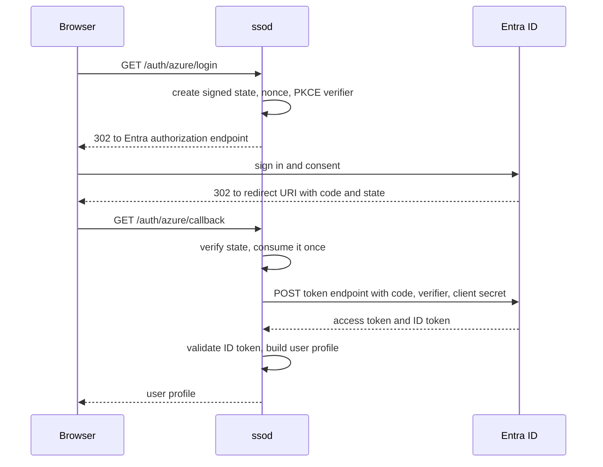

# Azure AD / Microsoft Entra ID SSO Setup Guide

Step-by-step instructions for configuring **Microsoft Entra ID's side** of the SSO integration (app registration, client secret, redirect URIs, user assignment) and wiring the resulting values into Universal SSO. Azure Active Directory (Azure AD) was renamed Microsoft Entra ID. The two names refer to the same service, and error codes still use the `AADSTS` prefix.

> **Project status.** The Azure provider is **planned, not yet implemented**. `pkg/sso` has the generic provider interface, driver registry, state and PKCE handling that an `azure` driver will plug into, and `.env.example` already reserves the `SSO_PROVIDERS_AZURE_*` variables. Until the adapter exists, `ssod` does not register `azure` and `/auth/azure/login` answers `404 PROVIDER_NOT_FOUND`. Everything on **Microsoft's side** (sections 1 to 3 and the manual checks in section 5) works today and is worth finishing first: it proves your tenant, client and secret are correct independently of any code. The `make google-*` helpers are Google-only, so this guide uses `curl` and `python3` instead.

Microsoft's portal and documentation change over time. This guide follows the current **Microsoft Entra admin center** layout (Identity, Applications, App registrations). If a label differs in your portal, use the linked Microsoft pages as the source of truth.

## Contents

0. [Start here: stuck? Read this first](#start-here-stuck-read-this-first)
1. [How the pieces fit](#1-how-the-pieces-fit)
2. [Entra ID tenant and app registration](#2-entra-id-tenant-and-app-registration)
3. [Client credentials and redirect URIs](#3-client-credentials-and-redirect-uris)
4. [Configuration values](#4-configuration-values)
5. [Verification and testing](#5-verification-and-testing)
6. [Security best practices](#6-security-best-practices)
7. [Troubleshooting](#7-troubleshooting)
8. [References](#8-references)

---

## Start here: stuck? Read this first

### Where people get stuck

| # | Symptom | Cause | Go to |
|---|---|---|---|
| 1 | `/auth/azure/login` returns 404 | The `azure` adapter is not implemented yet, so the provider is never registered | [Project status](#azure-ad--microsoft-entra-id-sso-setup-guide), [7.7](#77-errors-returned-by-this-project) |
| 2 | `AADSTS7000215: Invalid client secret provided` | The **Secret ID** (a GUID) was copied instead of the secret **Value** | [S2 below](#s2-secret-value-versus-secret-id), [7.2](#72-aadsts7000215-and-aadsts7000222-client-secret-problems) |
| 3 | "I never saw the secret Value" | Entra shows it only once, right after creation | [3.1](#31-create-a-client-secret), [S3 below](#s3-no-client-secret-value) |
| 4 | `AADSTS50011: The redirect URI ... does not match` | The URI registered in Entra differs from the one sent by one character | [7.1](#71-aadsts50011-redirect-uri-mismatch) |
| 5 | `AADSTS700016: Application ... was not found in the directory` | Wrong tenant in the URL, or a Client ID from another tenant | [7.3](#73-aadsts700016-and-aadsts90002-application-or-tenant-not-found) |
| 6 | `AADSTS50105` or "user is not assigned to a role" | **Assignment required** is on and the user is not assigned | [7.5](#75-aadsts50105-aadsts65001-and-aadsts50020-user-and-consent-problems) |
| 7 | Which "Supported account types" option? | It decides who can sign in and which `{tenant}` value to use | [2.3](#23-supported-account-types), [S1 below](#s1-portal-navigation) |
| 8 | `.env` still has placeholders | `.env` was copied from `.env.example` and never filled in | [4.3](#43-env-layout) |

### Fastest path (about 15 minutes)

Run each step and stop at the first one that fails.

```bash
# 0. One-time: create your private config and lock it down.
cp -n .env.example .env && chmod 600 .env
sed -i.bak "s|^SSO_STATE_SECRET=.*|SSO_STATE_SECRET=$(openssl rand -base64 48)|" .env && rm -f .env.bak

# 1. In the Entra admin center (steps S1 and S2 below), register the app, create a
#    client secret, and note: Application (client) ID, Directory (tenant) ID, secret Value.

# 2. Check that Microsoft publishes the tenant's discovery document (section 5.1).
TENANT=<your-tenant-id>
curl -s "https://login.microsoftonline.com/$TENANT/v2.0/.well-known/openid-configuration" \
  | python3 -c "import sys,json; d=json.load(sys.stdin); print(d['issuer']); print(d['authorization_endpoint'])"

# 3. Open the sign-in URL from section 5.2 in a browser and sign in.
# 4. Microsoft redirects to localhost:8080. Copy the code from the address bar and
#    exchange it with the curl command in section 5.3.
```

A successful token exchange (section 5.3) means everything on Microsoft's side is done. The last step, the end-to-end test through `ssod` (section 5.6), needs the planned `azure` adapter.

### S1. Portal navigation

Open [entra.microsoft.com](https://entra.microsoft.com/) and sign in with an account that may register applications. The search box at the top is more reliable than menu paths, which Microsoft reorganizes.

| You need | Navigate or search for | Notes |
|---|---|---|
| Tenant ID | **Identity > Overview** (or **Overview** of your app) | A GUID, also shown as **Directory (tenant) ID** |
| Create the app | **Identity > Applications > App registrations > New registration** | Needs the Application Developer role or a tenant that allows users to register apps |
| Client ID | App registration > **Overview** | Labeled **Application (client) ID** |
| Client secret | App registration > **Certificates & secrets > Client secrets** | See 3.1 |
| Redirect URIs | App registration > **Authentication** (or **Manage > Authentication**) | Platform **Web** |
| API permissions | App registration > **API permissions** | See 2.5 |
| Token claims | App registration > **Token configuration** | Optional claims such as `email` |
| User assignment | **Identity > Applications > Enterprise applications** > your app > **Users and groups** | See 2.6 |

Expected values for local development:

| Field | Value |
|---|---|
| Name | `Universal SSO (dev)` |
| Supported account types | **Single tenant** (employees only) or the option that matches your audience (2.3) |
| Redirect URI platform | **Web** |
| Redirect URI | `http://localhost:8080/auth/azure/callback` |

### S2. Secret Value versus Secret ID

After you create a client secret, the portal lists two similar-looking columns:

| Column in the portal | Looks like | Goes into |
|---|---|---|
| **Value** | A random string (about 40 characters, containing a `~`). Shown here as `<client-secret-value>` | `SSO_PROVIDERS_AZURE_CLIENT_SECRET` |
| **Secret ID** | A GUID such as `11111111-2222-3333-4444-555555555555` | Nowhere. It only identifies the secret in the portal |
| **Application (client) ID** (on Overview) | Also a GUID | `SSO_PROVIDERS_AZURE_CLIENT_ID` |

If you use the Secret ID as the secret, Microsoft answers `AADSTS7000215: Invalid client secret provided`. If a GUID ended up in the secret line, you copied the wrong column. Create a new secret and copy the **Value** immediately.

### S3. No client secret Value

Microsoft shows the secret **Value** only once, at creation. If you closed the page without copying it:

1. Open the app registration > **Certificates & secrets > Client secrets**.
2. Click **New client secret**, give it a description, choose an expiry, and click **Add**.
3. Copy the **Value** immediately and update `.env`.
4. After the new one works (section 5.3), delete the old secret from the same list.

### S4. The browser shows "This site can't be reached" after sign-in

This is expected when `ssod` is not handling `/auth/azure/callback` (and today it is not, because the adapter is planned): the page at `localhost:8080` has no server behind it, or the server answers `404 PROVIDER_NOT_FOUND`. The code you need is in the **address bar**. Copy the whole URL, including `?code=...&state=...`, and use it in section 5.3.

### S5. Tenant restrictions and "Need admin approval"

If a user sees **Need admin approval** or `AADSTS65001`, the tenant requires an administrator to consent to the requested permissions. With only `openid profile email` and `User.Read`, user consent is normally allowed, but a tenant policy can still block it. See 7.5.

---

## 1. How the pieces fit

Microsoft Entra ID is an OpenID Connect (OIDC) provider. Universal SSO will use the **authorization code flow with PKCE (S256)**: the server redirects the user to Entra, Entra redirects back with a one-time `code`, and the server exchanges that code (plus the PKCE verifier and the client secret) for an ID token.



What you configure on Microsoft's side maps to exactly three things:

| You create in Entra ID | Why the application needs it |
|---|---|
| An **app registration** (confidential web app) | Gives you the Application (client) ID and defines who may sign in |
| A **client secret** | Proves to the token endpoint that the request comes from your server |
| A **redirect URI** on the **Web** platform | Must exactly match the callback the server sends to Entra |

Entra endpoints used. `{tenant}` is a tenant GUID, a verified domain, or one of the aliases `common`, `organizations`, `consumers` (see 2.3):

| Purpose | URL |
|---|---|
| Discovery document | `https://login.microsoftonline.com/{tenant}/v2.0/.well-known/openid-configuration` |
| Issuer (`iss` claim, v2.0 tokens) | `https://login.microsoftonline.com/{tenant-id}/v2.0` |
| Authorization | `https://login.microsoftonline.com/{tenant}/oauth2/v2.0/authorize` |
| Token | `https://login.microsoftonline.com/{tenant}/oauth2/v2.0/token` |
| Signing keys (JWKS) | `https://login.microsoftonline.com/{tenant}/discovery/v2.0/keys` |
| UserInfo | `https://graph.microsoft.com/oidc/userinfo` |
| Logout | `https://login.microsoftonline.com/{tenant}/oauth2/v2.0/logout` |

Version 1.0 tokens use the issuer `https://sts.windows.net/{tenant-id}/` instead. Always use the **v2.0** endpoints listed above, and set the app's token version to 2 if you request access tokens for your own API (see 2.5).

---

## 2. Entra ID tenant and app registration

### 2.1 Prerequisites

- A Microsoft Entra tenant. A free tenant is enough. Without one, create it through the [Microsoft 365 developer program](https://developer.microsoft.com/microsoft-365/dev-program) or an Azure free account.
- A role that can register applications: **Application Developer**, **Cloud Application Administrator**, **Application Administrator**, or a tenant setting that lets all users register apps.
- To assign users or grant admin consent later, an administrator role is needed.
- Use **one app registration per environment** (dev, staging, production). Separate registrations keep secrets, redirect URIs and assignments isolated.

### 2.2 Register the application

1. Open the [Microsoft Entra admin center](https://entra.microsoft.com/).
2. Go to **Identity > Applications > App registrations** and click **New registration**.
3. **Name**: a label users see on the consent screen, for example `Universal SSO (dev)`.
4. **Supported account types**: pick one option (section 2.3).
5. **Redirect URI**: select the platform **Web** and enter `http://localhost:8080/auth/azure/callback`. You can add more URIs later (section 3.2).
6. Click **Register**.
7. On the **Overview** page, copy **Application (client) ID** and **Directory (tenant) ID**.

### 2.3 Supported account types

This choice decides who can sign in and which `{tenant}` value your URLs use. It can be changed later on the **Authentication** page, but changing it affects existing users.

| Option in the portal | Who can sign in | `{tenant}` in URLs |
|---|---|---|
| Accounts in this organizational directory only (**Single tenant**) | Members and invited guests of your tenant | Your tenant GUID or domain |
| Accounts in any organizational directory (**Multitenant**) | Work or school accounts from any Entra tenant | `organizations` |
| Multitenant and **personal Microsoft accounts** | Work, school, and personal accounts | `common` |
| **Personal Microsoft accounts only** | Only personal accounts such as Outlook.com | `consumers` |

Use **Single tenant** for company-internal SSO. It is the safest choice and the only one where the issuer in discovery is a fixed value. For `common` and `organizations`, the discovery document contains a literal `{tenantid}` placeholder in the issuer, so the server must validate the issuer against the `tid` claim of each token. The planned adapter will do this. Never accept an arbitrary issuer.

### 2.4 Platform and token settings

On the app registration, open **Authentication**:

| Setting | Value | Reason |
|---|---|---|
| Platform | **Web** | A confidential client with a server-side secret. Do not use *Single-page application* or *Mobile and desktop* |
| Implicit grant and hybrid flows | Leave **ID tokens** and **Access tokens** unchecked | This project uses the authorization code flow. Enabling implicit flow adds risk and gives nothing here |
| Allow public client flows | **No** | A public client must not send a secret. Setting this to Yes causes `AADSTS700025` |

### 2.5 API permissions and scopes

New registrations get **Microsoft Graph > User.Read** (delegated) by default. That, plus the standard OIDC scopes, is all this project needs.

| Scope | Purpose | Consent |
|---|---|---|
| `openid` | Required for an ID token | User |
| `profile` | `name`, `preferred_username` | User |
| `email` | `email` claim, if the account has one | User |
| `offline_access` | Refresh token | User |
| `User.Read` | Read the signed-in user's basic profile through Microsoft Graph | User |

Request only what you use. Sensitive scopes (for example `Directory.Read.All`) need **admin consent**: use **API permissions > Grant admin consent for <tenant>**.

Token version: an app registration issues v1.0 or v2.0 **access tokens** according to `requestedAccessTokenVersion` in the **Manifest** (`null` or `1` means v1, `2` means v2). ID tokens requested through the v2.0 endpoint are always v2.0. Set `2` if you validate access tokens with the v2.0 issuer.

### 2.6 Control who may sign in

By default any user in the tenant (and, depending on 2.3, other tenants) can sign in. To restrict access:

1. Open **Identity > Applications > Enterprise applications** and select your app.
2. **Properties**: set **Assignment required?** to **Yes**. Unassigned users then fail with `AADSTS50105`.
3. **Users and groups > Add user/group**: assign the users or groups that may sign in.
4. **Visible to users?** controls only whether the app shows in the My Apps portal. It does not grant or block access.

### 2.7 Optional claims and groups

Open **Token configuration**:

- **Add optional claim** (ID token): add `email` or `upn` if they are missing. Microsoft's `email` claim is optional and **not guaranteed to be verified**.
- **Add groups claim**: emits group IDs. When a user belongs to more than 200 groups (150 in SAML), the `groups` claim is replaced by `_claim_names` and `_claim_sources`, and the server must call Microsoft Graph to fetch the groups. Prefer **App roles** or a smaller **groups assigned to the application** setting to avoid this overage.

---

## 3. Client credentials and redirect URIs

### 3.1 Create a client secret

1. In the app registration, open **Certificates & secrets > Client secrets**.
2. Click **New client secret**.
3. **Description**: for example `universal-sso-dev`.
4. **Expires**: choose a preset (**180 days**, **365 days**, **730 days**) or **Custom**. The maximum is 24 months. Microsoft recommends less than 12 months. Choose the shortest value you can rotate comfortably.
5. Click **Add**.
6. Copy the **Value** column right now.

> **Copy the Value now.** Entra shows the secret **Value** only once. After you leave the page it cannot be viewed again. The **Secret ID** next to it is only a GUID and does not work as a secret.

For production, Microsoft recommends a **certificate** or a federated credential instead of a shared secret. The planned adapter will start with `client_secret`.

### 3.2 Redirect URIs

This project serves the callback at:

```text
GET {SSO_SERVER_BASE_URL}/auth/{provider}/callback
```

With the provider ID `azure`, register these under **Authentication > Add a platform > Web** (or **Add URI** on an existing Web platform):

| Environment | Redirect URI to register |
|---|---|
| Local development | `http://localhost:8080/auth/azure/callback` |
| Staging | `https://sso-staging.<your-domain>/auth/azure/callback` |
| Production | `https://sso.<your-domain>/auth/azure/callback` |

Matching is **exact**: scheme, host, port, path, letter case, and trailing slash must all be identical to the `redirect_uri` the application sends. The one exception: for `http://localhost`, Entra ignores the port when matching, but you should still register the real one.

Microsoft's validation rules for redirect URIs:

| Rule | Detail |
|---|---|
| Scheme | HTTPS required. `http` is allowed only for `localhost` |
| Wildcards | Not supported for personal Microsoft accounts. Work or school apps can use them only through the manifest, and they are discouraged |
| Fragment | Not allowed (`#fragment`) |
| Query string | Allowed for work or school apps only. Avoid it |
| Length | Maximum 256 characters per URI |
| Count | Maximum 256 URIs per app, or 100 if personal accounts are supported |
| Case | Case-sensitive |

Register every environment's URI on that environment's app registration.

### 3.3 Changes can take time

Microsoft states that changes to redirect URIs and app settings can take a few minutes to apply. If something looks right but still fails right after an edit, wait a few minutes and retry before debugging further.

---

## 4. Configuration values

### 4.1 Values obtained from Entra ID

| Value | Where to find it | Example shape |
|---|---|---|
| **Application (client) ID** | App registration > Overview | GUID, for example `11111111-2222-3333-4444-555555555555` |
| **Directory (tenant) ID** | App registration > Overview | GUID. Or `common`, `organizations`, `consumers` (see 2.3) |
| **Client secret Value** | Shown once at creation | Random string, about 40 characters, often containing a `~` |
| **Redirect URI** | App registration > Authentication | `http://localhost:8080/auth/azure/callback` |
| Secret ID, Object ID | Portal | Not used by the application |

### 4.2 Values you choose

| Variable | Purpose |
|---|---|
| `SSO_STATE_SECRET` | Local HMAC key (32+ bytes) that signs the OAuth `state` parameter. Not a Microsoft value. Generate it yourself |
| `SSO_SERVER_BASE_URL` | Public base URL. The redirect URI must be this plus `/auth/azure/callback` |

### 4.3 `.env` layout

Copy `.env.example` to `.env` and fill in the Azure block. These variable names are already reserved in `.env.example`:

```bash
# --- Server ---
SSO_SERVER_HOST=127.0.0.1
SSO_SERVER_PORT=8080
SSO_SERVER_BASE_URL=http://localhost:8080
SSO_STATE_SECRET=<output of: openssl rand -base64 48>

# --- Azure AD / Entra ID (values from the Entra admin center) ---
SSO_PROVIDERS_AZURE_CLIENT_ID=<application-client-id>
SSO_PROVIDERS_AZURE_CLIENT_SECRET=<client-secret-value>
SSO_PROVIDERS_AZURE_TENANT_ID=<directory-tenant-id>
SSO_PROVIDERS_AZURE_REDIRECT_URL=http://localhost:8080/auth/azure/callback
```

Rules for this file:

- `scripts/start.sh` loads it with the shell, so use only `KEY=VALUE` lines. Quote any value that contains spaces or shell characters.
- `SSO_PROVIDERS_AZURE_REDIRECT_URL` must equal one of the URIs registered in section 3.2 character for character, and equal `SSO_SERVER_BASE_URL` plus `/auth/azure/callback`.
- `SSO_PROVIDERS_AZURE_TENANT_ID=common` is the placeholder in `.env.example`. Use a real tenant GUID for single-tenant apps.
- `.env` is already git-ignored. `.env.example` is the only variant that is committed, and it must contain placeholders only.

### 4.4 How the values are used

| Value | Used in |
|---|---|
| Client ID | The `client_id` parameter of the authorization and token requests, and the expected `aud` claim of the ID token |
| Tenant ID | Builds the endpoint URLs and is compared with the `tid` claim and the issuer |
| Client secret | Sent only server-to-server in the token request. Never sent to the browser |
| Redirect URI | The `redirect_uri` parameter of both the authorization request and the token request. Both must match the registered value |
| State secret | Signs and verifies the `state` value (see [`pkg/sso/state.go`](../pkg/sso/state.go)) |

---

## 5. Verification and testing

These checks use only `curl`, a browser, and `python3`. They validate the Entra configuration independently of the application code. Replace `<tenant>`, `<client-id>` and the other placeholders with your values.

> **Note.** The `make google-*` helpers do not support Entra. The steps below are the manual equivalent. A helper for Azure will come with the adapter.

### 5.1 Confirm the discovery document is reachable

```bash
TENANT=<your-tenant-id>
curl -s "https://login.microsoftonline.com/$TENANT/v2.0/.well-known/openid-configuration" \
  | python3 -c "import sys,json; d=json.load(sys.stdin); print(d['issuer']); print(d['authorization_endpoint']); print(d['token_endpoint']); print(d['jwks_uri']); print(d.get('code_challenge_methods_supported'))"
```

Expected: the endpoints from section 1 with your tenant GUID in the issuer, and `['S256']` among the code challenge methods. A failure with `AADSTS90002` means the tenant ID is wrong (section 7.3). A network error is a proxy or connectivity problem, not an Entra configuration problem.

### 5.2 Check the client ID and redirect URI in a browser

`curl` cannot tell you whether the client is valid. Use a browser.

Build the URL (replace the placeholders, keep the encoding):

```text
https://login.microsoftonline.com/<tenant>/oauth2/v2.0/authorize
  ?client_id=<application-client-id>
  &response_type=code
  &redirect_uri=http%3A%2F%2Flocalhost%3A8080%2Fauth%2Fazure%2Fcallback
  &response_mode=query
  &scope=openid%20profile%20email%20offline_access
  &state=manual-test-1
```

Put it on one line in the browser address bar. Results:

| What you see | Meaning |
|---|---|
| Microsoft sign-in or consent page | Client ID, tenant and redirect URI are valid |
| `AADSTS50011` | The redirect URI is not registered on this app (section 7.1) |
| `AADSTS700016` | Client ID not found in that tenant (section 7.3) |
| `AADSTS50105` or "needs admin approval" | Assignment or consent settings block your account (section 7.5) |

### 5.3 Complete a manual code exchange with PKCE

This reproduces what the server does, proving the client secret works.

**Step 1.** Create a PKCE verifier and challenge:

```bash
VERIFIER=$(openssl rand -base64 48 | tr -d '=+/\n' | cut -c1-64)
CHALLENGE=$(printf '%s' "$VERIFIER" | openssl dgst -sha256 -binary | openssl base64 -A | tr '+/' '-_' | tr -d '=')
echo "$CHALLENGE"
```

**Step 2.** Open the URL from 5.2 in a browser with three more parameters appended:
`&code_challenge=<CHALLENGE>&code_challenge_method=S256&nonce=manual-nonce-1`

**Step 3.** Sign in and consent. Entra redirects to your redirect URI. If nothing is listening there, the browser shows a connection error, which is fine. The address bar still contains `?code=...&state=manual-test-1`. Copy the `code` value. It is single use and short-lived, so continue immediately.

**Step 4.** Exchange it. Keep the secret out of shell history by reading it from your environment:

```bash
read -rs AZURE_CLIENT_SECRET   # paste the secret Value, then Enter
curl -s "https://login.microsoftonline.com/$TENANT/oauth2/v2.0/token" \
  -d "grant_type=authorization_code" \
  -d "client_id=<application-client-id>" \
  -d "client_secret=$AZURE_CLIENT_SECRET" \
  -d "code=<CODE_FROM_BROWSER>" \
  -d "redirect_uri=http://localhost:8080/auth/azure/callback" \
  -d "code_verifier=$VERIFIER" \
  -d "scope=openid profile email offline_access" > /tmp/azure_token.json
python3 -c "import json; d=json.load(open('/tmp/azure_token.json')); print({k:(v if k in ('error','error_description','error_codes','token_type','expires_in','scope') else '<redacted>') for k,v in d.items()})"
```

Success shows `token_type`, `expires_in`, `scope`, and redacted `access_token`, `id_token` and `refresh_token` keys. An `error` key means the exchange failed. Use the `AADSTS` code in `error_description` with section 7.

**Step 5.** Inspect the ID token claims:

```bash
python3 - <<'EOF'
import json, base64
tok = json.load(open('/tmp/azure_token.json'))['id_token']
payload = tok.split('.')[1]
payload += '=' * (-len(payload) % 4)
claims = json.loads(base64.urlsafe_b64decode(payload))
for k in ('iss', 'aud', 'tid', 'oid', 'sub', 'preferred_username', 'nonce', 'exp', 'ver'):
    print(k, '=', claims.get(k))
EOF
rm -f /tmp/azure_token.json
```

Check these against what the server will enforce:

| Claim | Must be |
|---|---|
| `iss` | `https://login.microsoftonline.com/<tid>/v2.0` with the `tid` from the same token |
| `aud` | Your Application (client) ID exactly |
| `tid` | Your tenant GUID (single tenant), or an allowed tenant |
| `exp` | In the future |
| `nonce` | The value you sent (`manual-nonce-1`) |
| `ver` | `2.0` |
| `sub` / `oid` | Present. See 6.5 for which one to use as the user key |

This step only decodes the token for inspection and does not verify the signature. The application must verify signatures against the keys at `jwks_uri`.

### 5.4 Negative tests

Confirm that failures fail safely:

| Test | How | Expected |
|---|---|---|
| Wrong redirect URI | Change one character in `redirect_uri` in 5.2 | `AADSTS50011` |
| Reused code | Run the Step 4 `curl` twice with the same code | Second call returns `invalid_grant` (`AADSTS54005`) |
| Wrong secret | Alter one character of the secret | `invalid_client` (`AADSTS7000215`) |
| Missing verifier | Omit `code_verifier` in Step 4 after using a `code_challenge` | `invalid_grant` (`AADSTS501481` or `AADSTS70000`) |
| Unassigned user | With **Assignment required** on, sign in as an unassigned user | `AADSTS50105` |

### 5.5 Local server checks that need no Entra account

These confirm the server side that the Azure provider will plug into:

```bash
export SSO_STATE_SECRET=$(openssl rand -base64 48)
make start
curl -s http://127.0.0.1:8080/healthz
curl -s http://127.0.0.1:8080/providers
curl -s -o /dev/null -w "%{http_code}\n" "http://127.0.0.1:8080/auth/azure/login"                    # 404 until the adapter exists
curl -s -o /dev/null -w "%{http_code}\n" "http://127.0.0.1:8080/auth/mock/callback?state=forged"   # 400
make stop
```

The `mock` provider exercises the same state, PKCE and replay protections that the Azure provider will use.

### 5.6 End-to-end test through `ssod`

This section applies once the `azure` adapter is implemented.

1. Fill in `.env` as in 4.3 and run `make start`. The log should show `azure` among the providers.
2. Open `http://localhost:8080/auth/azure/login` in a browser.
3. You should be redirected to Microsoft, sign in, and land on `/auth/azure/callback`, which returns JSON with your user profile (no tokens).
4. Reload the callback URL. It must fail with `STATE_MISMATCH` because the state is single use.
5. Repeat with an account that is **not** assigned (or from another tenant for a single-tenant app) and confirm Entra blocks it.

---

## 6. Security best practices

### 6.1 Protect the client secret

- Keep it only in `.env` (local) or a secrets manager (shared environments). Never in source, `README`, tickets, chat, or container image layers.
- `chmod 600 .env` so only your user can read it.
- `.env` is git-ignored by this repository. Before every push, run `bash .bob/skills/secure-config/scripts/scan_secrets.sh .` to catch accidental leaks.
- Do not pass secrets as command-line arguments. They appear in process listings and shell history. Use `read -s` or environment variables as in 5.3.
- Never log the client secret, authorization codes, access tokens, refresh tokens, or ID tokens. Log the provider ID and error codes only.

### 6.2 Use a secrets manager outside local development

Inject the values as environment variables at deploy time instead of shipping a `.env` file:

| Platform | Mechanism |
|---|---|
| Kubernetes | `Secret` objects mounted as environment variables, ideally synced from an external secrets store |
| Azure | Azure Key Vault referenced by the service, with a managed identity |
| Containers | Runtime `--env` or secret mounts, never `ENV` or `COPY .env` in a Dockerfile or Containerfile |
| CI/CD | The pipeline's masked secret variables |

### 6.3 Rotate and respond to leaks

- Client secrets expire (maximum 24 months). Put the expiry date in a calendar or monitor it. An expired secret fails with `AADSTS7000222`.
- Rotate without downtime: add a **second** secret, deploy it, check that sign-in works, then delete the old one. Entra allows several active secrets on one app.
- If a secret may have leaked, treat it as compromised: create a replacement, deploy it, delete the old one, and review **Monitoring > Sign-in logs** for the app.
- Review who has the **Owner** role on the app registration and the enterprise application. Owners can add secrets.

### 6.4 Keep the OAuth flow hardened

| Control | Status in this project |
|---|---|
| Signed, expiring, single-use `state` (CSRF protection) | Implemented |
| PKCE with `S256` | Implemented in the manager and mock provider. Entra supports it for confidential clients |
| Redirect URI exact match | Enforced by Entra. Keep the list minimal |
| ID token validation (`iss`, `aud`, `tid`, `exp`, signature, `nonce`) | Planned in the `azure` adapter (RS256, keys from the tenant's JWKS) |
| Issuer check against `tid` for `common` and `organizations` | Planned. Required for multi-tenant apps |
| HTTPS in every non-local environment | Required by Entra for non-localhost redirect URIs |
| Do not echo tokens to the browser | The reference server returns the profile only |

### 6.5 Identify users correctly

- `sub` is **pairwise**: it is unique per user **and per application**. Use it as the user key within this app. It is stable, but differs from the value another app sees.
- `oid` is the user's object ID in the directory and is the same across apps. Combine `tid` and `oid` when you need a key that works across applications.
- `email` is optional and **not guaranteed to be verified or unique**. Do not link accounts or grant access on an email address alone. `preferred_username` is mutable, display-only data.
- Multi-tenant apps: always key users by (`tid`, `oid`) or (`tid`, `sub`), never by `sub` alone.

### 6.6 Least privilege

- Request only `openid profile email` (plus `offline_access` if you need refresh tokens).
- Turn on **Assignment required** and assign only the groups that need access.
- Use separate app registrations and secrets for dev, staging and production.
- Keep the redirect URI list to the minimum needed. Remove `localhost` entries from the production registration.

---

## 7. Troubleshooting

Start with the exact `AADSTS` code in the Microsoft error page or in `error_description`. The [error code reference](https://learn.microsoft.com/en-us/entra/identity-platform/reference-error-codes) lists all of them.

| Code | Meaning | Go to |
|---|---|---|
| `AADSTS50011` | Reply address missing or mismatched | [7.1](#71-aadsts50011-redirect-uri-mismatch) |
| `AADSTS7000215` | Invalid client secret | [7.2](#72-aadsts7000215-and-aadsts7000222-client-secret-problems) |
| `AADSTS7000222` | Client secret expired | [7.2](#72-aadsts7000215-and-aadsts7000222-client-secret-problems) |
| `AADSTS700016` | Application not found in the directory | [7.3](#73-aadsts700016-and-aadsts90002-application-or-tenant-not-found) |
| `AADSTS90002` | Tenant not found | [7.3](#73-aadsts700016-and-aadsts90002-application-or-tenant-not-found) |
| `AADSTS54005`, `AADSTS70008`, `AADSTS70000` | Code already redeemed, expired, or invalid | [7.4](#74-invalid_grant-on-code-exchange) |
| `AADSTS50105`, `AADSTS65001`, `AADSTS50020` | User not assigned, consent missing, user not in tenant | [7.5](#75-aadsts50105-aadsts65001-and-aadsts50020-user-and-consent-problems) |
| `AADSTS700025`, `AADSTS700054`, `AADSTS9002313` | Public client, disabled response type, malformed request | [7.6](#76-aadsts700025-aadsts700054-and-aadsts9002313-request-and-client-type-problems) |

### 7.1 `AADSTS50011` redirect URI mismatch

The `redirect_uri` the application sent is not registered on that app.

| Check | Fix |
|---|---|
| Compare character by character | The value in the browser URL (decode `%3A`, `%2F`) must equal an entry under **Authentication** |
| `http` vs `https` | Register the scheme you actually use. Only localhost may use `http` |
| Trailing slash | `/callback` and `/callback/` are different |
| Port | Register the real port even though localhost matching ignores it |
| Host | `localhost` and `127.0.0.1` are different |
| Case | Entra compares URIs case-sensitively |
| Wrong platform | The URI was added under *Single-page application* or *Mobile and desktop* instead of **Web** |
| Wrong app | You may be using the Client ID of another registration |
| Just edited | Wait a few minutes (section 3.3) |
| Behind a proxy | The server may build `http://` while the public URL is `https://`. Set `SSO_PROVIDERS_AZURE_REDIRECT_URL` explicitly instead of deriving it |

### 7.2 `AADSTS7000215` and `AADSTS7000222` client secret problems

| Message | Cause | Fix |
|---|---|---|
| `AADSTS7000215: Invalid client secret provided` | The **Secret ID** was used instead of the **Value**, a character was lost or added, or the secret belongs to another app | Re-copy the **Value** (S2). If lost, create a new secret (S3) |
| `AADSTS7000222: The provided client secret keys are expired` | The secret passed its expiry date | Create a new secret, update `.env`, delete the old one |
| Works in the portal test but not in `.env` | `.env` value contains `$`, `#`, spaces or quotes that the shell changed | Quote the value in single quotes |

### 7.3 `AADSTS700016` and `AADSTS90002` application or tenant not found

| Check | Fix |
|---|---|
| Client ID in `.env` | Must be the **Application (client) ID** (not Object ID or Secret ID) of this registration |
| Tenant in the URL | A single-tenant app is only found in its own tenant. Do not use `common` for a single-tenant registration |
| Tenant typo | `AADSTS90002` means the tenant ID or domain does not exist |
| Wrong environment | A dev Client ID with a production tenant, or the reverse |

### 7.4 `invalid_grant` on code exchange

| Cause | Fix |
|---|---|
| Authorization code already used (`AADSTS54005`) | Codes are single use. Restart the login |
| Code expired or grant revoked (`AADSTS70008`) | Exchange immediately after the redirect |
| `redirect_uri` in the token request differs from the authorization request | Send the identical value in both |
| PKCE verifier does not match the challenge | The same verifier that produced the `code_challenge` must be sent. Check that the state and verifier were stored for this exact login |
| Refresh token revoked or expired (`AADSTS70000`, `AADSTS70008`) | Ask the user to sign in again |

### 7.5 `AADSTS50105`, `AADSTS65001` and `AADSTS50020` user and consent problems

| Message | Cause | Fix |
|---|---|---|
| `AADSTS50105`: user not assigned to a role | **Assignment required** is Yes and the user or their group is not assigned | Assign the user under **Enterprise applications > Users and groups**, or set Assignment required to No |
| `AADSTS65001`: consent missing | The user or admin has not consented to the requested scopes | Grant admin consent under **API permissions**, or sign in once and accept |
| `AADSTS50020`: user account does not exist in the tenant | A personal or other-tenant account signs in to a single-tenant app | Invite the user as a guest (B2B), or change the supported account types (section 2.3) |
| "Need admin approval" | Tenant policy blocks user consent | An administrator grants consent for the organization |

### 7.6 `AADSTS700025`, `AADSTS700054` and `AADSTS9002313` request and client type problems

| Message | Cause | Fix |
|---|---|---|
| `AADSTS700025`: client is public so neither client_assertion nor client_secret should be presented | **Allow public client flows** is set to Yes, but the request sends a secret | Set it to **No** (section 2.4) |
| `AADSTS700054`: response_type 'id_token' is not enabled | The request asked for an ID token directly | Use `response_type=code`, which this project does. Do not enable implicit flow |
| `AADSTS9002313`: Invalid request. Request is malformed | A required parameter is missing or has a wrong format | Compare your URL with 5.2 and check encoding |

### 7.7 Errors returned by this project

| Server error code | HTTP | Typical meaning |
|---|---|---|
| `STATE_MISMATCH` | 400 | Forged, replayed, or already-used `state`, or state issued for a different provider. Restart login |
| `STATE_EXPIRED` | 400 | The signed state exceeded its lifetime (10 minutes by default). Restart login |
| `IDP_REJECTED` | 401 | Entra returned an `error` parameter, for example `access_denied` when the user clicked Cancel |
| `PROVIDER_NOT_FOUND` | 404 | The provider ID in the URL is not registered. **Today this is always the result for `azure`**, because the adapter is not implemented. Once it exists, the provider is registered only when its Client ID and secret are set in `.env` |
| `INVALID_CONFIG` | 500 | Startup problem, such as `SSO_STATE_SECRET` shorter than 32 bytes |
| `NETWORK_FAILURE` | 502 | `ssod` could not reach Entra (discovery, JWKS or token endpoint) or got an unexpected reply. Check connectivity and proxy settings |
| `SIGNATURE_INVALID` / `INVALID_TOKEN` / `TOKEN_EXPIRED` | 401 | The ID token failed verification (signature, issuer, audience, expiry). Check that the Client ID and tenant in `.env` match the token, and that the system clock is correct |
| `UNAUTHORIZED` | 401 | Sign-in succeeded at Entra but the account is outside the allowed tenant or assignment |

### 7.8 Localhost versus production confusion

| Symptom | Cause | Fix |
|---|---|---|
| Works locally, `AADSTS50011` in staging or production | Only the `localhost` URI is registered | Add the staging and production URIs to the registration for that environment (section 3.2) |
| Works in production, fails locally | `localhost` URI missing, or `.env` still holds the production URL | Register `http://localhost:8080/auth/azure/callback` on the dev registration |
| `http://` rejected for a real domain | Entra allows `http` only for localhost | Use `https://` and a domain name |
| Behind a TLS-terminating proxy, the server builds `http://` URLs | The proxy hides the original scheme | Set `SSO_PROVIDERS_AZURE_REDIRECT_URL` explicitly |
| Production still lists `localhost` | Leftover from development | Remove it from the production registration (least privilege) |
| Same registration reused across environments | One leaked secret affects everything | Use one registration and secret per environment |

### 7.9 CORS errors in the browser console

The flow in this project is a **server-side redirect flow**. The browser navigates to Microsoft and back, and the server calls the token endpoint. No cross-origin `fetch` is involved, so CORS errors mean something else is happening:

| You see | Cause | Fix |
|---|---|---|
| `blocked by CORS policy` on `login.microsoftonline.com/.../token` | Front-end JavaScript is calling the token endpoint directly | Do not do this. Send the user to `/auth/azure/login` and let the server exchange the code. The client secret must never reach a browser |
| `blocked by CORS policy` on `.../authorize` | Authorization URL requested with `fetch` or `XHR` | Use a full-page navigation or `window.location`, not `fetch` |
| `AADSTS9002326: Cross-origin token redemption is permitted only for the 'Single-Page Application' client-type` | A browser app redeems a code against a **Web** registration | Keep redemption on the server. Do not move the URI to the SPA platform for this project |

### 7.10 Quick diagnostic checklist

1. Is the right tenant selected in the Entra admin center (top-right directory switcher)?
2. Does the Client ID in `.env` belong to that tenant's app registration?
3. Does the redirect URI match across the portal (platform **Web**), `.env`, and the URL in the browser?
4. Is **Supported account types** right for the account you are testing with, and is the user assigned if **Assignment required** is on?
5. Is the secret the **Value**, not the Secret ID, and not expired?
6. Did you wait a few minutes after changing settings?
7. Does the manual exchange in 5.3 succeed? If yes, the Entra side is correct and the problem is in the application code.

---

## 8. References

- [Register an application with the Microsoft identity platform](https://learn.microsoft.com/en-us/graph/auth-register-app-v2)
- [Add and manage application credentials](https://learn.microsoft.com/en-us/entra/identity-platform/how-to-add-credentials)
- [Redirect URI (reply URL) restrictions and limitations](https://learn.microsoft.com/en-us/entra/identity-platform/reply-url)
- [OpenID Connect on the Microsoft identity platform](https://learn.microsoft.com/en-us/entra/identity-platform/v2-protocols-oidc)
- [OAuth 2.0 authorization code flow](https://learn.microsoft.com/en-us/entra/identity-platform/v2-oauth2-auth-code-flow)
- [ID token claims reference](https://learn.microsoft.com/en-us/entra/identity-platform/id-token-claims-reference)
- [Scopes and permissions with OpenID Connect](https://learn.microsoft.com/en-us/entra/identity-platform/scopes-oidc)
- [Enterprise application properties](https://learn.microsoft.com/en-us/entra/identity/enterprise-apps/application-properties)
- [Authentication and authorization error codes](https://learn.microsoft.com/en-us/entra/identity-platform/reference-error-codes)
- Related guides: [Google](Google-SSO-Setup.md), [Okta](Okta-SSO-Setup.md), [Auth0](Auth0-SSO-Setup.md), [SAML 2.0](SAML-SSO-Setup.md), [Generic OAuth 2.0](OAuth2-SSO-Setup.md)
- Project docs: [`README.md`](../README.md), [`Quickstart.md`](Quickstart.md), [`Architecture.md`](Architecture.md)
