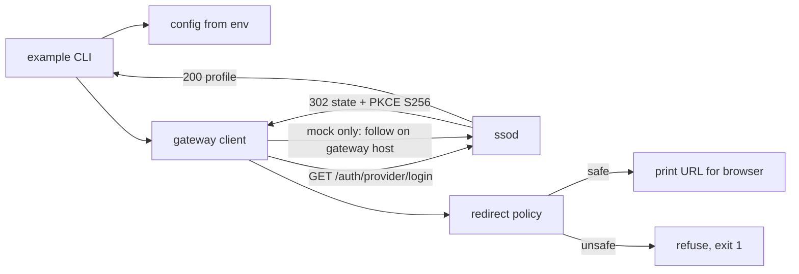

# Example clients

Five self-contained command-line clients for the Universal SSO gateway (`ssod`), one per language and provider pairing. They all speak the same HTTP contract, so any of them runs against the same gateway instance.

## Read this first

These examples are **clients of the gateway**. They do not implement OAuth, OIDC or SAML themselves, and they hold no client ids, secrets or tokens. The gateway owns the signed state, PKCE verifier, nonce, client secret and tokens.

The gateway implements `mock`, `google`, and (when configured) `okta`, `auth0` and `azure` (Microsoft Entra ID). The SAML 2.0 and generic OAuth 2.0 adapters are **planned**.

Every client works with every implemented provider. Pick one with `SSO_PROVIDER`:

| Example | Default provider | Other providers |
|---|---|---|
| [`examples/oauth2-rust`](../examples/oauth2-rust/README.md) | `oauth2` | any of `mock`, `okta`, `auth0`, `azure`, `google` |
| [`examples/saml2-go`](../examples/saml2-go/README.md) | `saml` | same |
| [`examples/auth0-python`](../examples/auth0-python/README.md) | `auth0` | same |
| [`examples/okta-java`](../examples/okta-java/README.md) | `okta` | same |
| [`examples/azure-ad-csharp`](../examples/azure-ad-csharp/README.md) | `azure` | same |

The default of a client is the provider it is named after. For `oauth2` and `saml` there is no gateway adapter yet, so those two defaults answer `404 PROVIDER_NOT_FOUND`, which the client reports clearly. Set `SSO_PROVIDER` to an implemented provider to use them today.

## End-to-end check

`bash tests/e2e.sh` builds the gateway with `-tags e2e`, which mounts in-process **fake** OIDC servers (`pkg/sso/oidc/oidctest`) for Okta, Auth0 and Entra on the gateway's own port. It then runs all five clients against `okta`, `auth0`, `azure` and `mock` (20 sign-ins, each must print `signed in via <provider>`) plus four negative checks (forged state, missing state, unknown provider, a code the IdP never issued). A missing toolchain is a failure, not a skip, unless `E2E_ALLOW_SKIP=1`.

What this proves: the adapters, the gateway and the five clients work together over HTTP, including authorization code with PKCE, token exchange, ID token verification and nonce. **What it does not prove:** that a real Okta, Auth0 or Entra tenant accepts your configuration. The fake approves every request and never asks a person to sign in. A real sign-in needs your tenant, your credentials and a browser, and follows the matching `Docs/*-SSO-Setup.md` guide. The `-tags e2e` binary is for tests only and must never be deployed.

## What each client does



The redirect policy refuses: a non-https external IdP, a host outside `SSO_EXPECTED_IDP_HOST` (including look-alike hosts), a missing `state`, and a missing PKCE `code_challenge_method=S256`. The SAML client also decodes the `AuthnRequest` and checks `Destination` and the assertion consumer URL.

## Commands and exit codes

| Command | Meaning |
|---|---|
| `check` | gateway healthy and the provider is registered |
| `login` | start a sign-in, print the URL to open in a browser |
| `login --follow` (`-follow` in Go) | finish the sign-in without a browser, only while every redirect stays on the gateway host (mock) |

Exit `0` success, `1` failure, `2` bad usage or configuration.

## Configuration

Every example reads the same variables from the environment (an `.env.example` is provided in each folder, with no secrets):

| Variable | Default | Meaning |
|---|---|---|
| `SSO_GATEWAY_URL` | `http://localhost:8080` | gateway base URL; plain http only for loopback |
| `SSO_PROVIDER` | per example | provider id registered in the gateway |
| `SSO_EXPECTED_IDP_HOST` | empty | pin the IdP host |
| `SSO_HTTP_TIMEOUT_SECONDS` | `10` | request timeout, 1 to 300 |
| `SSO_LOG_LEVEL` | `warn` | Go and Python examples only |

## Run the tests

```bash
make test-examples          # root Go tests, then every example's suite
REQUIRE_ALL=1 make test-examples   # fail instead of skipping a missing toolchain
```

A suite whose toolchain is missing is reported as `SKIPPED`, never as passed. Toolchains: Go, Rust (cargo), Python 3, JDK 21 with Maven, and the .NET 8 SDK. If `dotnet` is not installed, a per-user SDK in `~/.local/share/dotnet-universal-sso` is used when present (override with `DOTNET_LOCAL`). It lives outside the repository on purpose, so it is never scanned or committed:

```bash
curl -sSL https://dot.net/v1/dotnet-install.sh -o /tmp/dotnet-install.sh
bash /tmp/dotnet-install.sh --channel 8.0 --install-dir "$HOME/.local/share/dotnet-universal-sso"
```

Last verified results: Go 87.6% coverage on the client package, Rust 11 tests with `clippy -D warnings`, Python 18 tests, Java 15 tests, C# 27 tests. All five also completed a live mock sign-in against a running `ssod`.

## Try one against your gateway

```bash
make start                                   # repository root
cd examples/auth0-python && cp .env.example .env
SSO_PROVIDER=mock make login-mock            # prints: signed in via mock as Mock User
make login                                   # real provider: open the printed URL in a browser
```
