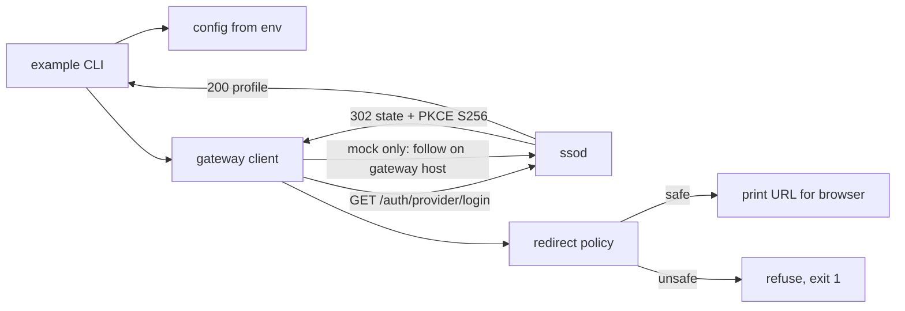

# Example clients

Five self-contained command-line clients for the Universal SSO gateway (`ssod`), one per language and provider pairing. They all speak the same HTTP contract, so any of them runs against the same gateway instance.

## Read this first

These examples are **clients of the gateway**. They do not implement OAuth, OIDC or SAML themselves, and they hold no client ids, secrets or tokens. The gateway owns the signed state, PKCE verifier, nonce, client secret and tokens.

The gateway currently implements the `mock` and `google` providers only. The Okta, Auth0, Azure AD, SAML 2.0 and generic OAuth 2.0 adapters are **planned**. So today:

| Example | Default provider | Against today's `ssod` |
|---|---|---|
| [`examples/oauth2-rust`](../examples/oauth2-rust/README.md) | `oauth2` | `404 PROVIDER_NOT_FOUND`, reported clearly |
| [`examples/saml2-go`](../examples/saml2-go/README.md) | `saml` | same |
| [`examples/auth0-python`](../examples/auth0-python/README.md) | `auth0` | same |
| [`examples/okta-java`](../examples/okta-java/README.md) | `okta` | same |
| [`examples/azure-ad-csharp`](../examples/azure-ad-csharp/README.md) | `azure` | same |

With `SSO_PROVIDER=mock` every example completes a full sign-in without a browser, which is what the live runs and the tests exercise. Once an adapter lands in the gateway, the matching client works unchanged. Real-provider runs additionally need a sandbox tenant and credentials, which are not included. Each example's README links the matching setup guide.

Token refresh, session cookies and protected-resource calls are **not** implemented. The gateway has no such endpoints (its callback returns the user profile and never echoes tokens), and a client-side imitation would be misleading.

## What each client does



The redirect policy refuses: a non-https external IdP, a host outside `SSO_EXPECTED_IDP_HOST` (including look-alike hosts), a missing `state`, and a missing PKCE `code_challenge_method=S256`. The SAML client also decodes the `AuthnRequest` and checks `Destination` and the assertion consumer URL.

## Commands and exit codes

| Command | Meaning |
|---|---|
| `check` | gateway healthy and the provider is registered |
| `login` | start a sign-in, print the URL to open in a browser |
| `login --follow` (`-follow` in Go) | finish the sign-in without a browser, only while every redirect stays on the gateway host (mock) |

Exit `0` success, `1` failure, `2` bad usage or configuration.

## Configuration

Every example reads the same variables from the environment (an `.env.example` is provided in each folder, with no secrets):

| Variable | Default | Meaning |
|---|---|---|
| `SSO_GATEWAY_URL` | `http://localhost:8080` | gateway base URL; plain http only for loopback |
| `SSO_PROVIDER` | per example | provider id registered in the gateway |
| `SSO_EXPECTED_IDP_HOST` | empty | pin the IdP host |
| `SSO_HTTP_TIMEOUT_SECONDS` | `10` | request timeout, 1 to 300 |
| `SSO_LOG_LEVEL` | `warn` | Go and Python examples only |

## Run the tests

```bash
make test-examples          # root Go tests, then every example's suite
REQUIRE_ALL=1 make test-examples   # fail instead of skipping a missing toolchain
```

A suite whose toolchain is missing is reported as `SKIPPED`, never as passed. Toolchains: Go, Rust (cargo), Python 3, JDK 21 with Maven, and the .NET 8 SDK. If `dotnet` is not installed, a per-user SDK in `~/.local/share/dotnet-universal-sso` is used when present (override with `DOTNET_LOCAL`). It lives outside the repository on purpose, so it is never scanned or committed:

```bash
curl -sSL https://dot.net/v1/dotnet-install.sh -o /tmp/dotnet-install.sh
bash /tmp/dotnet-install.sh --channel 8.0 --install-dir "$HOME/.local/share/dotnet-universal-sso"
```

Last verified results: Go 87.6% coverage on the client package, Rust 11 tests with `clippy -D warnings`, Python 18 tests, Java 15 tests, C# 27 tests. All five also completed a live mock sign-in against a running `ssod`.

## Try one against your gateway

```bash
make start                                   # repository root
cd examples/auth0-python && cp .env.example .env
SSO_PROVIDER=mock make login-mock            # prints: signed in via mock as Mock User
make login                                   # 404 PROVIDER_NOT_FOUND until the adapter exists
```
