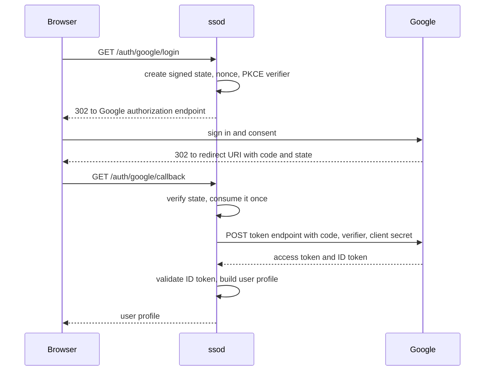

# Google SSO Setup Guide

Step-by-step instructions for configuring **Google's side** of the SSO integration (Google Cloud project, consent screen, OAuth client) and wiring the resulting values into Universal SSO.

> **Project status.** The Google provider is implemented (`pkg/sso/google`) and `ssod` registers it automatically when `SSO_PROVIDERS_GOOGLE_CLIENT_ID` and `SSO_PROVIDERS_GOOGLE_CLIENT_SECRET` hold real values. Unedited `.env.example` placeholders are skipped, so the server still starts without Google. Check `make start` output for `providers: google, mock`. The `make google-*` helpers in [Start here](#start-here-stuck-read-this-first) verify the Google side independently of the server.

Google's console and documentation change over time. This guide follows the current **Google Auth Platform** layout (Branding, Audience, Clients, Data Access). If a label differs in your console, use the linked Google pages as the source of truth.

## Contents

0. [Start here: stuck? Read this first](#start-here-stuck-read-this-first)
1. [How the pieces fit](#1-how-the-pieces-fit)
2. [Google Cloud project setup](#2-google-cloud-project-setup)
3. [OAuth 2.0 credentials](#3-oauth-20-credentials)
4. [Configuration values](#4-configuration-values)
5. [Verification and testing](#5-verification-and-testing)
6. [Security best practices](#6-security-best-practices)
7. [Troubleshooting](#7-troubleshooting)
8. [References](#8-references)

---

## Start here: stuck? Read this first

### Where people get stuck

| # | Symptom | Cause | Go to |
|---|---|---|---|
| 1 | `/auth/google/login` returns 404 | `google` is not registered: the Client ID or secret in `.env` is still empty or a placeholder, or `ssod` was not restarted after editing `.env` | `make google-check`, then `make restart` and look for `providers: google, mock` in `.run/app.log` |
| 2 | "I never saw the Client secret" | Google shows it once, at creation | [3.1](#31-create-the-oauth-client), [S3 below](#s3-no-client-secret) |
| 3 | A value starting with `GOCSPX-` ended up in the Client ID field | The secret was pasted into the wrong line. A Client ID is `<project-number>-<random>` followed by the Google suffix | [S2 below](#s2-client-id-and-secret-mixed-up) |
| 4 | Google shows `redirect_uri_mismatch` | The URI in Google differs from `.env` by one character | [7.1](#71-redirect_uri_mismatch-error-400) |
| 5 | "Which API do I enable?" | For sign-in, none | [2.3](#23-enable-apis) |
| 6 | Where is the OAuth consent screen? | It is now **Google Auth Platform** (Branding, Audience, Data Access) | [S1 below](#s1-console-navigation) |
| 7 | `.env` still has placeholders | `.env` was copied from `.env.example` and never filled in | `make google-check` |

### Fastest path (about 10 minutes)

Run each step and stop at the first one that fails.

```bash
# 0. One-time: create your private config and lock it down.
cp -n .env.example .env && chmod 600 .env
sed -i.bak "s|^SSO_STATE_SECRET=.*|SSO_STATE_SECRET=$(openssl rand -base64 48)|" .env && rm -f .env.bak

# 1. In Google Cloud Console (steps S1 and S2 below), create the client, then
#    paste the Client ID and Client secret into .env (two separate lines).

# 2. Validate .env. Prints exactly what is wrong and how to fix it. Never prints secrets.
make google-check

# 3. Print a sign-in URL with PKCE. Open it in your browser and sign in.
make google-url

# 4. Google redirects to localhost:8080 and the browser shows "connection refused".
#    That is expected. Copy the FULL address-bar URL and exchange it:
make google-exchange CODE='http://localhost:8080/auth/google/callback?state=...&code=...'
```

A successful run ends with `The Google side is configured correctly.` At that point everything on Google's side is done. The last step is the end-to-end test through `ssod` (section 5.6).

With no internet access, run `go run ./cmd/ssoctl google check --offline`, which skips the Google reachability check. The helper lives in [`cmd/ssoctl`](../cmd/ssoctl/main.go) and does what section 5.3 does by hand, with the state, nonce and PKCE checks included.

### S1. Console navigation

Open [console.cloud.google.com](https://console.cloud.google.com/) and use the search box at the top. Typing the page name is more reliable than menu paths, which Google reorganizes.

| You need | Type in the search box | Direct link |
|---|---|---|
| Project picker | (top bar, left of the search box) | n/a |
| Consent screen overview | `Google Auth Platform` | [auth/overview](https://console.developers.google.com/auth/overview) |
| App name, support email | `Branding` | [auth/branding](https://console.developers.google.com/auth/branding) |
| Internal / External, test users | `Audience` | use the left menu of Google Auth Platform |
| Scopes | `Data Access` | use the left menu of Google Auth Platform |
| Client ID, secret, redirect URIs | `Clients` | [auth/clients](https://console.developers.google.com/auth/clients) |

First visit to **Google Auth Platform** shows a **Get started** button. Click it and complete the four short forms: App information, Audience, Contact information, then agree to the policy and **Create**. Until you do, the Clients page asks you to configure the consent screen first.

Expected form values for local development:

| Field | Value |
|---|---|
| App name | `Universal SSO (dev)` |
| User support email | your own address from the drop-down |
| Audience | **External** (or **Internal** if your project belongs to a Workspace organization) |
| Contact email | your own address |

### S2. Client ID and secret mixed up

After **Create client**, Google shows a dialog with two values. They look different:

| Field in Google's dialog | Looks like | Goes into |
|---|---|---|
| Client ID | `<project-number>-<random>` + `.apps.googleusercontent.com` | `SSO_PROVIDERS_GOOGLE_CLIENT_ID` |
| Client secret | `GOCSPX-` followed by 28 characters | `SSO_PROVIDERS_GOOGLE_CLIENT_SECRET` |

If `make google-check` says the Client ID "starts with GOCSPX-", the secret was pasted into the Client ID line, and the real Client ID is still missing. Open the client on the [Clients page](https://console.developers.google.com/auth/clients): the Client ID is shown at the top and can be copied again at any time.

### S3. No client secret

Google shows the full secret only once, when the secret is created. If you closed the dialog without copying it:

1. Open the [Clients page](https://console.developers.google.com/auth/clients) and click your client.
2. In the client's secrets section, add a new secret (the button is typically labeled **Add secret**; Google's wording may differ).
3. Copy it immediately and update `.env`.
4. After the new one works (`make google-exchange` succeeds), disable or delete the old secret.

If the console does not offer this, create a new client instead (section 3.1) and register the same redirect URI.

### S4. The browser shows "This site can't be reached" after sign-in

This is the expected result of `make google-url` when `ssod` is not running: the page at `localhost:8080` has no server behind it. The code you need is in the **address bar** of that error page. Copy the whole URL, including `?state=...&code=...`.

If `ssod` is running (`make start`), the same URL reaches the server. The callback endpoint then completes the login itself and returns the profile as JSON, which uses up the single-use code. If you still want to run the exchange by hand, stop the server first (`make stop`) so the code in the address bar stays unused.

### S5. Test users and "Access blocked"

For an **External** app in **Testing** status, add your account under **Audience** (left menu of Google Auth Platform) > **Test users** > **Add users**. With only `openid email profile` Google normally does not require this, but adding yourself removes one variable while you debug.

---

## 1. How the pieces fit

Google is an OpenID Connect (OIDC) provider. Universal SSO uses the **authorization code flow with PKCE (S256)**: the server redirects the user to Google, Google redirects back with a one-time `code`, and the server exchanges that code (plus the PKCE verifier and the client secret) for an ID token.



What you configure on Google's side maps to exactly three things:

| You create in Google Cloud | Why the application needs it |
|---|---|
| A project with a consent screen | Defines who may sign in and what users see |
| An OAuth client of type **Web application** | Gives you the Client ID and Client secret |
| An **authorized redirect URI** | Must exactly match the callback the server sends to Google |

Google endpoints used (from Google's discovery document at `https://accounts.google.com/.well-known/openid-configuration`, which I fetched while writing this guide):

| Purpose | URL |
|---|---|
| Issuer (`iss` claim) | `https://accounts.google.com` |
| Authorization | `https://accounts.google.com/o/oauth2/v2/auth` |
| Token | `https://oauth2.googleapis.com/token` |
| UserInfo | `https://openidconnect.googleapis.com/v1/userinfo` |
| Signing keys (JWKS) | `https://www.googleapis.com/oauth2/v3/certs` |

---

## 2. Google Cloud project setup

### 2.1 Prerequisites

- A Google account that can create Cloud projects.
- For **Internal** apps (employees only): a Google Workspace or Cloud Identity organization, and a project that belongs to it.
- Use **one project per environment** (dev, staging, production). Google's OAuth policy expects production apps to be separate from test projects, and separate projects keep credentials and test users isolated.

### 2.2 Create the project

1. Open the [Google Cloud Console](https://console.cloud.google.com/).
2. Click the project picker at the top, then **New project**.
3. Enter a project name (for example `universal-sso-dev`), choose the organization or folder if you have one, and click **Create**.
4. Make sure the new project is selected in the project picker before continuing.

### 2.3 Enable APIs

For sign-in only, you request the `openid`, `email` and `profile` scopes, and Google's documentation does not list any API that must be enabled for that. Google's rule is that an application **that calls Google APIs** must enable those APIs.

| API | When you need it |
|---|---|
| None | Sign-in with `openid email profile` (this project's use case) |
| A specific Google API (for example People API) | Only if you later request extra data through that API |
| Google Identity Services | **Not needed.** It is the browser JavaScript library for the "Sign in with Google" button. This project uses the server-side code flow instead |

To enable an API if you need one:

1. Open the [API Library](https://console.developers.google.com/apis/library).
2. Search for the API, open it, and click **Enable**.
3. Accept the terms of service or enable billing if prompted.

### 2.4 Configure the Google Auth Platform (consent screen)

1. Open the [Google Auth Platform overview](https://console.developers.google.com/auth/overview) and click **Get started**.
2. **App information**
   - **App name**: shown to users on the consent screen. Do not use Google trademarks such as "Google" or "YouTube" in the name.
   - **User support email**: pick an address you monitor. It must be your own Google account address or a Google Group you manage.
3. **Audience** (also called user type). This choice has the biggest effect on who can sign in:

   | Audience | Who can sign in | Use when |
   |---|---|---|
   | **Internal** | Only members of your Google Workspace / Cloud organization | Company-internal SSO. Other accounts get `org_internal` |
   | **External** | Any Google account (subject to publishing status below) | Customer-facing apps |
   | **Personal** | Only the single Google account that created the app | A private sandbox only you use. It **cannot be changed later** to Internal or External |

4. **Contact information**: an address where Google can send project notices. Keep it current.
5. Accept the user data policy and click **Create**.

### 2.5 Publishing status (External apps only)

| Status | Behavior |
|---|---|
| **Testing** | Only users on the **Test users** list (up to 100) can sign in. Consent grants expire after **7 days**, including refresh tokens. |
| **In production** | Any Google account can sign in. Click **Publish app** to switch. |

The 7-day expiry and test-user requirement do **not** apply when an app only requests `openid`, `email` and `profile` (or their `userinfo.*` equivalents), which is all this project needs. Those users do not need to be on the test list and see no warning. Add any other scope and the restrictions apply again.

For development, add your own account under **Audience → Test users** anyway so behavior stays predictable if scopes change.

### 2.6 Data Access (scopes)

1. Open **Data Access** and click **Add or remove scopes**.
2. Select `openid`, `.../auth/userinfo.email` and `.../auth/userinfo.profile`.
3. Save.

These are non-sensitive scopes, so no Google verification review is needed for them. Request only what you use: every extra scope lowers user consent rates and may trigger verification.

---

## 3. OAuth 2.0 credentials

### 3.1 Create the OAuth client

1. Open the [Clients page](https://console.developers.google.com/auth/clients).
2. Click **Create client**.
3. **Application type**: **Web application**. This is a confidential client, which is what a server holding a client secret requires.
4. **Name**: a label only you see, for example `universal-sso-dev-web`.
5. **Authorized JavaScript origins**: leave empty. They only matter for browser-side Google Identity Services flows.
6. **Authorized redirect URIs**: click **Add URI** for each callback (see 3.2).
7. Click **Create**.
8. In the **OAuth client created** dialog, copy the **Client ID** and **Client secret**, or click **Download JSON**.

> **Copy the secret now.** Google shows the full client secret only at creation. After you close the dialog it cannot be viewed or downloaded again. If you lose it, create a new secret or a new client.

### 3.2 Redirect URIs

This project serves the callback at:

```text
GET {SSO_SERVER_BASE_URL}/auth/{provider}/callback
```

With the provider ID `google`, register these:

| Environment | Redirect URI to register |
|---|---|
| Local development | `http://localhost:8080/auth/google/callback` |
| Staging | `https://sso-staging.<your-domain>/auth/google/callback` |
| Production | `https://sso.<your-domain>/auth/google/callback` |

Matching is **exact**: scheme (`http` vs `https`), host, port, path, letter case, and trailing slash must all be identical to the `redirect_uri` the application sends. Register every environment's URI on that environment's client.

Google's validation rules for redirect URIs:

| Rule | Detail |
|---|---|
| Scheme | HTTPS required. `localhost` URIs (including localhost IPs) may use HTTP |
| Host | No raw IP addresses, except localhost IPs |
| Domain | Public suffix list TLDs only. No `googleusercontent.com`. No URL-shortener domains |
| Userinfo | No `user:pass@` component |
| Path | No path traversal (`/..`) |
| Query | No open redirects |
| Fragment | No `#fragment` |
| Characters | No wildcards (`*`), non-printable characters, invalid percent-encoding, or null characters |

There is no wildcard support, so each distinct callback URL is its own entry.

### 3.3 Changes can take time

Google notes that redirect URI and consent screen changes may take from a few minutes up to several hours to take effect. If something looks right but still fails right after an edit, wait a few minutes and retry before debugging further.

---

## 4. Configuration values

### 4.1 Values obtained from Google

| Value | Where to find it | Example shape |
|---|---|---|
| **Client ID** | Clients page → your client | `<digits>-<random>.apps.googleusercontent.com` |
| **Client secret** | Shown once at creation (or the downloaded JSON) | starts with `GOCSPX-` |
| **Authorized redirect URI** | Clients page → your client → Authorized redirect URIs | `http://localhost:8080/auth/google/callback` |
| Project ID / number | Console project picker | Only for audit and support. Not used by the application |

The downloaded JSON (`client_secret_*.json`) contains the same Client ID and secret under `web`. Do not keep it in the repository. Copy the two values into your environment, then delete or vault the file.

### 4.2 Values you choose

| Variable | Purpose |
|---|---|
| `SSO_STATE_SECRET` | Local HMAC key (32+ bytes) that signs the OAuth `state` parameter. Not a Google value. Generate it yourself |
| `SSO_SERVER_BASE_URL` | Public base URL. The redirect URI must be this plus `/auth/google/callback` |

### 4.3 `.env` layout

Copy `.env.example` to `.env` and fill in the Google block:

```bash
# --- Server ---
SSO_SERVER_HOST=127.0.0.1
SSO_SERVER_PORT=8080
SSO_SERVER_BASE_URL=http://localhost:8080
SSO_STATE_SECRET=<output of: openssl rand -base64 48>

# --- Google (values from the Google Cloud Console Clients page) ---
SSO_PROVIDERS_GOOGLE_CLIENT_ID=<your-client-id>.apps.googleusercontent.com
SSO_PROVIDERS_GOOGLE_CLIENT_SECRET=<your-client-secret>
SSO_PROVIDERS_GOOGLE_REDIRECT_URL=http://localhost:8080/auth/google/callback
# Optional: only accept accounts from this Google Workspace domain (checked via the hd claim)
# SSO_PROVIDERS_GOOGLE_HOSTED_DOMAIN=example.com
```

Rules for this file:

- `scripts/start.sh` loads it with the shell, so use only `KEY=VALUE` lines. Quote any value that contains spaces or shell characters.
- `SSO_PROVIDERS_GOOGLE_REDIRECT_URL` must equal one of the URIs registered in section 3.2 character for character, and equal `SSO_SERVER_BASE_URL` plus `/auth/google/callback`.
- `.env` is already git-ignored. `.env.example` is the only variant that is committed, and it must contain placeholders only.

### 4.4 How the values are used

| Value | Used in |
|---|---|
| Client ID | The `client_id` parameter of the authorization request, the token request, and the expected `aud` claim of the ID token |
| Client secret | Sent only server-to-server in the token request. Never sent to the browser |
| Redirect URI | The `redirect_uri` parameter of both the authorization request and the token request. Both must match Google's registered value |
| State secret | Signs and verifies the `state` value (see [`pkg/sso/state.go`](../pkg/sso/state.go)) |

Optional: set `SSO_PROVIDERS_GOOGLE_HOSTED_DOMAIN` to restrict sign-in to one Google Workspace domain. The provider passes it as the `hd` request parameter (a UI hint only) and then enforces it by checking the ID token's `hd` claim (`checkDomain` in [`pkg/sso/google/provider.go`](../pkg/sso/google/provider.go)).

---

## 5. Verification and testing

These checks use only `curl`, a browser, and `python3`. They validate the Google configuration independently of the application code.

> **Shortcut.** `make google-check`, `make google-url` and `make google-exchange` automate 5.2 and 5.3 and add `state`, `nonce` and ID-token claim checks. Use the manual steps below to understand what the helper does or when you cannot run Go.

### 5.1 Confirm the discovery document is reachable

```bash
curl -s https://accounts.google.com/.well-known/openid-configuration \
  | python3 -c "import sys,json; d=json.load(sys.stdin); print(d['authorization_endpoint']); print(d['token_endpoint']); print(d['code_challenge_methods_supported'])"
```

Expected: the two endpoints from section 1 and `['plain', 'S256']`. A failure here is a network or proxy problem, not a Google configuration problem.

### 5.2 Check the client ID and redirect URI in a browser

`curl` cannot tell you whether the client is valid, because Google answers `302` even for a made-up client ID. Use a browser.

Build the URL (replace the placeholders, keep the encoding):

```text
https://accounts.google.com/o/oauth2/v2/auth
  ?client_id=<your-client-id>.apps.googleusercontent.com
  &redirect_uri=http%3A%2F%2Flocalhost%3A8080%2Fauth%2Fgoogle%2Fcallback
  &response_type=code
  &scope=openid%20email%20profile
  &state=manual-test-1
```

Put it on one line in the browser address bar. Results:

| What you see | Meaning |
|---|---|
| Google sign-in or consent page | Client ID and redirect URI are valid |
| `Error 400: redirect_uri_mismatch` | The redirect URI is not registered on this client (section 7.1) |
| `Error 401: invalid_client` | Wrong or unknown client ID |
| `Access blocked` or `org_internal` | Audience or test-user setting blocks your account (section 7.5) |

### 5.3 Complete a manual code exchange with PKCE

This reproduces what the server does, proving the client secret works.

**Step 1.** Create a PKCE verifier and challenge:

```bash
VERIFIER=$(openssl rand -base64 48 | tr -d '=+/\n' | cut -c1-64)
CHALLENGE=$(printf '%s' "$VERIFIER" | openssl dgst -sha256 -binary | openssl base64 -A | tr '+/' '-_' | tr -d '=')
echo "$CHALLENGE"
```

**Step 2.** Open the URL from 5.2 in a browser with two more parameters appended:
`&code_challenge=<CHALLENGE>&code_challenge_method=S256&nonce=manual-nonce-1`

**Step 3.** Sign in and consent. Google redirects to your redirect URI. If nothing is listening there, the browser shows a connection error, which is fine. The address bar still contains `?code=...&state=manual-test-1`. Copy the `code` value. It is single use and short-lived, so continue immediately.

**Step 4.** Exchange it. Keep the secret out of shell history by reading it from your environment:

```bash
read -rs GOOGLE_CLIENT_SECRET   # paste the secret, then Enter
curl -s https://oauth2.googleapis.com/token \
  -d "code=<CODE_FROM_BROWSER>" \
  -d "client_id=<your-client-id>.apps.googleusercontent.com" \
  -d "client_secret=$GOOGLE_CLIENT_SECRET" \
  -d "redirect_uri=http://localhost:8080/auth/google/callback" \
  -d "grant_type=authorization_code" \
  -d "code_verifier=$VERIFIER" > /tmp/google_token.json
python3 -c "import json; d=json.load(open('/tmp/google_token.json')); print({k:(v if k in ('error','error_description','token_type','expires_in','scope') else '<redacted>') for k,v in d.items()})"
```

Success shows `token_type`, `expires_in`, `scope`, and redacted `access_token` and `id_token` keys. An `error` key means the exchange failed (section 7).

**Step 5.** Inspect the ID token claims:

```bash
python3 - <<'EOF'
import json, base64
tok = json.load(open('/tmp/google_token.json'))['id_token']
payload = tok.split('.')[1]
payload += '=' * (-len(payload) % 4)
claims = json.loads(base64.urlsafe_b64decode(payload))
for k in ('iss', 'aud', 'sub', 'email_verified', 'hd', 'nonce', 'exp'):
    print(k, '=', claims.get(k))
EOF
rm -f /tmp/google_token.json
```

Check these against what the server will enforce:

| Claim | Must be |
|---|---|
| `iss` | `https://accounts.google.com` (or `accounts.google.com`) |
| `aud` | Your Client ID exactly |
| `exp` | In the future |
| `nonce` | The value you sent (`manual-nonce-1`) |
| `sub` | Present. This is the stable user key (see 6.5) |

This step only decodes the token for inspection and does not verify the signature. The application must verify signatures against the keys at `jwks_uri`.

### 5.4 Negative tests

Confirm that failures fail safely:

| Test | How | Expected |
|---|---|---|
| Wrong redirect URI | Change one character in `redirect_uri` in 5.2 | `redirect_uri_mismatch` |
| Reused code | Run the Step 4 `curl` twice with the same code | Second call returns `invalid_grant` |
| Wrong secret | Alter one character of the secret | `invalid_client` |
| Missing verifier | Omit `code_verifier` in Step 4 after using a `code_challenge` | `invalid_grant` |

### 5.5 Local server checks that need no Google account

These confirm the server side that the Google provider plugs into:

```bash
export SSO_STATE_SECRET=$(openssl rand -base64 48)
make start
curl -s http://127.0.0.1:8080/healthz
curl -s http://127.0.0.1:8080/providers
curl -s -o /dev/null -w "%{http_code}\n" "http://127.0.0.1:8080/auth/mock/callback?state=forged"   # 400
make stop
```

The `mock` provider exercises the same state, PKCE and replay protections that the Google provider will use.

### 5.6 End-to-end test through `ssod`

1. Fill in `.env` as in 4.3 and run `make start`.
2. Open `http://localhost:8080/auth/google/login` in a browser.
3. You should be redirected to Google, sign in, and land on `/auth/google/callback`, which returns JSON with your user profile (no tokens).
4. Reload the callback URL. It must fail with `STATE_MISMATCH` because the state is single use.
5. Repeat with an account that is **not** allowed (not a test user, or outside the organization for Internal apps) and confirm Google blocks it.

---

## 6. Security best practices

### 6.1 Protect the client secret

- Keep it only in `.env` (local) or a secrets manager (shared environments). Never in source, `README`, tickets, chat, or container image layers.
- `chmod 600 .env` so only your user can read it.
- `.env` is git-ignored by this repository. Before every push, run `bash .bob/skills/secure-config/scripts/scan_secrets.sh .` to catch accidental leaks.
- Do not pass secrets as command-line arguments. They appear in process listings and shell history. Use `read -s` or environment variables as in 5.3.
- Never log the client secret, authorization codes, access tokens, or ID tokens. Log the provider ID and error codes only.

### 6.2 Use a secrets manager outside local development

Inject the values as environment variables at deploy time instead of shipping a `.env` file:

| Platform | Mechanism |
|---|---|
| Kubernetes | `Secret` objects mounted as environment variables, ideally synced from an external secrets store |
| Cloud runtimes | The platform's secret manager (for example Google Secret Manager, AWS Secrets Manager) referenced by the service definition |
| Containers | Runtime `--env` or secret mounts, never `ENV` or `COPY .env` in a Dockerfile or Containerfile |
| CI/CD | The pipeline's masked secret variables |

### 6.3 Rotate and respond to leaks

- If a secret may have leaked, treat it as compromised: create a replacement secret for the client in the Clients page, deploy it, then disable or delete the old one. Check your console for the exact controls available.
- Deleted clients stop working immediately (`deleted_client`). Google also deletes clients that go unused for long periods, and deleted clients can be restored for a limited time.
- Review who has Owner or Editor access on the Google Cloud project. Anyone with that access can view and manage OAuth clients.

### 6.4 Keep the OAuth flow hardened

| Control | Status in this project |
|---|---|
| Signed, expiring, single-use `state` (CSRF protection) | Implemented |
| PKCE with `S256` | Implemented in the manager and mock provider |
| Redirect URI exact match | Enforced by Google. Keep the list minimal |
| ID token validation (`iss`, `aud`, `exp`, signature, `nonce`) | Implemented in `pkg/sso/google` (RS256 only, keys from Google's JWKS). Google lists these as mandatory checks |
| HTTPS in every non-local environment | Required by Google for non-localhost redirect URIs |
| Do not echo tokens to the browser | The reference server returns the profile only |

### 6.5 Identify users correctly

- Use the `sub` claim as the permanent user key. Google states it is unique and never reused, while the email address can change.
- Treat `email` as an attribute, and check `email_verified` before trusting it.
- To restrict access to your company, check the `hd` claim on the server. Do not rely on the email domain, and do not rely on the `hd` request parameter.

### 6.6 Least privilege

- Request only `openid email profile`.
- Use separate Google Cloud projects, clients and secrets for dev, staging and production.
- Keep the redirect URI list to the minimum needed. Remove `localhost` entries from the production client.

---

## 7. Troubleshooting

Start with the exact `error` code Google shows or returns. Most problems are one of the cases below.

### 7.1 `redirect_uri_mismatch` (Error 400)

The `redirect_uri` the application sent is not registered on that client.

| Check | Fix |
|---|---|
| Compare character by character | The value in the browser URL (decode `%3A`, `%2F`) must equal an entry on the Clients page |
| `http` vs `https` | Register the scheme you actually use. Only localhost may use `http` |
| Trailing slash | `/callback` and `/callback/` are different |
| Port | `localhost:8080` and `localhost:3000` are different |
| Host | `localhost` and `127.0.0.1` are different |
| Case | Paths are case-sensitive |
| Wrong client | You may be using the Client ID from another project or environment |
| Just edited | Wait a few minutes (section 3.3) |
| Behind a proxy | The server may build `http://` while the public URL is `https://`. Set `SSO_PROVIDERS_GOOGLE_REDIRECT_URL` explicitly instead of deriving it |

### 7.2 `invalid_client` (Error 401)

The Client ID or client secret is wrong.

- Re-copy both values. Look for trailing spaces, a missing `.apps.googleusercontent.com` suffix, or smart quotes.
- Confirm the Client ID and secret belong to the **same** client.
- If `.env` values contain special characters, quote them. `scripts/start.sh` sources the file in a shell.
- If the secret was lost, create a new one. It cannot be recovered.

### 7.3 `deleted_client`

The client was deleted manually or removed automatically for inactivity. Restore it from the Clients page within the restore window, or create a new client and update `.env`.

### 7.4 `invalid_grant` on code exchange

| Cause | Fix |
|---|---|
| Authorization code already used | Codes are single use. Restart the login |
| Code expired | Exchange immediately after the redirect |
| `redirect_uri` in the token request differs from the authorization request | Send the identical value in both |
| PKCE verifier does not match the challenge | The same verifier that produced the `code_challenge` must be sent. Check that the state and verifier were stored for this exact login |
| Refresh token revoked or expired | Common in Testing status after 7 days for non-basic scopes. Ask the user to sign in again |

### 7.5 `access_denied`, `org_internal`, "Access blocked"

| Message | Cause | Fix |
|---|---|---|
| `org_internal` | Audience is **Internal** and the account is outside your organization | Use an organization account, or change Audience to External |
| "Access blocked: has not completed verification" or test-user error | Audience is External in **Testing** and the account is not a test user, with scopes beyond `openid email profile` | Add the user under Audience → Test users, publish the app, or reduce scopes |
| `client_user_mismatch` | Audience is **Personal** and a different Google account tried to sign in | Sign in with the creating account, or create a separate non-Personal project |
| `admin_policy_enforced` | A Workspace admin restricts third-party apps | The admin must allow your Client ID in Admin console API controls |
| `disallowed_useragent` | Sign-in opened inside an embedded web view | Open the flow in the system browser |

### 7.6 API enablement problems

- **For sign-in only**, no API needs to be enabled. If you are looking for an "OAuth 2.0 API" toggle, there is none. The consent screen and OAuth client are configured under Google Auth Platform.
- **When calling another Google API** and you receive a `403` saying the API has not been used in the project or is disabled, open the [API Library](https://console.developers.google.com/apis/library), select the same project that owns your OAuth client, and enable it. Wait a few minutes and retry.
- If the call still fails, confirm the scope for that API is listed under Data Access and was granted by the user.
- Enabling the API in a different project than the one that owns the client has no effect on your client.

### 7.7 Errors returned by this project

| Server error code | HTTP | Typical meaning |
|---|---|---|
| `STATE_MISMATCH` | 400 | Forged, replayed, or already-used `state`, or state issued for a different provider. Restart login |
| `STATE_EXPIRED` | 400 | The signed state exceeded its lifetime (10 minutes by default). Restart login |
| `IDP_REJECTED` | 401 | Google returned an `error` parameter, for example `access_denied` when the user clicked Cancel |
| `PROVIDER_NOT_FOUND` | 404 | The provider ID in the URL is not registered. `google` is registered only when its Client ID and secret are set in `.env` |
| `INVALID_CONFIG` | 500 | Startup problem, such as `SSO_STATE_SECRET` shorter than 32 bytes. `ssod` also refuses to start when the Google Client ID is set but the secret is a placeholder, or the Client ID starts with `GOCSPX-` |
| `NETWORK_FAILURE` | 502 | `ssod` could not reach Google (discovery, JWKS or token endpoint) or got an unexpected reply. Check connectivity and proxy settings |
| `SIGNATURE_INVALID` / `INVALID_TOKEN` / `TOKEN_EXPIRED` | 401 | The ID token failed verification (signature, issuer, audience, expiry). Check that the Client ID in `.env` is the one that issued the token and that the system clock is correct |
| `UNAUTHORIZED` | 401 | Sign-in succeeded at Google but the account is outside `SSO_PROVIDERS_GOOGLE_HOSTED_DOMAIN` |

### 7.8 Localhost versus production confusion

| Symptom | Cause | Fix |
|---|---|---|
| Works locally, `redirect_uri_mismatch` in staging or production | Only the `localhost` URI is registered | Add the staging and production URIs to the client for that environment (section 3.2) |
| Works in production, fails locally | `localhost` URI missing, or `.env` still holds the production URL | Register `http://localhost:8080/auth/google/callback` on the dev client |
| `http://` rejected for a real domain | Google allows `http` only for localhost | Use `https://` and a domain name |
| Behind a TLS-terminating proxy, the server builds `http://` URLs | The proxy hides the original scheme | Set `SSO_PROVIDERS_GOOGLE_REDIRECT_URL` explicitly |
| Production still lists `localhost` | Leftover from development | Remove it from the production client (least privilege) |
| Same client reused across environments | One leaked secret affects everything | Use one client and secret per environment |

`make google-check` flags the common ones: it rejects `http` on non-local hosts, raw IPs, wildcards and fragments, and warns when the redirect URL differs from `SSO_SERVER_BASE_URL`.

### 7.9 CORS errors in the browser console

The flow in this project is a **server-side redirect flow**. The browser navigates to Google and back, and the server calls the token endpoint. No cross-origin `fetch` is involved, so CORS errors mean something else is happening:

| You see | Cause | Fix |
|---|---|---|
| `blocked by CORS policy` on `oauth2.googleapis.com/token` | Front-end JavaScript is calling the token endpoint directly | Do not do this. Send the user to `/auth/google/login` and let the server exchange the code. The client secret must never reach a browser |
| `blocked by CORS policy` on `accounts.google.com/o/oauth2/v2/auth` | Authorization URL requested with `fetch` or `XHR` | Use a full-page navigation or `window.location`, not `fetch` |
| Google Identity Services errors about "origin not allowed" | You are using the browser button library, which needs **Authorized JavaScript origins** | Not needed for this project. Leave that field empty (section 3.1) |

### 7.10 Quick diagnostic checklist

1. Is the right Google Cloud project selected in the console?
2. Does the Client ID in `.env` belong to that project's Web application client?
3. Does the redirect URI match across the console, `.env`, and the URL in the browser?
4. Is the Audience and publishing status right for the account you are testing with?
5. Did you wait a few minutes after changing settings?
6. Does `make google-exchange` (or the manual exchange in 5.3) succeed? If yes, the Google side is correct and the problem is in the application code.

---

## 8. References

- [Using OAuth 2.0 for web server applications](https://developers.google.com/identity/protocols/oauth2/web-server) (includes redirect URI validation rules)
- [OpenID Connect with Google](https://developers.google.com/identity/openid-connect/openid-connect)
- [Get started with the Google Auth Platform](https://support.google.com/cloud/answer/15544987)
- [Manage app audience and publishing status](https://support.google.com/cloud/answer/15549945)
- [Manage OAuth clients](https://support.google.com/cloud/answer/15549257)
- [Google OAuth 2.0 Playground](https://developers.google.com/oauthplayground/)
- Project docs: [`README.md`](../README.md), [`Quickstart.md`](Quickstart.md), [`Architecture.md`](Architecture.md)
