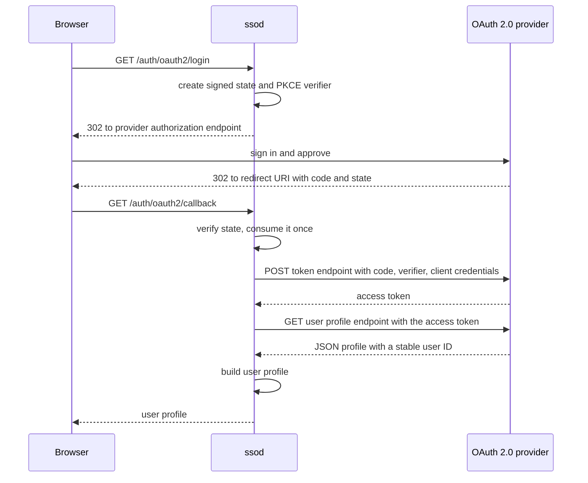

# Generic OAuth 2.0 SSO Setup Guide

Step-by-step instructions for connecting **any OAuth 2.0 authorization server that is not OpenID Connect** (GitHub-style providers, Discord, Slack, Dropbox, a vendor's custom server) to Universal SSO: registering the client, redirect URIs, endpoints, client authentication, token handling, fetching the user profile, and wiring the values into the project. For providers that publish OIDC discovery, use the dedicated guides ([Google](Google-SSO-Setup.md), [Azure AD / Entra ID](Azure-AD-SSO-Setup.md), [Okta](Okta-SSO-Setup.md), [Auth0](Auth0-SSO-Setup.md)) instead: they give you a signed ID token and a standard identity.

> **Project status.** Generic OAuth 2.0 is **implemented** as the `oauth2` driver (`pkg/sso/oauth2`) and registered by `ssod` when `SSO_PROVIDERS_OAUTH2_*` holds real values. It is verified **only against an in-process fake authorization server** (`oauth2test`), never against a live provider. `.env.example` ships the block with `-placeholder` values, so the provider stays off until you fill it in. The `make google-*` helpers are Google-only, so this guide uses `curl` and `python3` for the manual checks.

Every OAuth 2.0 provider names its console and fields differently, and plain OAuth 2.0 leaves several things (user profile endpoint, user ID field, scopes) to the provider. This guide names the **generic fields** and uses `https://idp.example.com/...` placeholders. Always take exact endpoint URLs and scope names from your provider's documentation.

## Contents

0. [Start here: stuck? Read this first](#start-here-stuck-read-this-first)
1. [How the pieces fit](#1-how-the-pieces-fit)
2. [Provider and client registration](#2-provider-and-client-registration)
3. [Client credentials and redirect URIs](#3-client-credentials-and-redirect-uris)
4. [Configuration values](#4-configuration-values)
5. [Verification and testing](#5-verification-and-testing)
6. [Security best practices](#6-security-best-practices)
7. [Troubleshooting](#7-troubleshooting)
8. [References](#8-references)

---

## Start here: stuck? Read this first

### Where people get stuck

| # | Symptom | Cause | Go to |
|---|---|---|---|
| 1 | `/auth/oauth2/login` returns 404 | The provider is not registered: `CLIENT_ID` or `CLIENT_SECRET` is empty or still a `-placeholder` value | [7.7](#77-errors-returned-by-this-project) |
| 2 | "How do I know who the user is?" | Plain OAuth 2.0 has **no ID token**. You must call the provider's profile endpoint | [S2 below](#s2-oauth-20-is-not-sign-in-by-itself), [2.4](#24-the-user-profile-endpoint) |
| 3 | `redirect_uri` error at the provider | The URI registered differs from the one sent by one character | [7.1](#71-redirect_uri-mismatch) |
| 4 | The token response cannot be parsed | The provider answers with form-encoded text instead of JSON | [S3 below](#s3-token-response-is-not-json), [7.3](#73-the-token-response-is-not-json-or-lacks-fields) |
| 5 | `invalid_client` at the token endpoint | Wrong secret, or the client authenticates with the wrong method (header vs body) | [7.2](#72-invalid_client-and-unauthorized_client) |
| 6 | "I never saw the client secret" | Many providers show it once | [3.1](#31-obtain-the-client-id-and-client-secret) |
| 7 | Two different accounts get merged | Accounts were linked on an unverified email address | [6.5](#65-identify-users-correctly) |
| 8 | `.env` has no OAuth 2.0 block | An older `.env` predates the block. Copy it from `.env.example` | [4.3](#43-env-layout) |

### Fastest path (about 15 minutes)

Run each step and stop at the first one that fails.

```bash
# 0. One-time: create your private config and lock it down.
cp -n .env.example .env && chmod 600 .env
sed -i.bak "s|^SSO_STATE_SECRET=.*|SSO_STATE_SECRET=$(openssl rand -base64 48)|" .env && rm -f .env.bak

# 1. In the provider's developer console (steps S1 and S2 below), register an OAuth app and note:
#    Client ID, Client secret, authorization URL, token URL and user profile URL.

# 2. If the provider publishes server metadata (RFC 8414), read the endpoints from it (section 5.1).
curl -s https://idp.example.com/.well-known/oauth-authorization-server \
  | python3 -c "import sys,json; d=json.load(sys.stdin); print(d['authorization_endpoint']); print(d['token_endpoint'])"

# 3. Open the authorization URL from section 5.2 in a browser and approve.
# 4. The provider redirects to localhost:8080. Copy the code from the address bar and
#    exchange it with the curl command in section 5.3. Then call the profile endpoint (5.3, step 5).
```

A successful token exchange **and** a successful profile call (section 5.3) mean everything on the provider's side is done. The last step, the end-to-end test through `ssod` (section 5.6), needs real values in the `SSO_PROVIDERS_OAUTH2_*` block.

### S1. Console navigation

Provider consoles differ. Look for these names and match by meaning:

| You need | Look for |
|---|---|
| Create the client | "OAuth apps", "Developer settings", "Applications", "Create app", "Register application" |
| Client ID and secret | "Credentials", "Client credentials", "App secret" |
| Redirect URIs | "Redirect URIs", "Callback URL", "Authorization callback URL", "Allowed redirect URLs" |
| Scopes | "Scopes", "Permissions", "OAuth scopes" |
| Endpoints | The provider's "OAuth documentation", or the metadata URL (5.1) |
| Users and access | "Users", "Collaborators", "Test users", "Organization access" |

Expected values for local development:

| Field | Value |
|---|---|
| Application name | `Universal SSO (dev)` |
| Application type | **Web application** (a **confidential** client) |
| Redirect URI | `http://localhost:8080/auth/oauth2/callback` |
| Scopes | The smallest scopes that return a stable user ID and, if needed, an email (provider-specific) |
| Homepage URL | `http://localhost:8080` (if the provider asks) |

### S2. OAuth 2.0 is not sign-in by itself

OAuth 2.0 (RFC 6749) is an **authorization** framework: it proves the user let your application access a resource, and gives you an **access token** for that resource. It does not define an identity. There is no `sub`, no `iss`, no `aud` check, and no signed ID token. To sign users in, the adapter:

1. Run the authorization code flow with PKCE and exchange the code for an **access token**.
2. Call the provider's **user profile endpoint** with that token (for example `GET https://idp.example.com/user`).
3. Read a **stable user ID** from the JSON reply (for example `id`) and use it as the user key.

Both the profile endpoint and the field names are **provider-specific**, so they must be configured (4.3). If the provider supports OpenID Connect, use that instead. It removes this guesswork.

### S3. Token response is not JSON

RFC 6749 section 5.1 says the token response is JSON. Some providers (GitHub is the well-known example) reply with `application/x-www-form-urlencoded` text such as `access_token=...&scope=...&token_type=bearer` unless the request sends `Accept: application/json`. The adapter always sends that header. In the manual steps below, `curl` sends it with `-H "Accept: application/json"`.

### S4. The browser shows "This site can't be reached" after approval

This is expected when `ssod` is not running on that address, or the provider is not registered (404 `PROVIDER_NOT_FOUND`): the page at `localhost:8080` has no server behind it, or the server answers `404 PROVIDER_NOT_FOUND`. The code you need is in the **address bar**. Copy the whole URL, including `?code=...&state=...`, and use it in section 5.3.

### S5. Who is allowed to approve

Some providers limit new apps to the owner or listed **test users** until the app is reviewed or published. If a second account sees "access denied" or "app not approved", add it as a collaborator or test user, or publish the app. Organization-owned data may also need an **organization admin to approve** the app.

---

## 1. How the pieces fit

OAuth 2.0's **authorization code flow** has the user approve access at the provider, then your server exchanges a one-time `code` for tokens. Universal SSO adds **PKCE (S256, RFC 7636)** and a **signed, single-use `state`**, as the current security guidance (RFC 9700) recommends for every client. The sign-in identity then comes from a profile call.



What you configure maps to exactly three things:

| You create at the provider | Why the application needs it |
|---|---|
| An **OAuth application** (confidential web client) | Gives you the Client ID and Client secret |
| A **redirect URI** | Must exactly match the callback the server sends to the provider |
| **Scopes** | Decide what the access token may read. Request the minimum |

Endpoints the application needs. The paths below are placeholders. Take the real ones from your provider's documentation:

| Purpose | Placeholder | Required |
|---|---|---|
| Authorization endpoint | `https://idp.example.com/oauth/authorize` | Yes |
| Token endpoint | `https://idp.example.com/oauth/token` | Yes |
| User profile endpoint | `https://idp.example.com/api/user` | Yes for sign-in |
| Revocation endpoint (RFC 7009) | `https://idp.example.com/oauth/revoke` | Optional |
| Introspection endpoint (RFC 7662) | `https://idp.example.com/oauth/introspect` | Optional |
| Server metadata (RFC 8414) | `https://idp.example.com/.well-known/oauth-authorization-server` | Optional. Use it when it exists |

Client authentication at the token endpoint (RFC 6749 section 2.3.1):

| Method | How | Notes |
|---|---|---|
| `client_secret_basic` | `Authorization: Basic base64(client_id:client_secret)` (each part form-urlencoded first) | The method the RFC requires every server to support. Preferred |
| `client_secret_post` | `client_id` and `client_secret` in the request body | The RFC marks it **NOT RECOMMENDED**, but many providers only accept this. Use it when the provider says so |
| `private_key_jwt`, mutual TLS | Signed assertion or client certificate | Stronger. Not supported by the adapter |

---

## 2. Provider and client registration

### 2.1 Prerequisites

- A developer account at the provider, with the right to register applications (for organization-owned apps, an owner or admin role).
- The provider's OAuth documentation: authorization URL, token URL, profile URL, scope names, and the profile field that holds the stable user ID.
- Use **one OAuth app per environment** (dev, staging, production). Separate apps keep secrets, redirect URIs and test users isolated.

### 2.2 Register the OAuth application

1. Open the provider's developer console and choose **New application** (or similar).
2. **Name**: for example `Universal SSO (dev)`.
3. **Type**: **Web application** (confidential client). Do not choose *SPA*, *native* or *public*, which have no secret.
4. **Redirect URI**: `http://localhost:8080/auth/oauth2/callback` (see 3.2).
5. Select the **scopes** (2.3).
6. Create the app and copy the **Client ID** and **Client secret** (3.1).

### 2.3 Scopes

Scopes are provider-specific strings. RFC 6749 only defines the syntax: space-separated tokens in the `scope` parameter.

| Scope role | Examples (provider-specific, check yours) | Needed for |
|---|---|---|
| Read the signed-in user's profile | `read:user`, `identify`, `profile` | The stable user ID and display name |
| Read the email address | `user:email`, `email` | `email`, only if the provider needs a separate scope |
| Refresh tokens | `offline_access`, or a provider flag | Only if you need refresh tokens |

Request only what you use. Extra scopes lower consent rates and enlarge the damage from a leaked token. Some providers return the **granted** scope in the token response, and it may be narrower than what you requested, so read it.

### 2.4 The user profile endpoint

After the token exchange the application calls the profile endpoint with `Authorization: Bearer <access_token>` (RFC 6750). You must tell it which JSON field is the stable user ID:

| Item | What to find in the provider's documentation |
|---|---|
| Profile URL | For example `https://idp.example.com/api/user` |
| **User ID field** | A **permanent, immutable** identifier, such as `id` (a number or UUID). Not `login`, `username`, `name` or `email`, which can change or be reused |
| Email field | May need a separate call or scope, and may not be verified |
| Display name field | Display only |

This is the single most provider-specific step. A wrong choice here causes duplicate or merged accounts (6.5).

### 2.5 Control who may sign in

OAuth 2.0 does not say who may sign in. The provider usually lets anyone with an account approve the app. To restrict access, enforce a rule in the application after the profile call, for example:

- an allow-list of user IDs, or
- membership in an organization or team (a second API call with the right scope), or
- a provider-side setting that limits the app to an organization, if it has one.

The adapter does **not** enforce an allow-list: any account the provider lets approve the app can sign in, and `ssod` returns its profile. Enforce your rule in the application that consumes the profile, or restrict the app at the provider. Decide your rule before production.

---

## 3. Client credentials and redirect URIs

### 3.1 Obtain the Client ID and Client secret

1. Open your OAuth app in the provider's console.
2. Copy the **Client ID**. It is public and appears in the browser URL.
3. Generate or reveal the **Client secret** and copy it.

> **Copy the secret now.** Many providers show a secret only once, and some hide it after you leave the page. If you lose it, generate a new one. Rotating usually invalidates the old one, so deploy the new value in the same maintenance window.

### 3.2 Redirect URIs

This project serves the callback at:

```text
GET {SSO_SERVER_BASE_URL}/auth/{provider}/callback
```

With the provider ID `oauth2`, register these:

| Environment | Redirect URI to register |
|---|---|
| Local development | `http://localhost:8080/auth/oauth2/callback` |
| Staging | `https://sso-staging.<your-domain>/auth/oauth2/callback` |
| Production | `https://sso.<your-domain>/auth/oauth2/callback` |

RFC 9700 (the OAuth 2.0 security best current practice) requires **exact string matching** of redirect URIs. Scheme, host, port, path, letter case, and trailing slash must all be identical to the `redirect_uri` the application sends. Some older providers match by prefix or allow wildcards. Never rely on that.

General rules (check your provider for variations):

| Rule | Detail |
|---|---|
| Scheme | HTTPS for real domains. `http://localhost` is commonly allowed for development |
| Fragment | Not allowed (RFC 6749 section 3.1.2) |
| Wildcards | Avoid. They enable redirect attacks |
| Count | Some providers allow only one URI per app. Then create one app per environment |
| Query string | Allowed by the RFC, but avoid it. Some providers reject it |

### 3.3 Changes can take time

Most providers apply redirect URI changes immediately, but a few cache them for several minutes. If something looks right but still fails right after an edit, wait a few minutes and retry before debugging further.

---

## 4. Configuration values

### 4.1 Values obtained from the provider

| Value | Where to find it | Example shape |
|---|---|---|
| **Client ID** | The app's credentials page | Opaque string |
| **Client secret** | Shown at creation or on demand | Long random string |
| **Authorization URL** | Provider documentation or metadata | `https://idp.example.com/oauth/authorize` |
| **Token URL** | Provider documentation or metadata | `https://idp.example.com/oauth/token` |
| **User profile URL** | Provider documentation | `https://idp.example.com/api/user` |
| **User ID field** | Provider documentation (profile JSON) | `id` |
| **Scopes** | Provider documentation | Space-separated list |
| **Client authentication method** | Provider documentation | `client_secret_basic` or `client_secret_post` |
| Redirect URI | The app's settings | `http://localhost:8080/auth/oauth2/callback` |

### 4.2 Values you choose

| Variable | Purpose |
|---|---|
| `SSO_STATE_SECRET` | Local HMAC key (32+ bytes) that signs the OAuth `state` parameter. Not a provider value. Generate it yourself |
| `SSO_SERVER_BASE_URL` | Public base URL. The redirect URI must be this plus `/auth/oauth2/callback` |

### 4.3 `.env` layout

These variables are read by `ssod` (`cmd/ssod/vendors.go`). The same block ships in `.env.example` with `-placeholder` values, so the provider stays switched off until you replace them. `SSO_PROVIDERS_OAUTH2_REVOKE_URL` is optional and enables token revocation (RFC 7009). Check your settings with `make provider-check P=oauth2`.

```bash
# --- Server ---
SSO_SERVER_HOST=127.0.0.1
SSO_SERVER_PORT=8080
SSO_SERVER_BASE_URL=http://localhost:8080
SSO_STATE_SECRET=<output of: openssl rand -base64 48>

# --- Generic OAuth 2.0 (values from your provider) ---
SSO_PROVIDERS_OAUTH2_CLIENT_ID=<your-client-id>
SSO_PROVIDERS_OAUTH2_CLIENT_SECRET=<your-client-secret>
SSO_PROVIDERS_OAUTH2_AUTH_URL=https://idp.example.com/oauth/authorize
SSO_PROVIDERS_OAUTH2_TOKEN_URL=https://idp.example.com/oauth/token
SSO_PROVIDERS_OAUTH2_USERINFO_URL=https://idp.example.com/api/user
SSO_PROVIDERS_OAUTH2_SCOPES="read:user user:email"
SSO_PROVIDERS_OAUTH2_USER_ID_FIELD=id
SSO_PROVIDERS_OAUTH2_REDIRECT_URL=http://localhost:8080/auth/oauth2/callback
# Optional: client authentication method, basic (default) or post
# SSO_PROVIDERS_OAUTH2_AUTH_STYLE=basic
# Optional: RFC 7009 revocation endpoint
# SSO_PROVIDERS_OAUTH2_REVOKE_URL=https://idp.example.com/oauth/revoke
```

Rules for this file:

- `scripts/start.sh` loads it with the shell, so use only `KEY=VALUE` lines. **Quote `SSO_PROVIDERS_OAUTH2_SCOPES`**, because scopes contain spaces.
- `SSO_PROVIDERS_OAUTH2_REDIRECT_URL` must equal one of the URIs registered in section 3.2 character for character, and equal `SSO_SERVER_BASE_URL` plus `/auth/oauth2/callback`.
- All three endpoint URLs must be `https` outside local testing.
- `.env` is already git-ignored. `.env.example` is the only variant that is committed, and it must contain placeholders only.

### 4.4 How the values are used

| Value | Used in |
|---|---|
| Client ID | The `client_id` parameter of the authorization and token requests |
| Client secret | Sent only server-to-server in the token request. Never sent to the browser |
| Authorization URL | Where the browser is redirected (with `state` and PKCE) |
| Token URL | Where the server exchanges the code |
| User profile URL | Called with the access token to identify the user |
| User ID field | The JSON field copied into the user's stable ID |
| Redirect URI | The `redirect_uri` parameter of both the authorization request and the token request. Both must match the registered value |
| State secret | Signs and verifies the `state` value (see [`pkg/sso/state.go`](../pkg/sso/state.go)) |

---

## 5. Verification and testing

These checks use only `curl`, a browser, and `python3`. They validate the provider configuration independently of the application code. Replace the `idp.example.com` URLs, `<client-id>` and the other placeholders with your values.

> **Note.** The `make google-*` helpers do not support generic OAuth 2.0. The steps below are the manual equivalent. `make provider-check P=oauth2` validates the `.env` settings (it does not call the provider).

### 5.1 Confirm the endpoints (or the metadata) are reachable

If the provider publishes authorization server metadata (RFC 8414):

```bash
curl -s https://idp.example.com/.well-known/oauth-authorization-server \
  | python3 -c "import sys,json; d=json.load(sys.stdin); print(d['issuer']); print(d['authorization_endpoint']); print(d['token_endpoint']); print(d.get('code_challenge_methods_supported')); print(d.get('token_endpoint_auth_methods_supported'))"
```

Expected: your endpoints, `S256` among the code challenge methods, and the client authentication methods the token endpoint accepts. Many OAuth-only providers publish no metadata. Then confirm each URL from the documentation:

```bash
curl -s -o /dev/null -w "authorize: %{http_code}\n" "https://idp.example.com/oauth/authorize"
curl -s -o /dev/null -w "token:     %{http_code}\n" -X POST "https://idp.example.com/oauth/token"
```

A `4xx` JSON error from the token URL (for example `invalid_request`) proves the endpoint exists. A `404` or a connection error means the URL is wrong or blocked, which is a network or documentation problem, not a client problem.

### 5.2 Check the client ID and redirect URI in a browser

`curl` cannot tell you whether the client is valid. Use a browser.

Build the URL (replace the placeholders, keep the encoding):

```text
https://idp.example.com/oauth/authorize
  ?response_type=code
  &client_id=<your-client-id>
  &redirect_uri=http%3A%2F%2Flocalhost%3A8080%2Fauth%2Foauth2%2Fcallback
  &scope=read%3Auser%20user%3Aemail
  &state=manual-test-1
```

Put it on one line in the browser address bar. Results:

| What you see | Meaning |
|---|---|
| Provider sign-in or approval page | Client ID and redirect URI are valid |
| Error about the redirect URI | The URI is not registered on this app (section 7.1) |
| `unauthorized_client`, "unknown client" or `invalid_request` | Wrong client ID, or the app is not allowed to use this flow (section 7.2) |
| `invalid_scope` | A scope is not valid for this provider (section 7.5) |

### 5.3 Complete a manual code exchange with PKCE and read the profile

This reproduces what the server does, proving the client secret, the token endpoint and the profile endpoint.

**Step 1.** Create a PKCE verifier and challenge:

```bash
VERIFIER=$(openssl rand -base64 48 | tr -d '=+/\n' | cut -c1-64)
CHALLENGE=$(printf '%s' "$VERIFIER" | openssl dgst -sha256 -binary | openssl base64 -A | tr '+/' '-_' | tr -d '=')
echo "$CHALLENGE"
```

**Step 2.** Open the URL from 5.2 in a browser with two more parameters appended:
`&code_challenge=<CHALLENGE>&code_challenge_method=S256`

Providers that do not support PKCE ignore these parameters. That is a finding in itself (6.4).

**Step 3.** Approve. The provider redirects to your redirect URI. If nothing is listening there, the browser shows a connection error, which is fine. The address bar still contains `?code=...&state=manual-test-1`. Copy the `code` value. It is single use and short-lived, so continue immediately.

**Step 4.** Exchange it. Keep the secret out of shell history by reading it from your environment. Send `Accept: application/json` so providers that default to form encoding reply with JSON (S3). Use the body form below, or switch to HTTP Basic with `-u "<your-client-id>:$OAUTH2_CLIENT_SECRET"` if the provider requires `client_secret_basic`:

```bash
read -rs OAUTH2_CLIENT_SECRET   # paste the secret, then Enter
curl -s -H "Accept: application/json" https://idp.example.com/oauth/token \
  -d "grant_type=authorization_code" \
  -d "client_id=<your-client-id>" \
  -d "client_secret=$OAUTH2_CLIENT_SECRET" \
  -d "code=<CODE_FROM_BROWSER>" \
  -d "redirect_uri=http://localhost:8080/auth/oauth2/callback" \
  -d "code_verifier=$VERIFIER" > /tmp/oauth2_token.json
python3 -c "import json; d=json.load(open('/tmp/oauth2_token.json')); print({k:(v if k in ('error','error_description','token_type','expires_in','scope') else '<redacted>') for k,v in d.items()})"
```

Success shows `token_type` (usually `bearer`), `scope` and a redacted `access_token`. An `error` key means the exchange failed (section 7). If `json.load` fails, the provider returned non-JSON text (S3, 7.3).

**Step 5.** Call the profile endpoint and inspect the user ID field:

```bash
ACCESS_TOKEN=$(python3 -c "import json; print(json.load(open('/tmp/oauth2_token.json'))['access_token'])")
curl -s -H "Authorization: Bearer $ACCESS_TOKEN" -H "Accept: application/json" https://idp.example.com/api/user > /tmp/oauth2_profile.json
python3 - <<'EOF'
import json
p = json.load(open('/tmp/oauth2_profile.json'))
print('keys           =', sorted(p.keys()))
print('id             =', p.get('id'))
print('has email      =', bool(p.get('email')))
EOF
unset ACCESS_TOKEN
rm -f /tmp/oauth2_token.json /tmp/oauth2_profile.json
```

Check these against what the server will enforce:

| Item | Must be |
|---|---|
| Token response `token_type` | `bearer` (case-insensitive) |
| Granted `scope` | Contains what you need. Providers may grant less than requested |
| Profile JSON | Contains the **User ID field** you configured, non-empty and stable across logins |
| Email | If present, may be **unverified**. See 6.5 |

There is no signature to verify. The profile endpoint over HTTPS with a valid token **is** the trust anchor, so the profile URL must be HTTPS and come from your configuration, never from a request.

### 5.4 Negative tests

Confirm that failures fail safely:

| Test | How | Expected |
|---|---|---|
| Wrong redirect URI | Change one character in `redirect_uri` in 5.2 | Provider redirect URI error |
| Reused code | Run the Step 4 `curl` twice with the same code | Second call returns `invalid_grant` |
| Wrong secret | Alter one character of the secret | `invalid_client` |
| Missing verifier | Omit `code_verifier` in Step 4 after using a `code_challenge` | `invalid_grant` or `invalid_request` (if the provider enforces PKCE) |
| Bad token | Call the profile URL with a modified token | `401` |

### 5.5 Local server checks that need no provider account

These confirm the server side without a provider account:

```bash
export SSO_STATE_SECRET=$(openssl rand -base64 48)
make start
curl -s http://127.0.0.1:8080/healthz
curl -s http://127.0.0.1:8080/providers
curl -s -o /dev/null -w "%{http_code}\n" "http://127.0.0.1:8080/auth/oauth2/login"                  # 404 until oauth2 is configured, 302 once it is
curl -s -o /dev/null -w "%{http_code}\n" "http://127.0.0.1:8080/auth/mock/callback?state=forged"   # 400
make stop
```

The `mock` provider exercises the same state, PKCE and replay protections that the OAuth 2.0 provider uses.

To see the whole flow with no provider account, run the example client against the in-process **fake** provider: `make run-example EX=rust MODE=e2e`. That proves the adapter and the client work together. It does not prove your real provider accepts your configuration, so finish with 5.6.

### 5.6 End-to-end test through `ssod`

This is the only step that proves a real provider works with your settings. It has not been run against any real provider by the project's authors.

1. Fill in `.env` as in 4.3 and run `make start`. The log should show `oauth2` among the providers.
2. Open `http://localhost:8080/auth/oauth2/login` in a browser.
3. You should be redirected to the provider, approve, and land on `/auth/oauth2/callback`, which returns JSON with your user profile (no tokens).
4. Reload the callback URL. It must fail with `STATE_MISMATCH` because the state is single use.
5. Confirm the provider restricts who may approve (2.5). The adapter itself has no allow-list.

---

## 6. Security best practices

### 6.1 Protect the client secret and tokens

- Keep the secret only in `.env` (local) or a secrets manager (shared environments). Never in source, `README`, tickets, chat, or container image layers.
- `chmod 600 .env` so only your user can read it.
- `.env` is git-ignored by this repository. Before every push, run `bash .bob/skills/secure-config/scripts/scan_secrets.sh .` to catch accidental leaks.
- Do not pass secrets as command-line arguments. They appear in process listings and shell history. Use `read -s` or environment variables as in 5.3.
- Never log the client secret, authorization codes, or access tokens. Access tokens are bearer tokens (RFC 6750): anyone holding one can use it. Log the provider ID and error codes only.
- Do not store the access token after sign-in unless you need it. This project returns only the profile.

### 6.2 Use a secrets manager outside local development

Inject the values as environment variables at deploy time instead of shipping a `.env` file:

| Platform | Mechanism |
|---|---|
| Kubernetes | `Secret` objects mounted as environment variables, ideally synced from an external secrets store |
| Cloud runtimes | The platform's secret manager (for example AWS Secrets Manager, Google Secret Manager, Azure Key Vault) referenced by the service definition |
| Containers | Runtime `--env` or secret mounts, never `ENV` or `COPY .env` in a Dockerfile or Containerfile |
| CI/CD | The pipeline's masked secret variables |

### 6.3 Rotate and respond to leaks

- If a secret may have leaked, treat it as compromised: generate a new secret, deploy it, and revoke the old one. Check your provider's console for the exact controls.
- If an access token may have leaked, revoke it at the provider's revocation endpoint (RFC 7009) if one exists, or revoke the app's grant for the user.
- Review who has admin access to the OAuth app at the provider. Admins can read or rotate the secret.
- Some providers delete unused apps or secrets. Check expiry rules in the provider's documentation.

### 6.4 Keep the OAuth flow hardened

| Control | Status in this project |
|---|---|
| Signed, expiring, single-use `state` (CSRF protection) | Implemented |
| PKCE with `S256` (RFC 7636, required by RFC 9700 for all clients) | Implemented in the manager and the adapter, which sends the verifier at the token endpoint. Whether the **provider** enforces it varies. Send it anyway |
| Redirect URI exact match | Enforced by the provider. Keep the list minimal and avoid wildcards |
| Issuer check with the `iss` response parameter (RFC 9207) | Not implemented. Would protect against mix-up attacks when several providers are configured |
| Profile and token URLs fixed in configuration, over HTTPS | Implemented. URLs come only from `.env`, must be `https` (`http` only for loopback), and are never taken from request data |
| Send `Accept: application/json` and parse strictly | Implemented (S3). A non-JSON token reply, a non-bearer `token_type` or an `error` member (even at HTTP 200) is rejected |
| Authorization codes are single use | Verified against the fake provider only |
| Do not echo tokens to the browser | The reference server returns the profile only |
| HTTPS in every non-local environment | Required |

### 6.5 Identify users correctly

- Use the provider's **immutable user ID** (for example a numeric `id`) as the permanent key, scoped by the provider ID so two providers cannot collide. Never use `login`, `username`, `name` or `email` as the key. They can change and be reassigned.
- Treat `email` as an attribute. Plain OAuth 2.0 does not say whether it is verified. Never link accounts or grant access on an unverified email (RFC 9700 and OWASP both warn about account takeover through unverified email linking). Use only an email the provider marks as verified, and prefer the stable ID.
- Never trust a profile that did not come from your configured profile URL over HTTPS.
- Do not accept an `access_token` or user ID sent by the browser. Everything must come from the server-side exchange.

### 6.6 Least privilege

- Request only the scopes that return the user ID (and an email if you need it).
- Use separate OAuth apps, secrets and test users for dev, staging and production.
- Keep the redirect URI list to the minimum needed. Remove `localhost` entries from the production app.
- Enforce an allow-list or organization check (2.5) when the provider lets anyone sign in.

---

## 7. Troubleshooting

Start with the exact `error` code the provider returns. RFC 6749 defines the standard ones. Most problems are one of the cases below.

| Error | Where | Go to |
|---|---|---|
| Redirect URI error page | Authorization step | [7.1](#71-redirect_uri-mismatch) |
| `invalid_client`, `unauthorized_client` | Token step | [7.2](#72-invalid_client-and-unauthorized_client) |
| Unparseable or empty token response | Token step | [7.3](#73-the-token-response-is-not-json-or-lacks-fields) |
| `invalid_grant` | Token step | [7.4](#74-invalid_grant-on-code-exchange) |
| `invalid_scope`, `access_denied` | Authorization or token step | [7.5](#75-invalid_scope-access_denied-and-server-errors) |
| `401` or empty fields from the profile URL | Profile step | [7.6](#76-profile-endpoint-problems) |

### 7.1 `redirect_uri` mismatch

The `redirect_uri` the application sent is not registered on that app.

| Check | Fix |
|---|---|
| Compare character by character | The value in the browser URL (decode `%3A`, `%2F`) must equal an entry in the app's redirect list |
| `http` vs `https` | Register the scheme you actually use. Only localhost may use `http` |
| Trailing slash | `/callback` and `/callback/` are different |
| Port | `localhost:8080` and `localhost:3000` are different |
| Host | `localhost` and `127.0.0.1` are different |
| Case | Paths are case-sensitive |
| Single-URI providers | Some apps hold only one URI. Create one app per environment |
| Wrong app | You may be using the Client ID of another application |
| Behind a proxy | The server may build `http://` while the public URL is `https://`. Set `SSO_PROVIDERS_OAUTH2_REDIRECT_URL` explicitly instead of deriving it |

### 7.2 `invalid_client` and `unauthorized_client`

| Message | Cause | Fix |
|---|---|---|
| `invalid_client` | Wrong Client ID or secret, or the client authenticated with the wrong method (header vs body) | Re-copy both values. Try `client_secret_post` if Basic fails, or the reverse (set `SSO_PROVIDERS_OAUTH2_AUTH_STYLE`) |
| `unauthorized_client` | The app may not use the authorization code grant | Enable that grant in the app settings, or use a **web application** type |
| Works in `curl` but not in `.env` | The value contains `$`, `#`, spaces or quotes that the shell changed | Quote the value in single quotes |
| Secret recently rotated | The old secret is no longer valid | Update `.env` and restart |

### 7.3 The token response is not JSON or lacks fields

| Symptom | Cause | Fix |
|---|---|---|
| Body looks like `access_token=...&scope=...&token_type=bearer` | The provider defaults to form encoding | Send `Accept: application/json` (S3) |
| HTTP 200 with an `error` key | Some providers return errors with status 200 | Check for `error` before reading `access_token` |
| `token_type` is `Bearer` or `bearer` | Case differs between providers | Compare case-insensitively |
| No `expires_in` | The token does not expire, or the provider omits it | Treat as unknown. Do not assume a lifetime |
| No `refresh_token` | The provider issues none, or needs a scope or a flag | Check the provider documentation (2.3) |
| `scope` narrower than requested | The user or the provider reduced it | Read the granted scope. Fail if a required scope is missing |

### 7.4 `invalid_grant` on code exchange

| Cause | Fix |
|---|---|
| Authorization code already used | Codes are single use. Restart the login |
| Code expired | Exchange immediately after the redirect |
| `redirect_uri` in the token request differs from the authorization request | Send the identical value in both. Many providers report this mismatch as `invalid_grant` |
| PKCE verifier does not match the challenge | The same verifier that produced the `code_challenge` must be sent. Check that the state and verifier were stored for this exact login |
| Code issued to a different client | The authorization and token requests used different Client IDs |

### 7.5 `invalid_scope`, `access_denied` and server errors

| Message | Cause | Fix |
|---|---|---|
| `invalid_scope` | A scope name is unknown to the provider, or not allowed for this app | Use the exact names from the provider's documentation. Separate scopes with a space (some providers use a comma) |
| `access_denied` | The user clicked Cancel, the app is not approved, or the account is not allowed | The server reports this as `IDP_REJECTED`. Check test users and organization approval (S5) |
| `unsupported_response_type` | The provider does not support the code flow for this app type | Use a **web application** app type |
| `invalid_request` | A parameter is missing or malformed | Compare your URL with 5.2 and check encoding |
| `server_error`, `temporarily_unavailable` | Provider problem | Retry later. Check the provider's status page |

### 7.6 Profile endpoint problems

| Symptom | Cause | Fix |
|---|---|---|
| `401` from the profile URL | Wrong token, expired token, or missing `Authorization: Bearer` header | Pass the header exactly. Some providers use `token <value>` instead of `Bearer`. Check the documentation |
| `403` | The token lacks the scope for that endpoint | Add the scope (2.3) |
| Empty or missing user ID field | Wrong field name in `SSO_PROVIDERS_OAUTH2_USER_ID_FIELD`, or the profile is nested | Print the keys (5.3, step 5) and fix the field name |
| `email` is `null` | The user hides it, or it needs a separate scope or endpoint | Request the scope, or do not depend on email (6.5) |
| Rate-limited (`429`) | Too many calls | Respect the `Retry-After` header, and avoid profile calls on every request |

### 7.7 Errors returned by this project

| Server error code | HTTP | Typical meaning |
|---|---|---|
| `STATE_MISMATCH` | 400 | Forged, replayed, or already-used `state`, or state issued for a different provider. Restart login |
| `STATE_EXPIRED` | 400 | The signed state exceeded its lifetime (10 minutes by default). Restart login |
| `IDP_REJECTED` | 401 | The provider returned an `error` parameter, for example `access_denied` when the user clicked Cancel |
| `PROVIDER_NOT_FOUND` | 404 | The provider ID in the URL is not registered. `oauth2` is registered only when its Client ID, secret and URLs are set to real values in `.env`, and `ssod` was (re)started afterwards |
| `UNSUPPORTED_METHOD` | 501 | Logout was requested (plain OAuth 2.0 has no logout endpoint), or revocation without `SSO_PROVIDERS_OAUTH2_REVOKE_URL` |
| `INVALID_CONFIG` | 500 | Startup problem, such as `SSO_STATE_SECRET` shorter than 32 bytes, or a missing or non-HTTPS endpoint URL |
| `NETWORK_FAILURE` | 502 | `ssod` could not reach the token or profile endpoint, or got an unexpected reply. Check connectivity and proxy settings. A non-JSON token reply also ends here (7.3) |
| `SIGNATURE_INVALID` / `INVALID_TOKEN` / `TOKEN_EXPIRED` | 401 | There is no ID token to verify in plain OAuth 2.0. These codes come from a rejected access token (the profile call returned `401`) or a missing user ID field |
| `UNAUTHORIZED` | 401 | Not returned by the `oauth2` adapter, which has no allow-list. Use it in your own application if you add one (2.5) |

### 7.8 Localhost versus production confusion

| Symptom | Cause | Fix |
|---|---|---|
| Works locally, redirect URI error in staging or production | Only the `localhost` URI is registered | Add the staging and production URIs to the app for that environment (section 3.2) |
| Works in production, fails locally | `localhost` URI missing, or `.env` still holds the production URL | Register `http://localhost:8080/auth/oauth2/callback` on the dev app |
| `http://` rejected for a real domain | Providers allow `http` only for localhost | Use `https://` and a domain name |
| Behind a TLS-terminating proxy, the server builds `http://` URLs | The proxy hides the original scheme | Set `SSO_PROVIDERS_OAUTH2_REDIRECT_URL` explicitly |
| Production still lists `localhost` | Leftover from development | Remove it from the production app (least privilege) |
| Same app reused across environments | One leaked secret affects everything | Use one app and secret per environment |

### 7.9 CORS errors in the browser console

The flow in this project is a **server-side redirect flow**. The browser navigates to the provider and back, and the server calls the token and profile endpoints. No cross-origin `fetch` is involved, so CORS errors mean something else is happening:

| You see | Cause | Fix |
|---|---|---|
| `blocked by CORS policy` on the token URL | Front-end JavaScript is calling the token endpoint directly | Do not do this. Send the user to `/auth/oauth2/login` and let the server exchange the code. The client secret must never reach a browser |
| `blocked by CORS policy` on the authorization URL | Authorization URL requested with `fetch` or `XHR` | Use a full-page navigation or `window.location`, not `fetch` |
| `blocked by CORS policy` on the profile URL | A browser script calls the profile endpoint with the access token | Keep the token on the server. A browser-side call would also expose the token |
| Many providers send no CORS headers on token endpoints | By design, to keep secrets off the browser | Treat this as a sign that the call belongs on the server |

### 7.10 Quick diagnostic checklist

1. Is the app a **web application** (confidential) type at the provider?
2. Does the Client ID in `.env` belong to that app, and is the secret the current one?
3. Does the redirect URI match across the provider console, `.env`, and the URL in the browser?
4. Are the three URLs (authorization, token, profile) from the provider's documentation, over HTTPS?
5. Does the token response parse as JSON (with `Accept: application/json`), and does it hold `access_token`?
6. Does the profile JSON contain the configured **User ID field**?
7. Does the manual exchange and profile call in 5.3 succeed? If yes, the provider side is correct and the problem is in the application code.

---

## 8. References

- [RFC 6749: The OAuth 2.0 Authorization Framework](https://www.rfc-editor.org/rfc/rfc6749) (authorization code flow, client authentication, error codes)
- [RFC 7636: Proof Key for Code Exchange (PKCE)](https://www.rfc-editor.org/rfc/rfc7636)
- [RFC 9700: Best Current Practice for OAuth 2.0 Security](https://www.rfc-editor.org/rfc/rfc9700)
- [RFC 8414: OAuth 2.0 Authorization Server Metadata](https://www.rfc-editor.org/rfc/rfc8414)
- [RFC 9207: Authorization Server Issuer Identification](https://www.rfc-editor.org/rfc/rfc9207)
- [RFC 6750: Bearer Token Usage](https://www.rfc-editor.org/rfc/rfc6750)
- [RFC 7009: Token Revocation](https://www.rfc-editor.org/rfc/rfc7009)
- [RFC 7662: Token Introspection](https://www.rfc-editor.org/rfc/rfc7662)
- [RFC 8252: OAuth 2.0 for Native Apps](https://www.rfc-editor.org/rfc/rfc8252)
- Related guides: [Google](Google-SSO-Setup.md), [Azure AD / Entra ID](Azure-AD-SSO-Setup.md), [Okta](Okta-SSO-Setup.md), [Auth0](Auth0-SSO-Setup.md), [SAML 2.0](SAML-SSO-Setup.md)
- Project docs: [`README.md`](../README.md), [`Quickstart.md`](Quickstart.md), [`Architecture.md`](Architecture.md)
