# Okta SSO Setup Guide

Step-by-step instructions for configuring **Okta's side** of the SSO integration (OIDC app integration, authorization server, redirect URIs, user assignment) and wiring the resulting values into Universal SSO.

> **Project status.** The Okta provider is **implemented** (`pkg/sso/okta`, built on the generic OIDC provider in `pkg/sso/oidc`) and `ssod` registers it as `okta` once `SSO_PROVIDERS_OKTA_CLIENT_ID` and `SSO_PROVIDERS_OKTA_CLIENT_SECRET` are set to real values. It is verified against an in-process **fake** OIDC server (`bash tests/e2e.sh`, unit tests), **not against a live Okta tenant**: that needs your tenant and a browser, which is what section 5.6 is for. Everything on **Okta's side** (sections 1 to 3 and the manual checks in section 5) is worth finishing first, because it proves your tenant, client and secret are correct independently of any code. The `make google-*` helpers are Google-only, so this guide uses `curl` and `python3` instead.

Okta's Admin Console and documentation change over time. This guide follows the current **Okta Integrator Free Plan / Okta Identity Engine** layout (Applications, Security, Reports). If a label differs in your console, use the linked Okta pages as the source of truth.

## Contents

0. [Start here: stuck? Read this first](#start-here-stuck-read-this-first)
1. [How the pieces fit](#1-how-the-pieces-fit)
2. [Okta org and app integration setup](#2-okta-org-and-app-integration-setup)
3. [Client credentials and redirect URIs](#3-client-credentials-and-redirect-uris)
4. [Configuration values](#4-configuration-values)
5. [Verification and testing](#5-verification-and-testing)
6. [Security best practices](#6-security-best-practices)
7. [Troubleshooting](#7-troubleshooting)
8. [References](#8-references)

---

## Start here: stuck? Read this first

### Where people get stuck

| # | Symptom | Cause | Go to |
|---|---|---|---|
| 1 | `/auth/okta/login` returns 404 | The provider is not registered: its client id is empty or still the `.env.example` sample, or `ssod` was not restarted | [7.7](#77-errors-returned-by-this-project) |
| 2 | "Which URL is my Okta domain?" | The Admin Console URL ends in `-admin.okta.com`. The org URL does not | [S2 below](#s2-okta-domain-and-issuer-url) |
| 3 | "Which issuer URL do I use?" | Org authorization server (`https://<domain>`) versus custom/default server (`https://<domain>/oauth2/default`) | [S3 below](#s3-which-authorization-server), [2.3](#23-choose-the-authorization-server) |
| 4 | "I never saw the client secret" | It is on the app's **General** tab, not in the wizard | [3.1](#31-find-the-client-id-and-client-secret) |
| 5 | Okta shows "The 'redirect_uri' parameter must be a Login redirect URI in the client app settings" | The URI in Okta differs from the one sent by one character | [7.1](#71-redirect_uri-mismatch) |
| 6 | `invalid_client` at the token endpoint | Wrong client ID or secret, or a wrong client authentication method | [7.2](#72-invalid_client) |
| 7 | `access_denied` or "User is not assigned to the client application" | The user or their group has no assignment on the app | [7.5](#75-access_denied-and-user-not-assigned) |
| 8 | `.env` still has placeholders | `.env` was copied from `.env.example` and never filled in | [4.3](#43-env-layout) |

### Fastest path (about 10 minutes)

Run each step and stop at the first one that fails.

```bash
# 0. One-time: create your private config and lock it down.
cp -n .env.example .env && chmod 600 .env
sed -i.bak "s|^SSO_STATE_SECRET=.*|SSO_STATE_SECRET=$(openssl rand -base64 48)|" .env && rm -f .env.bak

# 1. In the Okta Admin Console (steps S1 and S2 below), create the OIDC Web App and note:
#    Client ID, Client secret, and your issuer URL.

# 2. Check that Okta publishes the discovery document (section 5.1).
ISSUER=https://<your-okta-domain>/oauth2/default
curl -s "$ISSUER/.well-known/openid-configuration" \
  | python3 -c "import sys,json; d=json.load(sys.stdin); print(d['issuer']); print(d['authorization_endpoint'])"

# 3. Open the sign-in URL from section 5.2 in a browser and sign in.
# 4. Okta redirects to localhost:8080. Copy the code from the address bar and
#    exchange it with the curl command in section 5.3.
```

A successful token exchange (section 5.3) means everything on Okta's side is done. The last step, the end-to-end test through `ssod` (section 5.6), needs the `okta` provider enabled in `.env` (see section 6).

### S1. Console navigation

Open your Okta **Admin Console** (the `-admin` URL, see S2) and use the search box at the top. Typing the page name is more reliable than menu paths, which Okta reorganizes.

| You need | Navigate or search for | Notes |
|---|---|---|
| Create the app | **Applications > Applications > Create App Integration** | Choose **OIDC - OpenID Connect**, then **Web Application** |
| Client ID and secret | Your app > **General** tab > **Client Credentials** | See 3.1 |
| Redirect URIs | Your app > **General** tab > **LOGIN** section | See 3.2 |
| Assign users | Your app > **Assignments** tab | See 2.5 |
| Authorization servers | **Security > API > Authorization Servers** | Needs API Access Management for custom servers |
| Trusted origins (CORS) | **Security > API > Trusted Origins** | Only for browser-side calls, see 7.9 |
| Logs | **Reports > System Log** | The first place to look when sign-in fails |

Expected values for local development:

| Field | Value |
|---|---|
| App integration name | `Universal SSO (dev)` |
| Sign-in method | **OIDC - OpenID Connect** |
| Application type | **Web Application** |
| Grant type | **Authorization Code** (add **Refresh Token** only if you need it) |
| Sign-in redirect URI | `http://localhost:8080/auth/okta/callback` |
| Controlled access | **Limit access to selected groups**, or **Allow everyone** while developing |

### S2. Okta domain and issuer URL

Okta has two different hostnames. Using the wrong one is a common mistake.

| Hostname | Looks like | Used for |
|---|---|---|
| Org URL | `https://<subdomain>.okta.com` | OIDC endpoints and sign-in. **Use this** in `.env` |
| Admin URL | `https://<subdomain>-admin.okta.com` | The Admin Console only. Never use it as an issuer |

Other domain forms exist: preview orgs use `oktapreview.com`, regional orgs use for example `okta-emea.com`, and you may have a **custom domain**. To confirm your org URL, click your username at the top right of the Admin Console. The domain is shown in the drop-down.

### S3. Which authorization server

Every Okta org has an **org authorization server**. Orgs with API Access Management also have a **custom authorization server** called `default`.

| Server | Issuer (`SSO_PROVIDERS_OKTA_ISSUER_URL`) | Use when |
|---|---|---|
| **Default custom server** | `https://<your-okta-domain>/oauth2/default` | Recommended for this project. Supports custom scopes, claims (such as `groups`) and access policies |
| Another custom server | `https://<your-okta-domain>/oauth2/<server-id>` | You created a dedicated server for this app |
| Org server | `https://<your-okta-domain>` | Only for Okta's own APIs and simple sign-in. No custom scopes or claims |

`.env.example` uses the default custom server. The issuer URL has **no trailing slash** and **no path after the server ID**.

### S4. The browser shows "This site can't be reached" after sign-in

This is expected when `ssod` is not handling `/auth/okta/callback` (for example `ssod` is not running, or the provider is not enabled): the page at `localhost:8080` has no server behind it, or the server answers `404 PROVIDER_NOT_FOUND`. The code you need is in the **address bar**. Copy the whole URL, including `?code=...&state=...`, and use it in section 5.3.

### S5. User not assigned and "access_denied"

If the app was created with **Skip group assignment for now**, nobody can sign in, not even you. Open the app > **Assignments** > **Assign** and add yourself or a group. The org admin who created the app is not assigned automatically.

---

## 1. How the pieces fit

Okta is an OpenID Connect (OIDC) provider. Universal SSO will use the **authorization code flow with PKCE (S256)**: the server redirects the user to Okta, Okta redirects back with a one-time `code`, and the server exchanges that code (plus the PKCE verifier and the client secret) for an ID token.

```mermaid
sequenceDiagram
    participant B as Browser
    participant S as ssod
    participant O as Okta
    B->>S: GET /auth/okta/login
    S->>S: create signed state, nonce, PKCE verifier
    S-->>B: 302 to Okta authorization endpoint
    B->>O: sign in and consent
    O-->>B: 302 to redirect URI with code and state
    B->>S: GET /auth/okta/callback
    S->>S: verify state, consume it once
    S->>O: POST token endpoint with code, verifier, client secret
    O-->>S: access token and ID token
    S->>S: validate ID token, build user profile
    S-->>B: user profile
```



What you configure on Okta's side maps to exactly three things:

| You create in Okta | Why the application needs it |
|---|---|
| An **OIDC Web Application** integration | Gives you the Client ID and Client secret |
| A **redirect URI** (sign-in) | Must exactly match the callback the server sends to Okta |
| An **assignment** | Defines which users or groups may sign in |

Okta endpoints for the **default custom authorization server** (replace `<your-okta-domain>` with your org URL host):

| Purpose | URL |
|---|---|
| Issuer (`iss` claim) | `https://<your-okta-domain>/oauth2/default` |
| Discovery document | `https://<your-okta-domain>/oauth2/default/.well-known/openid-configuration` |
| Authorization | `https://<your-okta-domain>/oauth2/default/v1/authorize` |
| Token | `https://<your-okta-domain>/oauth2/default/v1/token` |
| Signing keys (JWKS) | `https://<your-okta-domain>/oauth2/default/v1/keys` |
| UserInfo | `https://<your-okta-domain>/oauth2/default/v1/userinfo` |
| Revocation | `https://<your-okta-domain>/oauth2/default/v1/revoke` |
| Logout | `https://<your-okta-domain>/oauth2/default/v1/logout` |

For the **org authorization server** the paths are `/oauth2/v1/authorize`, `/oauth2/v1/token` and so on, with the discovery document at `https://<your-okta-domain>/.well-known/openid-configuration` and the issuer `https://<your-okta-domain>`.

---

## 2. Okta org and app integration setup

### 2.1 Prerequisites

- An Okta org. A free developer org from the [Okta Developer site](https://developer.okta.com/signup/) is enough.
- An Admin Console account with the **Super Administrator** or **Application Administrator** role.
- For custom scopes, claims or access policies: **API Access Management** (included in developer orgs).
- Use **one app integration per environment** (dev, staging, production). Separate integrations keep secrets and redirect URIs isolated.

### 2.2 Create the app integration

1. Open the Admin Console and go to **Applications > Applications**.
2. Click **Create App Integration**.
3. **Sign-in method**: **OIDC - OpenID Connect**.
4. **Application type**: **Web Application**. This is a confidential client, which is what a server holding a client secret requires. Click **Next**.
5. **App integration name**: for example `Universal SSO (dev)`.
6. **Grant type**: keep **Authorization Code** checked. Check **Refresh Token** only if you need long-lived sessions. Leave **Implicit (hybrid)** and **Device Authorization** unchecked.
7. **Sign-in redirect URIs**: replace the default with `http://localhost:8080/auth/okta/callback` (see 3.2).
8. **Sign-out redirect URIs**: optional. Leave the default or remove it. This project does not use RP-initiated logout yet.
9. **Assignments** (controlled access): pick one of the options in 2.5.
10. Click **Save**.

### 2.3 Choose the authorization server

Go to **Security > API > Authorization Servers** and check that a server named **default** exists. Its issuer is the value for `SSO_PROVIDERS_OKTA_ISSUER_URL` (S3). If the page is missing, your org has no API Access Management. In that case use the org server (`https://<your-okta-domain>`), and note that custom claims and scopes are unavailable.

On the default server, check the **Access Policies** tab. A policy and a rule must allow the **Authorization Code** grant for your app, otherwise the token endpoint answers `access_denied` with a policy message. A newly created developer org already has a `Default Policy` and `Default Policy Rule` that allow every client.

### 2.4 Client authentication and PKCE

On your app > **General** tab > **Client Credentials** > **Edit**:

| Setting | Value | Reason |
|---|---|---|
| Client authentication | **Client secret** | A server-side confidential client. The adapter uses this method |
| Proof Key for Code Exchange (PKCE) | **Require PKCE as additional verification** (recommended) | PKCE is optional for confidential clients but this project always sends it. Requiring it blocks code interception |

Okta also supports **Public key / Private key** (`private_key_jwt`) authentication. It is a stronger option for production and a possible later extension.

### 2.5 Control who may sign in

Choose one of the options at creation time, or change them later under the app's **Assignments** tab:

| Option | Behavior |
|---|---|
| **Allow everyone in your organization to access** | Every user of the org can sign in. Fine for a developer org |
| **Limit access to selected groups** | Only members of the listed groups. Recommended for production |
| **Skip group assignment for now** | Nobody can sign in until you assign users or groups (see S5) |

Authentication policies (MFA, device assurance) are attached to the app under **Sign On** or **Authentication policy**. They run before Okta issues the code.

### 2.6 Scopes and claims

| Scope | Purpose |
|---|---|
| `openid` | Required for an ID token |
| `profile` | `name`, `preferred_username` and related claims |
| `email` | `email`, `email_verified` |
| `groups` | Group names in a `groups` claim, **only after** you add a claim (below) |
| `offline_access` | Refresh token. Needs the **Refresh Token** grant on the app |

This project needs only `openid profile email`. To add groups to the ID token:

1. Open **Security > API > Authorization Servers > default > Claims > Add Claim**.
2. **Name**: `groups`. **Include in token type**: **ID Token**, **Always**.
3. **Value type**: **Groups**. **Filter**: for example **Matches regex** `.*` (narrow it in production).
4. Save, then request the `groups` scope.

Without the filter no group is emitted. Request only what you use.

---

## 3. Client credentials and redirect URIs

### 3.1 Find the Client ID and Client secret

1. Open your app > **General** tab.
2. Scroll to **Client Credentials**. Copy the **Client ID**.
3. In **Client Secrets**, copy the **Client secret** (use the copy button). Unlike some providers, Okta lets you view the secret later while you have admin access. Treat that as a risk and not a feature: anyone with the app's admin rights can read it.

> **Rotate when in doubt.** To rotate, click **Add secret** to create a second secret, deploy it, then **Deactivate** and delete the old one. Okta supports two active secrets for zero-downtime rotation.

### 3.2 Redirect URIs

This project serves the callback at:

```text
GET {SSO_SERVER_BASE_URL}/auth/{provider}/callback
```

With the provider ID `okta`, register these under **Sign-in redirect URIs**:

| Environment | Redirect URI to register |
|---|---|
| Local development | `http://localhost:8080/auth/okta/callback` |
| Staging | `https://sso-staging.<your-domain>/auth/okta/callback` |
| Production | `https://sso.<your-domain>/auth/okta/callback` |

Matching is **exact**: scheme, host, port, path, letter case, and trailing slash must all be identical to the `redirect_uri` the application sends. Register every environment's URI on that environment's integration.

Okta's rules for redirect URIs:

| Rule | Detail |
|---|---|
| Form | Absolute URI |
| Scheme | HTTPS required for real domains. `http://localhost` is allowed for development |
| Fragment | Not allowed (`#fragment`) |
| Wildcards | Discouraged for sign-in URIs, and **not supported** for sign-out redirect URIs. Avoid them |
| Trusted origins | Redirect URIs are matched on the app. Browser-side (CORS) calls additionally need a **Trusted Origin** (section 7.9) |

### 3.3 Changes can take time

Okta applies most changes immediately, but cached policies and trusted-origin changes may take a short time. If something looks right but still fails right after an edit, wait a minute and retry. Then check **Reports > System Log** for the exact reason.

---

## 4. Configuration values

### 4.1 Values obtained from Okta

| Value | Where to find it | Example shape |
|---|---|---|
| **Client ID** | App > General > Client Credentials | About 20 characters, often starting with `0oa` |
| **Client secret** | App > General > Client Secrets | Long random string |
| **Issuer URL** | Security > API > Authorization Servers > default | `https://<your-okta-domain>/oauth2/default` |
| **Redirect URI** | App > General > LOGIN | `http://localhost:8080/auth/okta/callback` |
| Org ID, app ID | Console | Not used by the application |

### 4.2 Values you choose

| Variable | Purpose |
|---|---|
| `SSO_STATE_SECRET` | Local HMAC key (32+ bytes) that signs the OAuth `state` parameter. Not an Okta value. Generate it yourself |
| `SSO_SERVER_BASE_URL` | Public base URL. The redirect URI must be this plus `/auth/okta/callback` |

### 4.3 `.env` layout

Copy `.env.example` to `.env` and fill in the Okta block. These variable names are already reserved in `.env.example`:

```bash
# --- Server ---
SSO_SERVER_HOST=127.0.0.1
SSO_SERVER_PORT=8080
SSO_SERVER_BASE_URL=http://localhost:8080
SSO_STATE_SECRET=<output of: openssl rand -base64 48>

# --- Okta (values from the Okta Admin Console) ---
SSO_PROVIDERS_OKTA_CLIENT_ID=<your-client-id>
SSO_PROVIDERS_OKTA_CLIENT_SECRET=<your-client-secret>
SSO_PROVIDERS_OKTA_ISSUER_URL=https://<your-okta-domain>/oauth2/default
SSO_PROVIDERS_OKTA_REDIRECT_URL=http://localhost:8080/auth/okta/callback
```

Rules for this file:

- `scripts/start.sh` loads it with the shell, so use only `KEY=VALUE` lines. Quote any value that contains spaces or shell characters.
- `SSO_PROVIDERS_OKTA_REDIRECT_URL` must equal one of the URIs registered in section 3.2 character for character, and equal `SSO_SERVER_BASE_URL` plus `/auth/okta/callback`.
- `SSO_PROVIDERS_OKTA_ISSUER_URL` must match the `issuer` in the discovery document exactly. No trailing slash needed: a single trailing slash is ignored.
- `.env` is already git-ignored. `.env.example` is the only variant that is committed, and it must contain placeholders only.

### 4.4 How the values are used

| Value | Used in |
|---|---|
| Client ID | The `client_id` parameter of the authorization and token requests, and the expected `aud` claim of the ID token |
| Issuer URL | Locates the discovery document and is compared with the `iss` claim of each ID token |
| Client secret | Sent only server-to-server in the token request. Never sent to the browser |
| Redirect URI | The `redirect_uri` parameter of both the authorization request and the token request. Both must match the registered value |
| State secret | Signs and verifies the `state` value (see [`pkg/sso/state.go`](../pkg/sso/state.go)) |

---

## 5. Verification and testing

These checks use only `curl`, a browser, and `python3`. They validate the Okta configuration independently of the application code. Replace `<your-okta-domain>`, `<client-id>` and the other placeholders with your values.

> **Note.** The `make google-*` helpers do not support Okta. The steps below are the manual equivalent. A helper for Okta will come with the adapter.

### 5.1 Confirm the discovery document is reachable

```bash
ISSUER=https://<your-okta-domain>/oauth2/default
curl -s "$ISSUER/.well-known/openid-configuration" \
  | python3 -c "import sys,json; d=json.load(sys.stdin); print(d['issuer']); print(d['authorization_endpoint']); print(d['token_endpoint']); print(d['jwks_uri']); print(d.get('code_challenge_methods_supported'))"
```

Expected: the endpoints from section 1 and `['S256']` among the code challenge methods. An HTML page or a 404 means the domain or authorization server is wrong (S2, S3). A network error is a proxy or connectivity problem, not an Okta configuration problem.

### 5.2 Check the client ID and redirect URI in a browser

`curl` cannot tell you whether the client is valid. Use a browser.

Build the URL (replace the placeholders, keep the encoding):

```text
https://<your-okta-domain>/oauth2/default/v1/authorize
  ?client_id=<your-client-id>
  &response_type=code
  &scope=openid%20profile%20email
  &redirect_uri=http%3A%2F%2Flocalhost%3A8080%2Fauth%2Fokta%2Fcallback
  &state=manual-test-1
```

Put it on one line in the browser address bar. Results:

| What you see | Meaning |
|---|---|
| Okta sign-in page | Client ID and redirect URI are valid |
| Error page: "The 'redirect_uri' parameter must be a Login redirect URI in the client app settings" | The redirect URI is not registered on this app (section 7.1) |
| Error page: "The client_id parameter ... is invalid" or `invalid_client` | Wrong or unknown client ID, or the wrong org (section 7.2) |
| `access_denied` after signing in | The user is not assigned, or a policy denies the request (section 7.5) |

### 5.3 Complete a manual code exchange with PKCE

This reproduces what the server does, proving the client secret works.

**Step 1.** Create a PKCE verifier and challenge:

```bash
VERIFIER=$(openssl rand -base64 48 | tr -d '=+/\n' | cut -c1-64)
CHALLENGE=$(printf '%s' "$VERIFIER" | openssl dgst -sha256 -binary | openssl base64 -A | tr '+/' '-_' | tr -d '=')
echo "$CHALLENGE"
```

**Step 2.** Open the URL from 5.2 in a browser with three more parameters appended:
`&code_challenge=<CHALLENGE>&code_challenge_method=S256&nonce=manual-nonce-1`

**Step 3.** Sign in. Okta redirects to your redirect URI. If nothing is listening there, the browser shows a connection error, which is fine. The address bar still contains `?code=...&state=manual-test-1`. Copy the `code` value. It is single use and short-lived (about 60 seconds), so continue immediately.

**Step 4.** Exchange it. Keep the secret out of shell history by reading it from your environment. This uses HTTP Basic client authentication (`client_secret_basic`), Okta's default for Web Applications:

```bash
read -rs OKTA_CLIENT_SECRET   # paste the secret, then Enter
curl -s -u "<your-client-id>:$OKTA_CLIENT_SECRET" "$ISSUER/v1/token" \
  -d "grant_type=authorization_code" \
  -d "code=<CODE_FROM_BROWSER>" \
  -d "redirect_uri=http://localhost:8080/auth/okta/callback" \
  -d "code_verifier=$VERIFIER" > /tmp/okta_token.json
python3 -c "import json; d=json.load(open('/tmp/okta_token.json')); print({k:(v if k in ('error','error_description','token_type','expires_in','scope') else '<redacted>') for k,v in d.items()})"
```

Success shows `token_type`, `expires_in`, `scope`, and redacted `access_token` and `id_token` keys. An `error` key means the exchange failed (section 7).

**Step 5.** Inspect the ID token claims:

```bash
python3 - <<'EOF'
import json, base64
tok = json.load(open('/tmp/okta_token.json'))['id_token']
payload = tok.split('.')[1]
payload += '=' * (-len(payload) % 4)
claims = json.loads(base64.urlsafe_b64decode(payload))
for k in ('iss', 'aud', 'sub', 'email', 'email_verified', 'nonce', 'exp', 'ver', 'amr'):
    print(k, '=', claims.get(k))
EOF
rm -f /tmp/okta_token.json
```

Check these against what the server will enforce:

| Claim | Must be |
|---|---|
| `iss` | Your issuer URL exactly (no trailing slash) |
| `aud` | Your Client ID exactly |
| `exp` | In the future |
| `nonce` | The value you sent (`manual-nonce-1`) |
| `sub` | Present, for example `00u...`. This is the stable user key (see 6.5) |
| `ver` | `1` for Okta ID tokens |

This step only decodes the token for inspection and does not verify the signature. The application must verify signatures against the keys at `jwks_uri`.

### 5.4 Negative tests

Confirm that failures fail safely:

| Test | How | Expected |
|---|---|---|
| Wrong redirect URI | Change one character in `redirect_uri` in 5.2 | Okta error page about the Login redirect URI |
| Reused code | Run the Step 4 `curl` twice with the same code | Second call returns `invalid_grant` |
| Wrong secret | Alter one character of the secret | `invalid_client` |
| Missing verifier | Omit `code_verifier` in Step 4 after using a `code_challenge` | `invalid_grant` |
| Unassigned user | Sign in as a user with no assignment | `access_denied` |

### 5.5 Local server checks that need no Okta account

These confirm the server side that the Okta provider will plug into:

```bash
export SSO_STATE_SECRET=$(openssl rand -base64 48)
make start
curl -s http://127.0.0.1:8080/healthz
curl -s http://127.0.0.1:8080/providers
curl -s -o /dev/null -w "%{http_code}\n" "http://127.0.0.1:8080/auth/okta/login"                    # 404 until the adapter exists
curl -s -o /dev/null -w "%{http_code}\n" "http://127.0.0.1:8080/auth/mock/callback?state=forged"   # 400
make stop
```

The `mock` provider exercises the same state, PKCE and replay protections that the Okta provider will use.

### 5.6 End-to-end test through `ssod`

This section applies once the `okta` adapter is implemented.

1. Fill in `.env` as in 4.3 and run `make start`. The log should show `okta` among the providers.
2. Open `http://localhost:8080/auth/okta/login` in a browser.
3. You should be redirected to Okta, sign in, and land on `/auth/okta/callback`, which returns JSON with your user profile (no tokens).
4. Reload the callback URL. It must fail with `STATE_MISMATCH` because the state is single use.
5. Repeat with an account that is **not** assigned and confirm Okta blocks it.

---

## 6. Security best practices

### 6.1 Protect the client secret

- Keep it only in `.env` (local) or a secrets manager (shared environments). Never in source, `README`, tickets, chat, or container image layers.
- `chmod 600 .env` so only your user can read it.
- `.env` is git-ignored by this repository. Before every push, run `bash .bob/skills/secure-config/scripts/scan_secrets.sh .` to catch accidental leaks.
- Do not pass secrets as command-line arguments. They appear in process listings and shell history. Use `read -s` or environment variables as in 5.3. (The `curl -u` form in 5.3 reads the secret from a shell variable, but it is still visible in `ps` while curl runs. On shared machines send the credentials with `--config` or a here-document instead.)
- Never log the client secret, authorization codes, access tokens, refresh tokens, or ID tokens. Log the provider ID and error codes only.

### 6.2 Use a secrets manager outside local development

Inject the values as environment variables at deploy time instead of shipping a `.env` file:

| Platform | Mechanism |
|---|---|
| Kubernetes | `Secret` objects mounted as environment variables, ideally synced from an external secrets store |
| Cloud runtimes | The platform's secret manager (for example AWS Secrets Manager, Google Secret Manager, Azure Key Vault) referenced by the service definition |
| Containers | Runtime `--env` or secret mounts, never `ENV` or `COPY .env` in a Dockerfile or Containerfile |
| CI/CD | The pipeline's masked secret variables |

### 6.3 Rotate and respond to leaks

- If a secret may have leaked, treat it as compromised: **Add secret** on the app, deploy the new one, then **Deactivate** and delete the old one.
- Review **Reports > System Log** for unexpected `app.oauth2.token.grant` or `user.authentication.sso` events from unknown IP addresses.
- Review who holds the **Super Administrator** and **Application Administrator** roles. They can read client secrets.
- Prefer `private_key_jwt` client authentication for production, since there is no shared secret to leak.

### 6.4 Keep the OAuth flow hardened

| Control | Status in this project |
|---|---|
| Signed, expiring, single-use `state` (CSRF protection) | Implemented |
| PKCE with `S256` | Implemented in the manager and mock provider. Okta supports it, and you can require it per app (2.4) |
| Redirect URI exact match | Enforced by Okta. Keep the list minimal and avoid wildcards |
| ID token validation (`iss`, `aud`, `exp`, signature, `nonce`) | Implemented (RS256 only, keys from the server's JWKS, rotation-aware). `none` and HS256 are rejected |
| Issuer check against `SSO_PROVIDERS_OKTA_ISSUER_URL` | Implemented. A token from another org or authorization server is rejected |
| HTTPS in every non-local environment | Required for non-localhost redirect URIs |
| Do not echo tokens to the browser | The reference server returns the profile only |

### 6.5 Identify users correctly

- Use the `sub` claim as the permanent user key. It is the Okta user ID (for example `00u...`) and does not change when the email changes.
- Treat `email` as an attribute, and check `email_verified` before trusting it. Okta admins can set unverified emails.
- If you use groups for authorization, check the `groups` claim on the server. Do not trust a group name sent by the client.

### 6.6 Least privilege

- Request only `openid profile email`. Add `groups` or `offline_access` only when you use them.
- Use **Limit access to selected groups** in production.
- Use separate integrations, authorization servers and secrets for dev, staging and production.
- Keep the redirect URI list to the minimum needed. Remove `localhost` entries from the production integration.

---

## 7. Troubleshooting

Start with the exact error Okta shows or returns, then confirm it in **Reports > System Log** (filter by the app name or the client ID). Most problems are one of the cases below.

| Error | Meaning | Go to |
|---|---|---|
| Login redirect URI error page | `redirect_uri` not registered | [7.1](#71-redirect_uri-mismatch) |
| `invalid_client` | Unknown client, wrong secret, or wrong authentication method | [7.2](#72-invalid_client) |
| `invalid_grant` | Code used, expired, wrong verifier or wrong `redirect_uri` at the token step | [7.4](#74-invalid_grant-on-code-exchange) |
| `access_denied` | User not assigned, or a policy denies the request | [7.5](#75-access_denied-and-user-not-assigned) |
| `invalid_scope` | A scope is not allowed by the authorization server | [7.6](#76-invalid_scope-and-missing-claims) |
| Wrong issuer or 404 on discovery | Wrong domain or authorization server | [7.3](#73-wrong-issuer-or-authorization-server) |

### 7.1 `redirect_uri` mismatch

Okta shows an error page saying the `redirect_uri` must be a Login redirect URI in the client app settings.

| Check | Fix |
|---|---|
| Compare character by character | The value in the browser URL (decode `%3A`, `%2F`) must equal an entry under **Sign-in redirect URIs** |
| `http` vs `https` | Register the scheme you actually use. Only localhost may use `http` |
| Trailing slash | `/callback` and `/callback/` are different |
| Port | `localhost:8080` and `localhost:3000` are different |
| Host | `localhost` and `127.0.0.1` are different |
| Case | Paths are case-sensitive |
| Sign-out vs sign-in list | The URI was added under **Sign-out redirect URIs** instead of **Sign-in redirect URIs** |
| Wrong app or org | You may be using the Client ID of another integration or org |
| Behind a proxy | The server may build `http://` while the public URL is `https://`. Set `SSO_PROVIDERS_OKTA_REDIRECT_URL` explicitly instead of deriving it |

### 7.2 `invalid_client`

The Client ID or client secret is wrong, or the client authenticated with a method the app does not allow.

- Re-copy both values. Look for trailing spaces or smart quotes.
- Confirm the Client ID and secret belong to the **same** app, and that the issuer belongs to the **same** org.
- Confirm **Client authentication** on the app is **Client secret**, and that the token request authenticates with HTTP Basic or with `client_id` and `client_secret` in the body (the adapter sends them in the body by default).
- If `.env` values contain special characters, quote them. `scripts/start.sh` sources the file in a shell.
- If the secret was deactivated, add a new one (section 3.1).

### 7.3 Wrong issuer or authorization server

| Symptom | Cause | Fix |
|---|---|---|
| 404 or an HTML page at `.../.well-known/openid-configuration` | Wrong domain, or the `-admin` host was used | Use the org URL (S2) |
| `iss` in the token differs from `SSO_PROVIDERS_OKTA_ISSUER_URL` | Org server versus default server mismatch, or a trailing slash | Copy the `issuer` value from the discovery document into `.env` |
| `invalid_scope` for `groups` or a custom scope | The org server was used | Use a custom authorization server (S3) |
| 403 on the Authorization Servers page | The org has no API Access Management | Use the org server, or upgrade |

### 7.4 `invalid_grant` on code exchange

| Cause | Fix |
|---|---|
| Authorization code already used | Codes are single use. Restart the login |
| Code expired | Exchange immediately after the redirect (codes live about 60 seconds) |
| `redirect_uri` in the token request differs from the authorization request | Send the identical value in both. Okta reports this mismatch as `invalid_grant` at the token step |
| PKCE verifier does not match the challenge | The same verifier that produced the `code_challenge` must be sent. Check that the state and verifier were stored for this exact login |
| Refresh token revoked or expired | Ask the user to sign in again |

### 7.5 `access_denied` and user not assigned

| Message | Cause | Fix |
|---|---|---|
| "User is not assigned to the client application" | No assignment for the user or their groups | App > **Assignments** > **Assign** (S5) |
| `access_denied` with a policy message | No **Access Policy** rule on the authorization server allows this client, grant type or scope | Add or fix a rule under **Security > API > Authorization Servers > default > Access Policies** |
| `access_denied` after MFA or a sign-on rule | The app's **authentication policy** denied the sign-in | Review the policy and **Reports > System Log** |
| User clicked Cancel | The user declined | The server reports this as `IDP_REJECTED` |

### 7.6 `invalid_scope` and missing claims

| Symptom | Cause | Fix |
|---|---|---|
| `invalid_scope` | A requested scope is not defined or not allowed in the access policy rule | Remove the scope, or allow it under **Scopes** and in the policy rule |
| `refresh_token` missing | `offline_access` not requested or the **Refresh Token** grant is off | Enable the grant on the app (2.2) and request the scope |
| No `groups` claim | The claim does not exist or its filter matches nothing | Add the claim as in 2.6 and request the `groups` scope |
| `email_verified` is `false` | The user's email was not verified in Okta | Do not link accounts on that email (6.5) |

### 7.7 Errors returned by this project

| Server error code | HTTP | Typical meaning |
|---|---|---|
| `STATE_MISMATCH` | 400 | Forged, replayed, or already-used `state`, or state issued for a different provider. Restart login |
| `STATE_EXPIRED` | 400 | The signed state exceeded its lifetime (10 minutes by default). Restart login |
| `IDP_REJECTED` | 401 | Okta returned an `error` parameter, for example `access_denied` when the user clicked Cancel |
| `PROVIDER_NOT_FOUND` | 404 | The provider ID in the URL is not registered. `okta` is registered only when its Client ID and secret are set in `.env` |
| `INVALID_CONFIG` | 500 | Startup problem, such as `SSO_STATE_SECRET` shorter than 32 bytes |
| `NETWORK_FAILURE` | 502 | `ssod` could not reach Okta (discovery, JWKS or token endpoint) or got an unexpected reply. Check connectivity and proxy settings. Okta also answers `429` when you exceed rate limits (see `X-Rate-Limit-*` headers) |
| `SIGNATURE_INVALID` / `INVALID_TOKEN` / `TOKEN_EXPIRED` | 401 | The ID token failed verification (signature, issuer, audience, expiry). Check that the Client ID and issuer in `.env` match the token, and that the system clock is correct |
| `UNAUTHORIZED` | 401 | Sign-in succeeded at Okta but the account is not allowed by the application's own rules |

### 7.8 Localhost versus production confusion

| Symptom | Cause | Fix |
|---|---|---|
| Works locally, redirect URI error in staging or production | Only the `localhost` URI is registered | Add the staging and production URIs to the integration for that environment (section 3.2) |
| Works in production, fails locally | `localhost` URI missing, or `.env` still holds the production URL | Register `http://localhost:8080/auth/okta/callback` on the dev integration |
| `http://` rejected for a real domain | Okta allows `http` only for localhost | Use `https://` and a domain name |
| Behind a TLS-terminating proxy, the server builds `http://` URLs | The proxy hides the original scheme | Set `SSO_PROVIDERS_OKTA_REDIRECT_URL` explicitly |
| Production still lists `localhost` | Leftover from development | Remove it from the production integration (least privilege) |
| Same integration reused across environments | One leaked secret affects everything | Use one integration and secret per environment |
| Dev org issuer in a production `.env` | Copy and paste between environments | Check `SSO_PROVIDERS_OKTA_ISSUER_URL` per environment |

### 7.9 CORS errors in the browser console

The flow in this project is a **server-side redirect flow**. The browser navigates to Okta and back, and the server calls the token endpoint. No cross-origin `fetch` is involved, so CORS errors mean something else is happening:

| You see | Cause | Fix |
|---|---|---|
| `blocked by CORS policy` on `.../v1/token` | Front-end JavaScript is calling the token endpoint directly | Do not do this. Send the user to `/auth/okta/login` and let the server exchange the code. The client secret must never reach a browser |
| `blocked by CORS policy` on `.../v1/authorize` | Authorization URL requested with `fetch` or `XHR` | Use a full-page navigation or `window.location`, not `fetch` |
| Okta CORS error for a single-page app calling `userinfo` | The origin is not a **Trusted Origin** with CORS enabled | Not needed for this project. If you add browser calls later, add the origin under **Security > API > Trusted Origins** with **CORS** checked |

### 7.10 Quick diagnostic checklist

1. Are you in the right Okta org (the domain in `SSO_PROVIDERS_OKTA_ISSUER_URL` matches the org where the app lives)?
2. Does the Client ID in `.env` belong to the **Web Application** integration?
3. Does the redirect URI match across the Admin Console (sign-in list), `.env`, and the URL in the browser?
4. Is the user or one of their groups assigned to the app, and does an access policy rule allow the grant?
5. Is the issuer exactly the `issuer` from the discovery document?
6. Does the manual exchange in 5.3 succeed? If yes, the Okta side is correct and the problem is in the application code.
7. Still stuck? Open **Reports > System Log**, find the failed event, and read its `outcome.reason`.

---

## 8. References

- [Create an OIDC app integration (Okta Help)](https://help.okta.com/oie/en-us/content/topics/apps/apps_app_integration_wizard_oidc.htm)
- [Create an app integration for OpenID Connect (Okta Developer)](https://developer.okta.com/docs/guides/create-an-app-integration/openidconnect/main/)
- [Find your Okta domain](https://developer.okta.com/docs/guides/find-your-domain/main/)
- [Authorization servers](https://developer.okta.com/docs/concepts/auth-servers/)
- [Customize tokens returned from Okta with a groups claim](https://developer.okta.com/docs/guides/customize-tokens-groups-claim/main/)
- [System Log query](https://developer.okta.com/docs/reference/system-log-query/)
- [Rate limits](https://developer.okta.com/docs/reference/rl-dashboard/)
- Related guides: [Google](Google-SSO-Setup.md), [Azure AD / Entra ID](Azure-AD-SSO-Setup.md), [Auth0](Auth0-SSO-Setup.md), [SAML 2.0](SAML-SSO-Setup.md), [Generic OAuth 2.0](OAuth2-SSO-Setup.md)
- Project docs: [`README.md`](../README.md), [`Quickstart.md`](Quickstart.md), [`Architecture.md`](Architecture.md)
