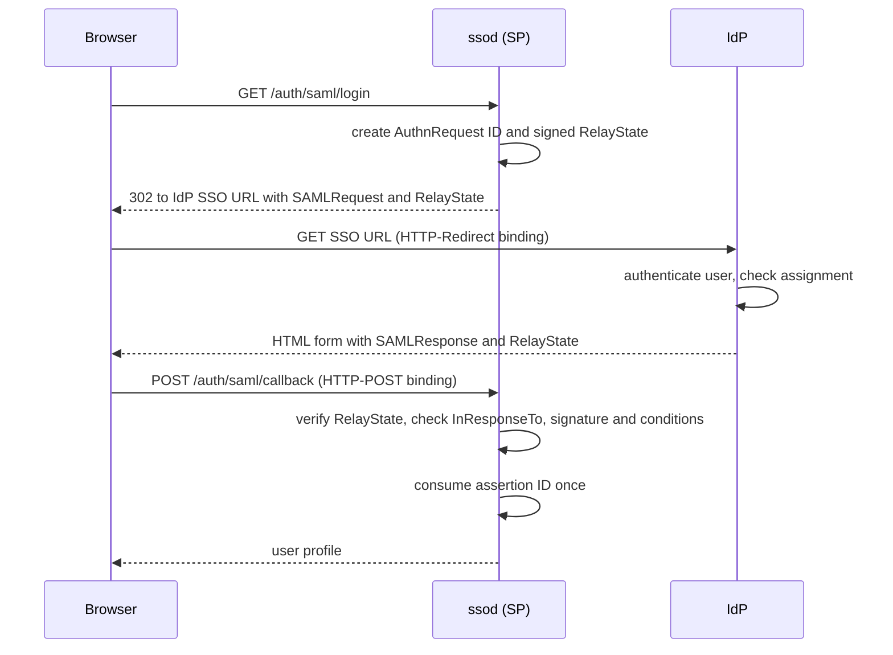

# Generic SAML 2.0 SSO Setup Guide

Step-by-step instructions for configuring **a SAML 2.0 identity provider (IdP)** against Universal SSO acting as the **service provider (SP)**: SP metadata, Assertion Consumer Service (ACS) URL, certificates, attribute mapping, and the validation rules the server must enforce. The guide is IdP-neutral and shows where Okta and Microsoft Entra ID differ. Other SAML IdPs (Keycloak, ADFS, Ping, Shibboleth, Google Workspace SAML apps) follow the same pattern.

> **Project status.** SAML 2.0 is **implemented** in `pkg/sso/saml` as SP-initiated Web Browser SSO (HTTP-Redirect request, HTTP-POST response). It is verified only against an in-process fake IdP (`pkg/sso/saml/samltest`), **never against a live IdP**, and only the Go example client can complete a SAML sign-in end to end (the other clients need OAuth `state` and PKCE parameters that a SAML redirect does not carry). **Not supported:** encrypted assertions (refused), IdP-initiated SSO (refused), Single Logout, SHA-1, refresh, revoke, userinfo and token validation (those return `UNSUPPORTED_METHOD`). The adapter does **not** serve SP metadata: you create it by hand (section 3.2). IdP metadata is not signature-checked: trust comes from where you load it, a local file or an https URL. `ssod` registers `saml` when `SSO_PROVIDERS_SAML_SP_ENTITY_ID` is set to a real value together with IdP metadata; SAML has no client id or secret. Validate your settings with `make provider-check P=saml`. The `make google-*` helpers are Google-only, so the manual checks in this guide use `curl`, `openssl`, `xmllint` and `python3`.

SAML consoles differ a lot between vendors. This guide names the **generic fields** every IdP asks for, and gives the exact labels for Okta and Entra ID. If a label differs in your IdP, match by meaning, and use the linked specifications as the source of truth.

## Contents

0. [Start here: stuck? Read this first](#start-here-stuck-read-this-first)
1. [How the pieces fit](#1-how-the-pieces-fit)
2. [Service provider and identity provider setup](#2-service-provider-and-identity-provider-setup)
3. [Certificates, metadata and ACS URLs](#3-certificates-metadata-and-acs-urls)
4. [Configuration values](#4-configuration-values)
5. [Verification and testing](#5-verification-and-testing)
6. [Security best practices](#6-security-best-practices)
7. [Troubleshooting](#7-troubleshooting)
8. [References](#8-references)

---

## Start here: stuck? Read this first

### Where people get stuck

| # | Symptom | Cause | Go to |
|---|---|---|---|
| 1 | `/auth/saml/login` returns 404 | `saml` is not registered: `SSO_PROVIDERS_SAML_SP_ENTITY_ID` is empty or still the placeholder, or no IdP metadata is set. Run `make provider-check P=saml` | [4.3](#43-env-layout), [7.7](#77-errors-returned-by-this-project) |
| 2 | "Which URL goes into the ACS field?" | `{SSO_SERVER_BASE_URL}/auth/saml/callback`. It is the SP's **POST** endpoint | [S2 below](#s2-the-four-values-every-idp-asks-for), [3.2](#32-acs-url-and-entity-id) |
| 3 | IdP says "Audience does not match" or "Invalid Issuer" | The SP Entity ID in the IdP differs from the one in the SP's config | [7.1](#71-audience-destination-and-entity-id-mismatch) |
| 4 | "Signature validation failed" | The IdP signing certificate is missing, expired, rotated, or the wrong element is signed | [7.2](#72-signature-validation-failed) |
| 5 | "The assertion is not yet valid" or "has expired" | Clock skew between the IdP and the server | [7.3](#73-clock-skew-notbefore-and-notonorafter) |
| 6 | The IdP shows an error before sign-in | The SP metadata or ACS URL was entered wrongly, or the user is not assigned | [7.4](#74-the-idp-rejects-the-request), [7.5](#75-user-not-assigned-and-nameid-problems) |
| 7 | "I get a `SAMLResponse` but cannot read it" | It is base64 XML. Decode it as in 5.3 | [5.3](#53-capture-and-decode-a-samlresponse) |
| 8 | Which variables does `.env` need? | `SSO_PROVIDERS_SAML_SP_ENTITY_ID` plus one of `_IDP_METADATA_URL` / `_IDP_METADATA_FILE`. The block is in `.env.example` | [4.3](#43-env-layout) |

### Fastest path (about 20 minutes)

Run each step and stop at the first one that fails.

```bash
# 0. One-time: create your private config and lock it down.
cp -n .env.example .env && chmod 600 .env
sed -i.bak "s|^SSO_STATE_SECRET=.*|SSO_STATE_SECRET=$(openssl rand -base64 48)|" .env && rm -f .env.bak

# 1. Generate the SP signing certificate (section 3.1). Skip if you only receive signed
#    responses and never sign requests.
mkdir -p _saml && chmod 700 _saml
openssl req -x509 -newkey rsa:2048 -sha256 -days 730 -nodes \
  -keyout _saml/sp.key -out _saml/sp.crt -subj "/CN=universal-sso-sp"
chmod 600 _saml/sp.key

# 2. In your IdP (steps S1 and S2 below), create a SAML app with the ACS URL and Entity ID,
#    then download or copy the IdP metadata (XML) and note the IdP SSO URL.

# 3. Validate the IdP metadata and check certificate expiry (section 5.1).
xmllint --noout idp-metadata.xml && echo "metadata is well-formed XML"

# 4. Trigger a login from the IdP (IdP-initiated) or craft a request (section 5.2),
#    capture the SAMLResponse and decode it (section 5.3).
```

A decoded response whose checks pass in 5.4 means the IdP side is correct. The last step is the end-to-end test through `ssod` (section 5.6).

### S1. Console navigation

| IdP | Where to create the SAML app | Where to find the IdP metadata |
|---|---|---|
| **Okta** | **Applications > Applications > Create App Integration > SAML 2.0** | App > **Sign On** tab > **SAML 2.0** > **Metadata URL** (or **Identity Provider metadata** link) |
| **Microsoft Entra ID** | **Identity > Applications > Enterprise applications > New application > Create your own application > Integrate any other application you don't find in the gallery**, then **Single sign-on > SAML** | **SAML Certificates** panel > **Federation Metadata XML** or **App Federation Metadata Url** |
| **Others** | Look for "SAML application", "Service provider", "Client (SAML)" or "Relying party" | Look for "IdP metadata", "Federation metadata" or "SAML descriptor" |

Expected values for local development:

| Field | Value |
|---|---|
| App name | `Universal SSO (dev)` |
| Single sign-on URL (ACS URL) | `http://localhost:8080/auth/saml/callback` |
| Audience URI (SP Entity ID) | `http://localhost:8080/auth/saml/metadata` |
| Name ID format | `EmailAddress` or `Persistent` (see 2.3) |
| Application username | Email, or the stable user ID |

> **Local HTTP.** Most IdPs accept `http://localhost` for the ACS URL on developer tenants. Production must use HTTPS.

### S2. The four values every IdP asks for

| IdP field names (varies) | What it is | Value for this project |
|---|---|---|
| Single sign-on URL, **ACS URL**, Reply URL, Assertion Consumer Service URL, Recipient | Where the IdP **POSTs** the signed response. The SP's `AssertionConsumerService` | `{SSO_SERVER_BASE_URL}/auth/saml/callback` |
| **Audience URI**, SP Entity ID, Identifier, Issuer of the SP | The SP's unique name. Appears in `<Audience>` and in the SP's request `<Issuer>` | `{SSO_SERVER_BASE_URL}/auth/saml/metadata` (any stable URI works; it need not be reachable) |
| Name ID format | How the user is identified | `urn:oasis:names:tc:SAML:1.1:nameid-format:emailAddress` or `urn:oasis:names:tc:SAML:2.0:nameid-format:persistent` |
| Default Relay State, Sign on URL | Optional. Where the user lands, or an SP-initiated start URL | Leave empty |

The Entity ID is only a **name**. It does not need to resolve on the web, but it must be **identical** in the IdP and in `.env` (character for character, including scheme and trailing slash).

### S3. SP-initiated versus IdP-initiated

| Flow | Starts at | Notes |
|---|---|---|
| **SP-initiated** | `GET /auth/saml/login` on `ssod`, which sends an `AuthnRequest` | Recommended. The response carries `InResponseTo`, which the server checks against the request it made. The state is bound to the browser session |
| **IdP-initiated** | The user clicks the app tile at the IdP | There is no `AuthnRequest`, so no `InResponseTo` to check. This weakens replay and CSRF protection. `ssod` refuses it: a response whose `RelayState` is not one it issued is rejected with `STATE_MISMATCH` |

### S4. The browser shows "This site can't be reached" after sign-in

This happens when the ACS URL registered at the IdP does not reach `ssod`, for example it points at another host or port, or `ssod` is not running. `ssod` handles `POST /auth/saml/callback`. To capture the `SAMLResponse` for inspection anyway, use your browser's developer tools network tab (**Preserve log** on) and copy the form field `SAMLResponse` from the POST request, or use a browser extension such as "SAML-tracer". Then follow 5.3.

### S5. Test users and assignment

Almost every IdP requires you to **assign** users or groups to the SAML app. If a user signs in at the IdP but sees "not assigned", "access denied" or an empty page, check the assignment first (Okta: **Assignments** tab. Entra: **Users and groups** and **Assignment required**).

---

## 1. How the pieces fit

SAML 2.0 is an XML-based single sign-on protocol. The user's **browser** carries signed XML messages between the **service provider** (this project, `ssod`) and the **identity provider** (the IdP). Unlike OIDC there is no back-channel token call: the signed **assertion** travels through the browser, so its **signature and conditions** are the whole security of the flow.

Universal SSO uses **SP-initiated Web Browser SSO** with the **HTTP-Redirect** binding for the request and the **HTTP-POST** binding for the response.



What you configure maps to exactly three things:

| You configure | Why the application needs it |
|---|---|
| A **SAML app** at the IdP with the SP's **ACS URL** and **Entity ID** | The IdP only sends responses to registered ACS URLs, addressed to that audience |
| The **IdP metadata** (entity ID, SSO URL, signing certificate) in the SP | The SP must know where to send requests and which key to trust |
| **Attribute and NameID mapping** | Decides which user ID, email and name arrive in the assertion |

SAML elements and URNs used (all from the OASIS specifications in section 8):

| Item | Value |
|---|---|
| Request binding | `urn:oasis:names:tc:SAML:2.0:bindings:HTTP-Redirect` |
| Response binding | `urn:oasis:names:tc:SAML:2.0:bindings:HTTP-POST` |
| NameID (email) | `urn:oasis:names:tc:SAML:1.1:nameid-format:emailAddress` |
| NameID (stable) | `urn:oasis:names:tc:SAML:2.0:nameid-format:persistent` |
| NameID (per session) | `urn:oasis:names:tc:SAML:2.0:nameid-format:transient` |
| Success status | `urn:oasis:names:tc:SAML:2.0:status:Success` |
| Other status codes | `Requester`, `Responder`, `VersionMismatch`, `AuthnFailed`, `NoPassive`, `InvalidNameIDPolicy`, `RequestDenied`, `UnsupportedBinding`, `UnknownPrincipal` (all under the same `urn:oasis:names:tc:SAML:2.0:status:` prefix) |

The SP publishes its own **metadata** XML (`EntityDescriptor` with `SPSSODescriptor`, `AssertionConsumerService`, and a `KeyDescriptor`) so the IdP can be configured by import. The adapter does **not** serve it: `ssod` has no `/auth/saml/metadata` endpoint. Create the file by hand (section 3.2) or type the values into the IdP console. The SP entity ID is only an identifier and does not have to be a reachable URL.

---

## 2. Service provider and identity provider setup

### 2.1 Prerequisites

- An IdP tenant where you can create SAML applications (Okta developer org, Entra tenant, Keycloak realm, and so on).
- An administrator role that can create applications and assign users.
- For real deployments, an HTTPS URL for the SP. The ACS URL, and later the SP metadata URL, must be reachable by the user's browser. They do **not** need to be reachable by the IdP, because the response travels through the browser.
- `openssl` (certificates), `xmllint` (part of libxml2, preinstalled on macOS and most Linux), `python3`, `curl`.
- Use **one SAML app per environment** (dev, staging, production) so entity IDs, certificates and assignments stay isolated.

### 2.2 Create the SAML application at the IdP

**Okta**

1. **Applications > Applications > Create App Integration**, choose **SAML 2.0**, click **Next**.
2. **App name**: `Universal SSO (dev)`. Click **Next**.
3. **Single sign-on URL**: `http://localhost:8080/auth/saml/callback`. Keep **Use this for Recipient URL and Destination URL** checked.
4. **Audience URI (SP Entity ID)**: `http://localhost:8080/auth/saml/metadata`.
5. **Name ID format**: `EmailAddress` or `Persistent`. **Application username**: `Email` (or `Okta username`).
6. **Attribute statements**: add `email` (`user.email`), `firstName` (`user.firstName`), `lastName` (`user.lastName`).
7. **Signed Responses / Assertions**: under **Show Advanced Settings** set **Response** and **Assertion Signature** to **Signed**.
8. Finish, then assign users on the **Assignments** tab.

**Microsoft Entra ID**

1. **Enterprise applications > New application > Create your own application**, choose **Integrate any other application you don't find in the gallery (Non-gallery)**.
2. Open **Single sign-on > SAML**.
3. **Basic SAML Configuration**: **Identifier (Entity ID)** = `http://localhost:8080/auth/saml/metadata`. **Reply URL (Assertion Consumer Service URL)** = `http://localhost:8080/auth/saml/callback`. **Sign on URL** and **Relay State** are optional.
4. **Attributes & Claims**: the default Name ID is `user.userprincipalname`. Change it to `user.mail` or keep UPN, and decide which attribute is the stable key (6.5).
5. **Users and groups**: assign users. If **Assignment required** is on, unassigned users fail with `AADSTS50105`.

**Other IdPs.** Use the generic fields from S2. The labels differ but the four values do not.

### 2.3 Name ID and attributes

| Choice | Use when | Notes |
|---|---|---|
| `emailAddress` | You trust the IdP to verify email and the address is stable | Simple. The address can change |
| `persistent` | You need a stable opaque identifier | Preferred as the user key. The IdP generates it per SP |
| `transient` | Anonymous sessions | Changes on every login. Not usable as a user key |
| `unspecified` | The IdP decides | Avoid unless you know what it sends |

Attributes the application will read (names vary, so map them at the IdP):

| Attribute (suggested name) | Maps to | Notes |
|---|---|---|
| `email` | `Claims.Email` | Check the IdP actually verifies it |
| `firstName`, `lastName` or `displayName` | `Claims.Name` | Display only |
| `groups` | Authorization | Optional. Entra overage applies (150 groups for SAML) |

### 2.4 Signing and encryption choices

| Setting | Recommended value | Reason |
|---|---|---|
| IdP signs the **Response** | Yes | Protects the whole message |
| IdP signs the **Assertion** | Yes | The signature that matters most. The SP must verify at least one that covers the assertion it uses |
| Assertion **encryption** | Optional. Off for first tests | Needs the SP's encryption certificate (3.1). Adds protection if HTTPS terminates before the SP |
| SP signs the **AuthnRequest** | Optional | Needed only if the IdP demands signed requests (`WantAuthnRequestsSigned`). Uses the Redirect-binding `SigAlg` and `Signature` query parameters |
| Signature algorithm | **RSA-SHA256** | SHA-1 is deprecated. Refuse it |
| Digest algorithm | **SHA-256** | Same |

---

## 3. Certificates, metadata and ACS URLs

### 3.1 Certificates and keys

Two kinds of keys appear in SAML:

| Key | Owner | Purpose | Where it lives |
|---|---|---|---|
| **IdP signing certificate** (public) | IdP | The SP verifies assertion signatures with it | Inside the IdP metadata (`KeyDescriptor use="signing"`) |
| **SP signing certificate and private key** | SP | Optional: signs `AuthnRequest`s and `LogoutRequest`s | `_saml/sp.crt`, `_saml/sp.key`. The key is a secret |
| **SP encryption certificate and key** | SP | Optional: decrypts encrypted assertions | Same pair can be reused, or use a second pair |

Generate a self-signed SP certificate. A SAML certificate is a key container, so a self-signed one is normal:

```bash
mkdir -p _saml && chmod 700 _saml
openssl req -x509 -newkey rsa:2048 -sha256 -days 730 -nodes \
  -keyout _saml/sp.key -out _saml/sp.crt -subj "/CN=universal-sso-sp"
chmod 600 _saml/sp.key
openssl x509 -in _saml/sp.crt -noout -subject -enddate
```

Keep `_saml/` out of git. The repository's `.gitignore` already ignores `.env` and every folder whose name starts with `_`, so `_saml/` is covered. Confirm with `git check-ignore _saml/sp.key` before you create the key.

Certificate lifetime: IdP signing certificates expire. Entra's default is **three years**. When the IdP rotates, the new certificate appears in the metadata, so reload the metadata regularly (6.3).

### 3.2 ACS URL and Entity ID

This project serves the callback (ACS) at:

```text
POST {SSO_SERVER_BASE_URL}/auth/{provider}/callback
```

With the provider ID `saml`:

| Environment | ACS URL | SP Entity ID (example) |
|---|---|---|
| Local development | `http://localhost:8080/auth/saml/callback` | `http://localhost:8080/auth/saml/metadata` |
| Staging | `https://sso-staging.<your-domain>/auth/saml/callback` | `https://sso-staging.<your-domain>/auth/saml/metadata` |
| Production | `https://sso.<your-domain>/auth/saml/callback` | `https://sso.<your-domain>/auth/saml/metadata` |

Unlike OIDC, SAML delivers the response by **POST**, not GET. Matching is strict: the IdP checks the ACS URL against its registered list, and the SP checks `Destination` and `Recipient` against its own ACS URL.

A minimal **SP metadata** document you can import into an IdP that accepts a file (replace the placeholders):

```xml
<?xml version="1.0" encoding="UTF-8"?>
<EntityDescriptor xmlns="urn:oasis:names:tc:SAML:2.0:metadata"
                  entityID="http://localhost:8080/auth/saml/metadata">
  <SPSSODescriptor AuthnRequestsSigned="false" WantAssertionsSigned="true"
                   protocolSupportEnumeration="urn:oasis:names:tc:SAML:2.0:protocol">
    <NameIDFormat>urn:oasis:names:tc:SAML:1.1:nameid-format:emailAddress</NameIDFormat>
    <AssertionConsumerService index="0" isDefault="true"
        Binding="urn:oasis:names:tc:SAML:2.0:bindings:HTTP-POST"
        Location="http://localhost:8080/auth/saml/callback"/>
  </SPSSODescriptor>
</EntityDescriptor>
```

Add a `<KeyDescriptor use="signing">` with your `sp.crt` (base64 body without the PEM header lines) if you sign requests or want the IdP to verify them.

### 3.3 Metadata and changes can take time

- **IdP metadata** is the source of truth for the IdP entity ID, SSO URL and signing certificate. Prefer a **metadata URL** over a pasted certificate, so rotations are picked up.
- Some IdPs cache SP metadata for minutes to hours. If a fix does not take effect, wait a few minutes and retry.
- After changing certificates at either side, restart the login from the start. Responses already in flight use the old key.

---

## 4. Configuration values

### 4.1 Values obtained from the IdP

| Value | Where to find it | Example shape |
|---|---|---|
| **IdP Entity ID** (Issuer) | IdP metadata `EntityDescriptor@entityID` | URL or URN, IdP-specific |
| **IdP SSO URL** | IdP metadata `SingleSignOnService@Location` (Redirect binding) | `https://<idp-host>/.../sso/saml` |
| **IdP signing certificate** | IdP metadata `KeyDescriptor use="signing"` | X.509, base64 |
| **IdP metadata URL** or file | Okta: app > Sign On > Metadata URL. Entra: SAML Certificates > App Federation Metadata Url | `https://<idp-host>/.../metadata` |
| Attribute names | IdP attribute mapping | `email`, `firstName`, ... |

### 4.2 Values you choose

| Value | Purpose |
|---|---|
| `SSO_STATE_SECRET` | Local HMAC key (32+ bytes) that signs the `RelayState`. Not a SAML value. Generate it yourself |
| `SSO_SERVER_BASE_URL` | Public base URL. The ACS URL must be this plus `/auth/saml/callback` |
| SP Entity ID | Any stable URI. Must be identical in the IdP |
| SP key pair | Section 3.1 |

### 4.3 `.env` layout

> **Implemented.** These are the variables `ssod` reads (`cmd/ssod/vendors.go`), and the same block is in `.env.example`. SAML stays switched off while the entity ID is empty or ends in `-placeholder`. Set exactly one of the two metadata variables. A file is parsed at start-up and a bad file stops `ssod`; a URL (https, or http for localhost) is fetched lazily and cached for one hour. `ACS_URL` defaults to `<SSO_SERVER_BASE_URL>/auth/saml/callback`. `SP_CERT_FILE` and `SP_KEY_FILE` are optional, must be set together, and the RSA key must be at least 2048 bits.

```bash
# --- Server ---
SSO_SERVER_HOST=127.0.0.1
SSO_SERVER_PORT=8080
SSO_SERVER_BASE_URL=http://localhost:8080
SSO_STATE_SECRET=<output of: openssl rand -base64 48>

# --- SAML 2.0 (values from your IdP) ---
SSO_PROVIDERS_SAML_IDP_METADATA_URL=https://<idp-host>/<path-to-metadata>
# Alternative to the URL: a local copy of the metadata file
# SSO_PROVIDERS_SAML_IDP_METADATA_FILE=./_saml/idp-metadata.xml
SSO_PROVIDERS_SAML_SP_ENTITY_ID=http://localhost:8080/auth/saml/metadata
SSO_PROVIDERS_SAML_ACS_URL=http://localhost:8080/auth/saml/callback
# Optional: sign AuthnRequests
# SSO_PROVIDERS_SAML_SP_CERT_FILE=./_saml/sp.crt
# SSO_PROVIDERS_SAML_SP_KEY_FILE=./_saml/sp.key
```

Rules for this file:

- `scripts/start.sh` loads it with the shell, so use only `KEY=VALUE` lines. Quote any value that contains spaces or shell characters.
- `SSO_PROVIDERS_SAML_ACS_URL` must equal the ACS URL registered at the IdP character for character, and equal `SSO_SERVER_BASE_URL` plus `/auth/saml/callback`.
- `SSO_PROVIDERS_SAML_SP_ENTITY_ID` must equal the Audience or Identifier at the IdP exactly.
- Key files hold secrets. Reference their **path** in `.env`, never the key content, and keep them out of git.
- `.env` is already git-ignored. `.env.example` is the only variant that is committed, and it must contain placeholders only.

### 4.4 How the values are used

| Value | Used in |
|---|---|
| IdP metadata | Provides the IdP entity ID (expected `Issuer`), SSO URL (where requests go), and signing certificate (signature trust) |
| SP Entity ID | The `Issuer` of the `AuthnRequest` and the required `Audience` of each assertion |
| ACS URL | The `AssertionConsumerServiceURL` of the request, and the required `Destination` and `Recipient` of the response |
| SP key pair | Signs requests, and decrypts assertions when encryption is on |
| State secret | Signs and verifies the `RelayState` (see [`pkg/sso/state.go`](../pkg/sso/state.go)) |

---

## 5. Verification and testing

These checks use only `curl`, `openssl`, `xmllint`, a browser, and `python3`. They validate the SAML configuration independently of the application code.

> **Note.** The `make google-*` helpers do not support SAML. `make provider-check P=saml [--online]` validates the SAML settings in `.env` (entity id, metadata, key pairing, ACS URL) and the steps below are the manual IdP-side checks.

### 5.1 Validate the IdP metadata and certificate

```bash
# Download (skip if you have the file already)
curl -s "https://<idp-host>/<path-to-metadata>" -o idp-metadata.xml

# Well-formed XML?
xmllint --noout idp-metadata.xml && echo "OK: well-formed"

# Entity ID, SSO URL and bindings
xmllint --format idp-metadata.xml | grep -E 'entityID|SingleSignOnService|NameIDFormat'

# Extract the signing certificate and check its expiry and fingerprint
python3 - <<'EOF'
import re, textwrap
xml = open('idp-metadata.xml', encoding='utf-8').read()
m = re.search(r'<(?:\w+:)?X509Certificate>\s*([^<]+?)\s*</', xml)
b64 = re.sub(r'\s+', '', m.group(1))
open('/tmp/idp.crt', 'w').write('-----BEGIN CERTIFICATE-----\n' + '\n'.join(textwrap.wrap(b64, 64)) + '\n-----END CERTIFICATE-----\n')
EOF
openssl x509 -in /tmp/idp.crt -noout -subject -issuer -enddate -fingerprint -sha256
rm -f /tmp/idp.crt
```

Check these:

| Item | Must be |
|---|---|
| `entityID` | The value you will configure as the expected IdP issuer |
| `SingleSignOnService` with `HTTP-Redirect` | Present. Its `Location` is the URL the SP redirects to |
| Certificate `notAfter` | In the future, with time to spare. Note the date for rotation (6.3) |
| Signature algorithm of the certificate | `sha256WithRSAEncryption` or stronger |

A download failure is a network or proxy problem. A 404 means the metadata URL is wrong.

### 5.2 Start a login and see the request

To see what the IdP receives, you can build an `AuthnRequest` by hand (the adapter builds the same kind of request, deflated and base64-encoded, in `Login`). The HTTP-Redirect binding encodes the XML as **raw DEFLATE, then base64, then URL-encoding**:

```bash
python3 - <<'EOF'
import base64, zlib, uuid, datetime, urllib.parse
acs = 'http://localhost:8080/auth/saml/callback'
sp = 'http://localhost:8080/auth/saml/metadata'
sso = 'https://<idp-host>/<sso-path>'
req_id = '_' + uuid.uuid4().hex
now = datetime.datetime.now(datetime.timezone.utc).strftime('%Y-%m-%dT%H:%M:%SZ')
xml = (f'<samlp:AuthnRequest xmlns:samlp="urn:oasis:names:tc:SAML:2.0:protocol" '
       f'xmlns:saml="urn:oasis:names:tc:SAML:2.0:assertion" ID="{req_id}" Version="2.0" '
       f'IssueInstant="{now}" Destination="{sso}" '
       f'ProtocolBinding="urn:oasis:names:tc:SAML:2.0:bindings:HTTP-POST" '
       f'AssertionConsumerServiceURL="{acs}">'
       f'<saml:Issuer>{sp}</saml:Issuer></samlp:AuthnRequest>')
raw = zlib.compress(xml.encode())[2:-4]   # strip the zlib header and checksum -> raw DEFLATE
q = urllib.parse.urlencode({'SAMLRequest': base64.b64encode(raw).decode(), 'RelayState': 'manual-test-1'})
print('Request ID:', req_id)
print(sso + '?' + q)
EOF
```

Open the printed URL in a browser. Results:

| What you see | Meaning |
|---|---|
| IdP login page | The IdP accepted the request and knows the SP |
| IdP error about an unknown SP, audience or ACS | The Entity ID or ACS URL is not registered at the IdP (section 7.4) |
| IdP error about a signature | The IdP requires signed requests. Sign the request or turn that setting off for the test |
| "Not assigned" or "access denied" after login | The user is not assigned to the app (S5) |

### 5.3 Capture and decode a SAMLResponse

After sign-in the IdP returns an HTML form that auto-posts a `SAMLResponse` field to your ACS URL. Capture that field with the browser developer tools (Network tab, **Preserve log**, find the `POST` to `/auth/saml/callback`, copy the `SAMLResponse` form value) or with SAML-tracer. Save it to a file and decode it:

```bash
# paste the value into saml_response.txt first (one line, no URL-encoding)
python3 - <<'EOF'
import base64, urllib.parse
v = open('saml_response.txt').read().strip()
v = urllib.parse.unquote_plus(v)      # undo form encoding if you copied it raw
open('/tmp/saml_response.xml', 'wb').write(base64.b64decode(v))
EOF
xmllint --format /tmp/saml_response.xml | head -80
```

A `SAMLResponse` is plain base64 here (HTTP-POST binding does **not** deflate). Delete the file when you are done because it contains personal data.

### 5.4 Check the response against the validation checklist

These are the checks the adapter performs (section 6.4). Do them by hand once so you know what "correct" looks like:

```bash
python3 - <<'EOF'
import xml.etree.ElementTree as ET
ns = {'p': 'urn:oasis:names:tc:SAML:2.0:protocol', 'a': 'urn:oasis:names:tc:SAML:2.0:assertion'}
r = ET.parse('/tmp/saml_response.xml').getroot()
print('Destination        =', r.get('Destination'))
print('InResponseTo       =', r.get('InResponseTo'))
print('Status             =', r.find('p:Status/p:StatusCode', ns).get('Value'))
print('Response Issuer    =', (r.find('a:Issuer', ns).text if r.find('a:Issuer', ns) is not None else None))
a = r.find('a:Assertion', ns)
print('Assertion ID       =', a.get('ID'))
print('Assertion Issuer   =', a.find('a:Issuer', ns).text)
print('NameID             =', a.find('a:Subject/a:NameID', ns).text, a.find('a:Subject/a:NameID', ns).get('Format'))
scd = a.find('a:Subject/a:SubjectConfirmation/a:SubjectConfirmationData', ns)
print('Recipient          =', scd.get('Recipient'))
print('SCD NotOnOrAfter   =', scd.get('NotOnOrAfter'))
c = a.find('a:Conditions', ns)
print('NotBefore          =', c.get('NotBefore'))
print('NotOnOrAfter       =', c.get('NotOnOrAfter'))
print('Audience           =', c.find('a:AudienceRestriction/a:Audience', ns).text)
for at in a.findall('a:AttributeStatement/a:Attribute', ns):
    print('Attribute', at.get('Name'), '=', [v.text for v in at.findall('a:AttributeValue', ns)])
EOF
rm -f /tmp/saml_response.xml saml_response.txt
```

Compare with what the server must enforce:

| Element | Must be |
|---|---|
| `Status/StatusCode` | `urn:oasis:names:tc:SAML:2.0:status:Success` |
| `Destination` (Response) | Your ACS URL exactly |
| `InResponseTo` | The ID of the `AuthnRequest` you made (5.2). Absent only for IdP-initiated flows |
| `Issuer` | The IdP entity ID from the metadata |
| `Recipient` (SubjectConfirmationData) | Your ACS URL exactly |
| `NotBefore` / `NotOnOrAfter` | Now is inside the window, allowing about ±60 s of clock skew |
| `Audience` | Your SP Entity ID exactly |
| Signature | Present on the Response or the Assertion, valid against the IdP certificate |
| Assertion `ID` | Never seen before (replay cache until `NotOnOrAfter`) |

This step reads the XML for inspection and does **not** verify signatures. Signature verification must use a SAML library with XML canonicalization (xmlsec, or Go's `crewjam/saml` or `russellhaering/goxmldsig`). Never write your own.

### 5.5 Local server checks that need no IdP

```bash
export SSO_STATE_SECRET=$(openssl rand -base64 48)
make start
curl -s http://127.0.0.1:8080/healthz
curl -s http://127.0.0.1:8080/providers
curl -s -o /dev/null -w "%{http_code}\n" "http://127.0.0.1:8080/auth/saml/login"                    # 404 unless saml is configured, else 302 to the IdP
curl -s -o /dev/null -w "%{http_code}\n" "http://127.0.0.1:8080/auth/mock/callback?state=forged"   # 400
make stop
```

The `mock` provider exercises the same state and replay protections that the SAML provider uses.

### 5.6 End-to-end test through `ssod`

Everything the project could verify without a live IdP is covered by `bash tests/e2e.sh` (the Go client signs in through `ssod` and the fake IdP in `pkg/sso/saml/samltest`, a forged or missing `RelayState` is refused). The steps below are the manual run against your real IdP, which has **not** been done for this project.

1. Fill in `.env` as in 4.3 and run `make start`. The log should show `saml` among the providers.
2. Open `http://localhost:8080/auth/saml/login` in a browser.
3. You should be redirected to the IdP, sign in, and land on `/auth/saml/callback`, which returns JSON with your user profile (no assertion).
4. Replay the same `SAMLResponse` (resend the POST). It must fail, because the assertion ID and the state are single use.
5. Tamper with the response (change the `NameID` and re-post). It must fail with `SIGNATURE_INVALID`.
6. Repeat with an unassigned user and confirm the IdP blocks it.

---

## 6. Security best practices

### 6.1 Protect keys and the state secret

- The SP private key and `SSO_STATE_SECRET` are secrets. Keep them only in `.env` or a protected folder (`chmod 600`) locally, and in a secrets manager elsewhere. Never in source, tickets, chat, or container image layers.
- Keep `_saml/` out of git. Before every push, run `bash .bob/skills/secure-config/scripts/scan_secrets.sh .` to catch accidental leaks. The scanner will flag a PEM private key.
- Never log the `SAMLResponse`, assertions, or key material. They contain personal data. Log the provider ID and error codes only.
- The IdP **public** certificate is not secret. It is public by design.

### 6.2 Use a secrets manager outside local development

| Platform | Mechanism |
|---|---|
| Kubernetes | `Secret` objects mounted as files or environment variables, ideally synced from an external secrets store |
| Cloud runtimes | The platform's secret manager referenced by the service definition |
| Containers | Runtime secret mounts for the key file, never `COPY` the key into an image |
| CI/CD | The pipeline's masked secret variables |

### 6.3 Rotate certificates and respond to leaks

- **IdP signing certificate**: it expires (Entra's default is three years). Use the **metadata URL** and reload it periodically, and keep both the old and the new certificate trusted during a rotation window.
- **SP key pair**: create a new key, publish the new metadata, wait for the IdP to pick it up, then retire the old key.
- If the SP key may have leaked, generate a new pair and update the IdP right away. If the IdP's signing key leaked, the IdP must rotate it, and you must remove the old certificate from trust.
- Put certificate expiry dates in a calendar or monitor them (`openssl x509 -enddate`).

### 6.4 Keep the SAML flow hardened

SAML attacks target XML parsing and signature handling. `pkg/sso/saml` implements each control below, each with a unit test against the fake IdP:

| Control | Status in this project |
|---|---|
| Signed, expiring, single-use `RelayState` (CSRF protection) | Implemented in `pkg/sso/state.go`, reusable for SAML |
| Verify the signature on the Response or the Assertion against the trusted IdP certificate | Implemented (goxmldsig, certificates from the metadata) |
| Defend against **XML Signature Wrapping**: use only the element the signature actually covers (resolve by `ID` reference) | Implemented: exactly one reference to the signed element, and only the verified copy is read. See `Docs/Architecture.md` |
| Reject DTDs and external entities (**XXE**), and cap the message size | Implemented (1 MiB cap, `<!DOCTYPE` and `<!ENTITY` refused before parsing) |
| Check `Destination`, `Recipient`, `Audience`, `Issuer` | Implemented |
| Check `NotBefore` and `NotOnOrAfter` with about ±60 s skew | Implemented |
| Check `InResponseTo` against the pending request, and consume it once | Implemented (own `state` to request-ID map, 15 minute TTL) |
| Assertion ID replay cache until `NotOnOrAfter` | Implemented |
| Reject SHA-1 signatures and weak keys | Implemented (SHA-1 refused, RSA under 2048 bits refused) |
| Refuse unsolicited (IdP-initiated) responses by default | Implemented |
| HTTPS in every non-local environment | Required, because the response carries identity data through the browser |

### 6.5 Identify users correctly

- Use the **`NameID`** with format `persistent`, or a dedicated immutable attribute, as the permanent user key. Scope it by **IdP entity ID**, so two IdPs cannot collide.
- `email` is an attribute. Check that the IdP verifies it before trusting it. Never link accounts or grant access on an email address alone.
- Do not use `transient` NameIDs as keys. They change on each login.
- Entra: the default NameID is the UPN, which can change. Prefer a stable object ID attribute for the user key.

### 6.6 Least privilege

- Release only the attributes you use (`email`, a name, and groups if you authorize with them).
- Assign only the users or groups that need access.
- Use separate IdP applications, entity IDs, certificates and keys for dev, staging and production.
- Keep the ACS URL list to the minimum. Remove `localhost` from the production app.

---

## 7. Troubleshooting

Start with the exact message the IdP or the server returns, and use the IdP's own log (Okta **Reports > System Log**, Entra **Sign-in logs**) to see why it rejected a request. Most problems are one of the cases below.

| Message | Meaning | Go to |
|---|---|---|
| "Audience does not match", "Invalid Issuer", `Destination mismatch` | Entity ID or ACS URL differs | [7.1](#71-audience-destination-and-entity-id-mismatch) |
| "Signature validation failed" | Certificate or signed-element problem | [7.2](#72-signature-validation-failed) |
| "Assertion not yet valid", "Assertion expired" | Clock skew | [7.3](#73-clock-skew-notbefore-and-notonorafter) |
| IdP error page before login | SP not registered or request malformed | [7.4](#74-the-idp-rejects-the-request) |
| "Not assigned", "access denied", wrong NameID | Assignment or mapping | [7.5](#75-user-not-assigned-and-nameid-problems) |
| `InResponseTo` mismatch | Response for another request, or unsolicited | [7.6](#76-inresponseto-relaystate-and-replay-problems) |

### 7.1 Audience, Destination and Entity ID mismatch

| Check | Fix |
|---|---|
| `Audience` in the assertion vs `SSO_PROVIDERS_SAML_SP_ENTITY_ID` | Make them identical, including scheme and trailing slash |
| `Destination` and `Recipient` vs `SSO_PROVIDERS_SAML_ACS_URL` | Make them identical to the ACS URL registered at the IdP |
| `Issuer` vs the IdP entity ID in the metadata | Reload the metadata. A tenant or app change can alter the issuer |
| `http` vs `https` | The IdP records the scheme you registered |
| Trailing slash, port, case | `/callback` and `/callback/` are different. `localhost:8080` and `localhost:3000` differ |
| Wrong app | You may be posting to the ACS of another environment |
| Behind a proxy | The server may build `http://` while the public URL is `https://`. Set `SSO_PROVIDERS_SAML_ACS_URL` explicitly |

### 7.2 Signature validation failed

| Cause | Fix |
|---|---|
| The IdP rotated its signing certificate | Reload the metadata. Trust the new certificate |
| The certificate in `.env` or the metadata is expired | Refresh it from the IdP (5.1 shows the expiry) |
| Only the Response is signed and the server checks the Assertion (or the reverse) | Sign both at the IdP, or check whichever is signed |
| Signature algorithm is SHA-1 | Change the IdP to RSA-SHA256 |
| The XML was changed in transit (whitespace, re-serialization, a proxy) | Pass the raw bytes to the verifier and canonicalize per the XML-DSig rules |
| Wrong certificate (SP certificate used instead of IdP) | Use the **IdP** signing certificate |
| Encrypted assertion cannot be decrypted | Upload the correct SP encryption certificate to the IdP |

### 7.3 Clock skew, NotBefore and NotOnOrAfter

| Symptom | Cause | Fix |
|---|---|---|
| "Assertion is not yet valid" | The server's clock is behind the IdP's | Enable NTP (`timedatectl` or `sntp`) |
| "Assertion has expired" | The server's clock is ahead, or the user waited too long on the IdP page | Sync the clock. Restart the login |
| Works on a laptop, fails in a container | Container or VM clock drift | Sync the host clock |

SAML assertions live for minutes, so a skew of more than about 60 seconds already causes failures. Check with `date -u` on the server and compare to a time service.

### 7.4 The IdP rejects the request

| Message | Cause | Fix |
|---|---|---|
| "Unknown service provider", "Issuer not found" | SP Entity ID not registered at the IdP | Register the exact entity ID (S2) |
| "ACS URL not allowed" | The request's `AssertionConsumerServiceURL` is not in the IdP's list | Add the URL, or omit it from the request so the IdP uses the default |
| "Signature required" or `WantAuthnRequestsSigned` | The IdP demands signed requests | Provide the SP certificate and sign the redirect request (2.4), or turn the setting off for tests |
| `UnsupportedBinding` | The request binding is not enabled | Use HTTP-Redirect for the request and HTTP-POST for the response |
| `InvalidNameIDPolicy` | The requested NameID format is not available | Match the NameID format configured at the IdP |
| `RequestDenied`, `AuthnFailed` | The IdP refused or authentication failed | Check the IdP's log |

### 7.5 User not assigned and NameID problems

| Message | Cause | Fix |
|---|---|---|
| Okta "User is not assigned" or Entra `AADSTS50105` | No assignment | Assign the user or group (S5) |
| NameID is empty or an unexpected value | The IdP maps another attribute | Fix **Application username** (Okta) or the Name identifier claim (Entra) |
| Missing `email`, `firstName`, `lastName` | No attribute statements | Add them in the IdP mapping (2.3) |
| `groups` missing | Not configured, or Entra overage (more than 150 groups for SAML) | Use group filters or app roles |
| The user key changes | A `transient` NameID, or a UPN that changed | Use `persistent` or an immutable attribute (6.5) |

### 7.6 `InResponseTo`, `RelayState` and replay problems

| Message | Cause | Fix |
|---|---|---|
| `InResponseTo` does not match | The response answers a different (older) request, or the browser used a stale tab | Restart the login. Do not open two logins in one browser session |
| `STATE_MISMATCH` on the callback | `RelayState` forged, replayed, or consumed already | Restart the login |
| `STATE_EXPIRED` | The user took longer than the state lifetime | Restart the login |
| Response accepted twice | Not expected: the assertion ID is cached and the `RelayState` is single use | The second post is refused. Restart the login |
| IdP-initiated response rejected | No `InResponseTo`, no pending request | Use SP-initiated login, or enable unsolicited responses explicitly (not recommended) |

### 7.7 Errors returned by this project

| Server error code | HTTP | Typical meaning |
|---|---|---|
| `STATE_MISMATCH` | 400 | Forged, replayed, or already-used `RelayState`, or state issued for a different provider. Restart login |
| `STATE_EXPIRED` | 400 | The signed state exceeded its lifetime (10 minutes by default). Restart login |
| `IDP_REJECTED` | 401 | The response status was not `Success` (for example `AuthnFailed`, `RequestDenied`) |
| `PROVIDER_NOT_FOUND` | 404 | The provider ID in the URL is not registered. For `saml` this means the entity ID or the IdP metadata is not configured |
| `UNSUPPORTED_METHOD` | 501 | Refresh, revoke, userinfo or token validation was requested: SAML does not support them |
| `INVALID_CONFIG` | 500 | Startup problem, such as `SSO_STATE_SECRET` shorter than 32 bytes, or unreadable IdP metadata or key files |
| `NETWORK_FAILURE` | 502 | `ssod` could not fetch the IdP metadata, or got an unexpected reply. Check connectivity and proxy settings |
| `SIGNATURE_INVALID` / `INVALID_TOKEN` / `TOKEN_EXPIRED` | 401 | The assertion failed verification (signature, issuer, audience, destination, time window, replay). Check the entity IDs, the certificate, and the clock |
| `UNAUTHORIZED` | 401 | Sign-in succeeded at the IdP but the account is not allowed by the application's own rules |

### 7.8 Localhost versus production confusion

| Symptom | Cause | Fix |
|---|---|---|
| Works locally, `Destination` or ACS error in production | Only the `localhost` ACS is registered | Add the production ACS URL to the IdP app for that environment (section 3.2) |
| Works in production, fails locally | The local ACS is not registered, or `.env` still holds the production URL | Register `http://localhost:8080/auth/saml/callback` on the dev app |
| `http://` rejected for a real domain | The IdP requires HTTPS | Use `https://` and a domain name |
| Behind a TLS-terminating proxy, the server builds `http://` URLs | The proxy hides the original scheme | Set `SSO_PROVIDERS_SAML_ACS_URL` explicitly |
| Same IdP app reused across environments | One leaked key or certificate affects everything, and the entity ID collides | Use one app, entity ID and key pair per environment |
| Dev IdP metadata in a production `.env` | Copy and paste between environments | Check `SSO_PROVIDERS_SAML_IDP_METADATA_URL` per environment |

### 7.9 CORS errors in the browser console

SAML's Web Browser SSO is **navigation only**: the browser follows a redirect, then submits an HTML form. No `fetch` or `XHR` is involved, so CORS does not apply to the normal flow. If you see CORS errors:

| You see | Cause | Fix |
|---|---|---|
| `blocked by CORS policy` on the IdP SSO URL | Front-end JavaScript requests the SSO URL with `fetch` | Navigate with `window.location` or a link. Never `fetch` the SSO URL |
| `blocked by CORS policy` on the ACS URL | A script posts the response to the ACS with `fetch` | Let the IdP's HTML form post to the ACS directly |
| A `Content-Security-Policy` `form-action` error | The CSP blocks the IdP's auto-submitting form | The page that posts to the ACS is the IdP's, so check the IdP's CSP. On `ssod`, allow the IdP origin in `form-action` only if you render SAML forms yourself |
| `SameSite` cookie missing on the POST callback | The cross-site POST drops `Lax` cookies | Do not rely on a session cookie in the callback. Bind the flow to the signed `RelayState` instead |

### 7.10 Quick diagnostic checklist

1. Does the IdP app's **ACS URL** equal `SSO_PROVIDERS_SAML_ACS_URL` and the `Destination` in the response?
2. Does the **Audience** equal `SSO_PROVIDERS_SAML_SP_ENTITY_ID`?
3. Does the response `Issuer` equal the IdP `entityID` from the metadata?
4. Is the IdP signing certificate current (5.1), and is the Response or Assertion signed with SHA-256?
5. Is the server clock within about 60 seconds of the IdP's?
6. Is the user assigned, and does the NameID have the format you expect?
7. Does the decoded response in 5.3 and 5.4 look right? If yes, the IdP side is correct and the problem is in the application code.

---

## 8. References

- [SAML 2.0 Core](https://docs.oasis-open.org/security/saml/v2.0/saml-core-2.0-os.pdf)
- [SAML 2.0 Bindings](https://docs.oasis-open.org/security/saml/v2.0/saml-bindings-2.0-os.pdf) (HTTP-Redirect with DEFLATE, HTTP-POST)
- [SAML 2.0 Profiles](https://docs.oasis-open.org/security/saml/v2.0/saml-profiles-2.0-os.pdf) (Web Browser SSO)
- [SAML 2.0 Metadata](https://docs.oasis-open.org/security/saml/v2.0/saml-metadata-2.0-os.pdf)
- [SAML 2.0 Security and Privacy Considerations](https://docs.oasis-open.org/security/saml/v2.0/saml-sec-consider-2.0-os.pdf)
- [SAML 2.0 Authentication Context](https://docs.oasis-open.org/security/saml/v2.0/saml-authn-context-2.0-os.pdf)
- [Okta: SAML app integration](https://help.okta.com/oie/en-us/content/topics/apps/apps_app_integration_wizard_saml.htm)
- [Microsoft Entra: Single sign-on SAML protocol](https://learn.microsoft.com/en-us/entra/identity-platform/single-sign-on-saml-protocol)
- [Microsoft Entra: Federation metadata](https://learn.microsoft.com/en-us/entra/identity-platform/federation-metadata)
- Related guides: [Google](Google-SSO-Setup.md), [Azure AD / Entra ID](Azure-AD-SSO-Setup.md), [Okta](Okta-SSO-Setup.md), [Auth0](Auth0-SSO-Setup.md), [Generic OAuth 2.0](OAuth2-SSO-Setup.md)
- Project docs: [`README.md`](../README.md), [`Quickstart.md`](Quickstart.md), [`Architecture.md`](Architecture.md)
