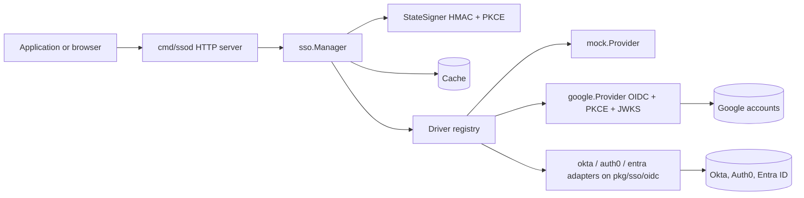
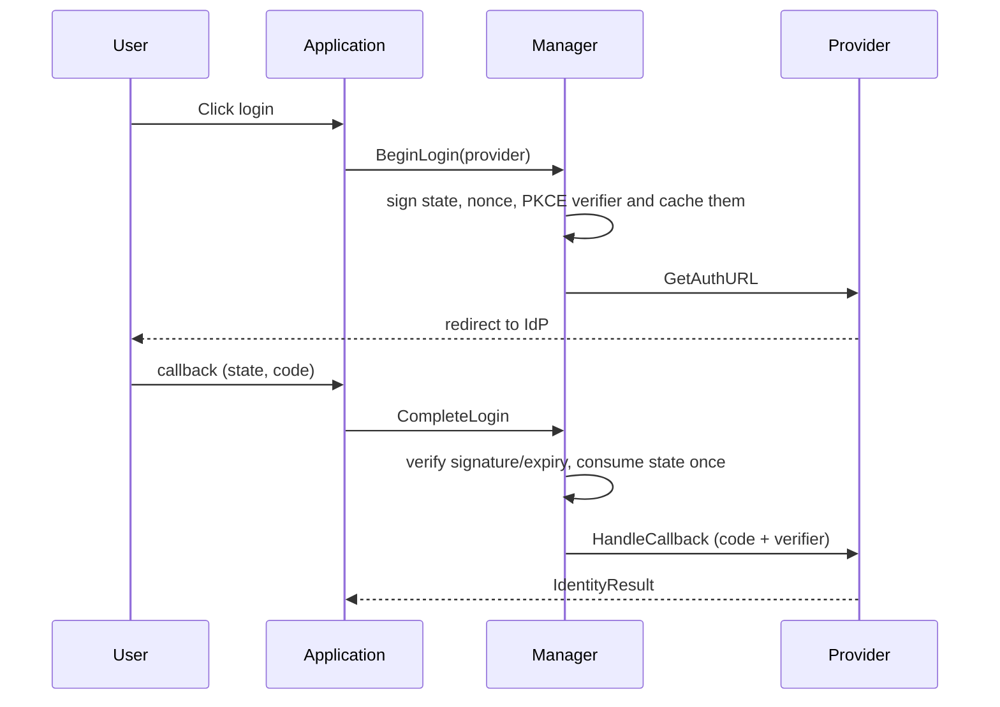

# Universal SSO

A modular Go SDK that gives applications one `Provider` abstraction over OIDC, OAuth 2.0 and SAML 2.0 identity providers. The core ships signed state (HMAC), mandatory PKCE (S256), one-time-use login state, a pluggable cache, a driver registry and an in-memory mock provider for tests.

**Status:** core, `Manager`, registry, mock provider and the **Google OIDC provider** (`pkg/sso/google`) are implemented. The **Okta, Auth0 and Microsoft Entra ID OIDC adapters** (`pkg/sso/okta`, `auth0`, `entra`, on the shared `pkg/sso/oidc`) the **generic OAuth 2.0 adapter** (`pkg/sso/oauth2`) and the **SAML 2.0 adapter** (`pkg/sso/saml`, SP-initiated Web Browser SSO) are implemented and tested against fake IdPs, not yet against live tenants or providers; see [Docs/Architecture.md](Docs/Architecture.md).

## Architecture



## Workflow



## Quick start

See [Docs/Quickstart.md](Docs/Quickstart.md), [Docs/Architecture.md](Docs/Architecture.md) and, for Google sign-in, [Docs/Google-SSO-Setup.md](Docs/Google-SSO-Setup.md).

```bash
cp .env.example .env     # then set SSO_STATE_SECRET to: openssl rand -base64 48 (ssod refuses the example value)
make start               # builds cmd/ssod, runs it detached, prints the URL
make stop                # graceful SIGTERM, SIGKILL after STOP_TIMEOUT
make restart
make test                # go vet + go test -race -cover
```

Before publishing, run `bash .bob/skills/secure-config/scripts/scan_secrets.sh .`, then `scripts/github-push.sh` (interactive helper that sets the remote, commits and pushes).

### Google credential helper (`ssoctl`)

`cmd/ssoctl` validates your Google OAuth setup and runs a PKCE sign-in by hand, independent of `ssod`. It never prints secrets.

```bash
make google-check                        # validate .env (add --offline via go run to skip network)
make google-url                          # print a sign-in URL, saves PKCE session to .run/
make google-exchange CODE='<full redirected URL>'   # exchange the code and check ID-token claims
```

Full walkthrough and troubleshooting: [Docs/Google-SSO-Setup.md](Docs/Google-SSO-Setup.md).

### Example clients (Rust, Go, Python, Java, C#)

`examples/` holds five command-line clients for the gateway: generic OAuth 2.0 in Rust, SAML 2.0 in Go, Auth0 in Python, Okta in Java and Azure AD / Entra ID in C#. They are clients of `ssod`: the gateway keeps the secrets and tokens. The Python (Auth0), Java (Okta) and C# (Entra, id `azure`) clients sign in through their adapters, tested against a fake IdP, not a live tenant. The Rust client signs in through the generic OAuth 2.0 adapter and the Go client through the SAML 2.0 adapter, both tested against fakes. SAML runs end to end with the Go client only: the other four clients require the OAuth `state` and PKCE parameters, which a SAML redirect (`SAMLRequest` and `RelayState`) does not carry. Details, limits and test instructions: [Docs/Examples.md](Docs/Examples.md). Run every suite with `make test-examples`. A generated audit page (status matrix, adapter code, config schema, gate results, open items) is [Docs/Documentation-Audit.html](Docs/Documentation-Audit.html); rebuild it with `make audit-dashboard`.

### Provider setup guides

Each guide follows the same structure: quick-start, how the pieces fit, provider-side setup, configuration values, verification with `curl`/`python3`, security, and troubleshooting.

| Provider | Guide | Adapter status |
|---|---|---|
| Google | [Docs/Google-SSO-Setup.md](Docs/Google-SSO-Setup.md) | Implemented (`pkg/sso/google`) |
| Azure AD / Microsoft Entra ID | [Docs/Azure-AD-SSO-Setup.md](Docs/Azure-AD-SSO-Setup.md) | Implemented (fake-IdP tested) |
| Okta | [Docs/Okta-SSO-Setup.md](Docs/Okta-SSO-Setup.md) | Implemented (fake-IdP tested) |
| Auth0 | [Docs/Auth0-SSO-Setup.md](Docs/Auth0-SSO-Setup.md) | Implemented (fake-IdP tested) |
| Generic OAuth 2.0 | [Docs/OAuth2-SSO-Setup.md](Docs/OAuth2-SSO-Setup.md) | Implemented (`pkg/sso/oauth2`, fake-provider tested) |
| Generic SAML 2.0 | [Docs/SAML-SSO-Setup.md](Docs/SAML-SSO-Setup.md) | Implemented (`pkg/sso/saml`, fake-IdP tested) |

Okta, Auth0, Azure AD, generic OAuth 2.0 and SAML 2.0 are verified against in-process fake servers only (`bash tests/e2e.sh` signs every example client in through each OAuth/OIDC adapter, and the Go client through SAML). They have **not** been exercised against a live tenant or provider. SAML 2.0 does not support encrypted assertions, IdP-initiated SSO, Single Logout or SHA-1, and it is enabled by `SSO_PROVIDERS_SAML_SP_ENTITY_ID` plus IdP metadata (no client id or secret); the guide lists the limits and the manual IdP-side checks.

## Lifecycle scripts

| Command | Script | Behaviour |
|---|---|---|
| `make start` | `scripts/start.sh` | Loads `.env`, builds `.run/ssod`, starts it detached, waits for `/healthz`, prints `URL`, PID and log path. Already running: reports the PID and exits 0. |
| `make stop` | `scripts/stop.sh` | SIGTERM, waits up to `STOP_TIMEOUT` (default 15 s), then SIGKILL. Nothing running or stale PID file: exits 0. |
| `make restart` | stop, then start | |
| `make clean` | `scripts/cleanup.sh [--dry-run]` | Stops the app and removes `.run/`, `node_modules`, `.venv`, `__pycache__`. |

### Launch an example against a provider

| Command | Script | Behaviour |
|---|---|---|
| `make provider-check P=okta` | `scripts/provider-check.sh <okta\|auth0\|azure\|oauth2\|saml> [--online]` | Validates the provider's settings in `.env` (placeholders, https, tenant or endpoints, redirect URI) and prints the redirect URI to register. Never prints secret values. Read-only. |
| `make run-example EX=python` | `scripts/run-example.sh <rust\|go\|python\|java\|csharp> [--mode mock\|e2e\|real] [--provider ID]` | Builds the gateway and the client, starts a gateway, checks that the provider is registered and runs `check` and `login`. `mock` (default) needs no credentials. `e2e` uses fake IdPs. `real` validates your `.env`, starts the project gateway and prints the browser URL. |

`scripts/run-example.sh --list` shows the example-to-provider map. The Rust example defaults to `oauth2`, which now exists. The Go example defaults to `saml`. It also accepts `--provider mock`; the other four examples reject `saml`. Full usage: [Docs/Examples.md](Docs/Examples.md#launch-scripts).

State lives in `.run/` (`app.pid`, `app.log`, `ssod`), which is git-ignored. Variables: `SSO_SERVER_HOST` (default `127.0.0.1`), `SSO_SERVER_PORT` (default `8080`), `SSO_STATE_SECRET` (required), `START_TIMEOUT`, `STOP_TIMEOUT`.

`ssod` endpoints: `GET /` (landing page with login links), `GET /mock/authorize` (local stand-in IdP for the mock provider), `GET /healthz`, `GET /providers`, `GET /auth/{provider}/login`, `GET /auth/{provider}/callback`, `POST /auth/{provider}/callback` (form fields `SAMLResponse` and `RelayState`, used by the SAML adapter; every other provider refuses it because it carries no code). It always registers `mock`, and registers `google` when `SSO_PROVIDERS_GOOGLE_CLIENT_ID` and `SSO_PROVIDERS_GOOGLE_CLIENT_SECRET` are set to real values (optional `SSO_PROVIDERS_GOOGLE_HOSTED_DOMAIN`). The registered providers are logged at startup and listed at `/providers`.

## License

MIT.

Third-party dependencies (the project's only ones, used by `pkg/sso/saml` for XML signature verification): `github.com/russellhaering/goxmldsig` (Apache-2.0), `github.com/beevik/etree` (BSD-2-Clause) and `github.com/jonboulle/clockwork` (Apache-2.0).
