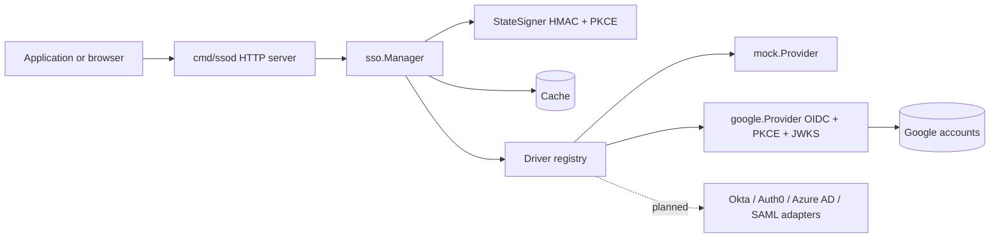
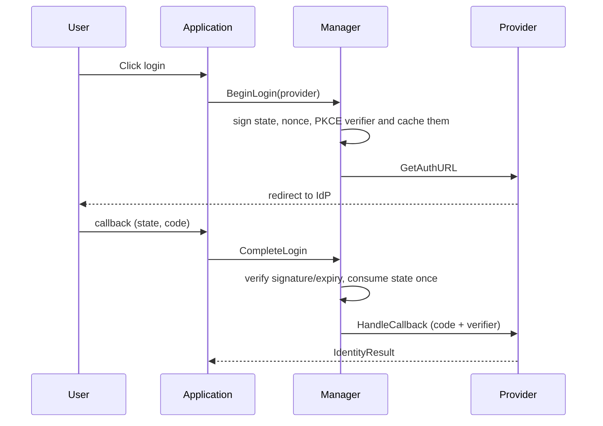

# Universal SSO

A modular Go SDK that gives applications one `Provider` abstraction over OIDC, OAuth 2.0 and SAML 2.0 identity providers. The core ships signed state (HMAC), mandatory PKCE (S256), one-time-use login state, a pluggable cache, a driver registry and an in-memory mock provider for tests.

**Status:** core, `Manager`, registry, mock provider and the **Google OIDC provider** (`pkg/sso/google`) are implemented. Okta, Auth0, Azure AD and SAML adapters are still to do; see [Docs/Architecture.md](Docs/Architecture.md).

## Architecture



## Workflow



## Quick start

See [Docs/Quickstart.md](Docs/Quickstart.md), [Docs/Architecture.md](Docs/Architecture.md) and, for Google sign-in, [Docs/Google-SSO-Setup.md](Docs/Google-SSO-Setup.md).

```bash
cp .env.example .env     # set SSO_STATE_SECRET (>= 32 bytes): openssl rand -base64 48
make start               # builds cmd/ssod, runs it detached, prints the URL
make stop                # graceful SIGTERM, SIGKILL after STOP_TIMEOUT
make restart
make test                # go vet + go test -race -cover
```

### Google credential helper (`ssoctl`)

`cmd/ssoctl` validates your Google OAuth setup and runs a PKCE sign-in by hand, independent of `ssod`. It never prints secrets.

```bash
make google-check                        # validate .env (add --offline via go run to skip network)
make google-url                          # print a sign-in URL, saves PKCE session to .run/
make google-exchange CODE='<full redirected URL>'   # exchange the code and check ID-token claims
```

Full walkthrough and troubleshooting: [Docs/Google-SSO-Setup.md](Docs/Google-SSO-Setup.md).

### Provider setup guides

Each guide follows the same structure: quick-start, how the pieces fit, provider-side setup, configuration values, verification with `curl`/`python3`, security, and troubleshooting.

| Provider | Guide | Adapter status |
|---|---|---|
| Google | [Docs/Google-SSO-Setup.md](Docs/Google-SSO-Setup.md) | Implemented (`pkg/sso/google`) |
| Azure AD / Microsoft Entra ID | [Docs/Azure-AD-SSO-Setup.md](Docs/Azure-AD-SSO-Setup.md) | Planned |
| Okta | [Docs/Okta-SSO-Setup.md](Docs/Okta-SSO-Setup.md) | Planned |
| Auth0 | [Docs/Auth0-SSO-Setup.md](Docs/Auth0-SSO-Setup.md) | Planned |
| Generic SAML 2.0 | [Docs/SAML-SSO-Setup.md](Docs/SAML-SSO-Setup.md) | Planned |
| Generic OAuth 2.0 | [Docs/OAuth2-SSO-Setup.md](Docs/OAuth2-SSO-Setup.md) | Planned |

For the planned providers, the identity-provider side can be configured and verified today with the manual steps in each guide. `ssod` answers `404 PROVIDER_NOT_FOUND` for them until their adapters exist.

## Lifecycle scripts

| Command | Script | Behaviour |
|---|---|---|
| `make start` | `scripts/start.sh` | Loads `.env`, builds `.run/ssod`, starts it detached, waits for `/healthz`, prints `URL`, PID and log path. Already running: reports the PID and exits 0. |
| `make stop` | `scripts/stop.sh` | SIGTERM, waits up to `STOP_TIMEOUT` (default 15 s), then SIGKILL. Nothing running or stale PID file: exits 0. |
| `make restart` | stop, then start | |
| `make clean` | `scripts/cleanup.sh [--dry-run]` | Stops the app and removes `.run/`, `node_modules`, `.venv`, `__pycache__`. |

State lives in `.run/` (`app.pid`, `app.log`, `ssod`), which is git-ignored. Variables: `SSO_SERVER_HOST` (default `127.0.0.1`), `SSO_SERVER_PORT` (default `8080`), `SSO_STATE_SECRET` (required), `START_TIMEOUT`, `STOP_TIMEOUT`.

`ssod` endpoints: `GET /` (landing page with login links), `GET /mock/authorize` (local stand-in IdP for the mock provider), `GET /healthz`, `GET /providers`, `GET /auth/{provider}/login`, `GET /auth/{provider}/callback`. It always registers `mock`, and registers `google` when `SSO_PROVIDERS_GOOGLE_CLIENT_ID` and `SSO_PROVIDERS_GOOGLE_CLIENT_SECRET` are set to real values (optional `SSO_PROVIDERS_GOOGLE_HOSTED_DOMAIN`). The registered providers are logged at startup and listed at `/providers`.

## License

MIT
