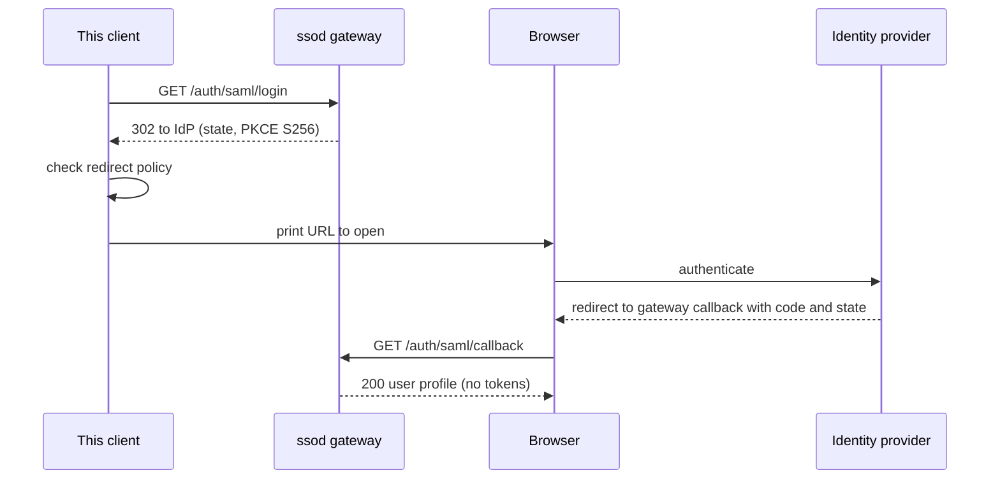

# SAML 2.0 in Go

A Go client for the Universal SSO gateway (`ssod`). It starts a sign-in for the `saml` provider with a SAML 2.0 identity provider, checks the redirect the gateway returns, and completes the sign-in without a browser for the mock provider, and for `saml` against the test IdP used by `bash tests/e2e.sh`.

> **Read this first.** This client talks to the gateway in this repository. The gateway implements `mock`, `google`, `okta`, `auth0`, `azure`, generic `oauth2` and `saml`. Okta, Auth0, Azure, OAuth 2.0 and SAML 2.0 are tested only against in-process fake IdPs (`bash tests/e2e.sh` in the repository root), not against live tenants. This is the one client that can complete a SAML sign-in: SAML does not support encrypted assertions, IdP-initiated SSO or Single Logout. A provider that is not configured in the gateway answers `404 PROVIDER_NOT_FOUND`, which this client reports clearly. The full flow runs without a browser with `make login-mock` or `bash tests/e2e.sh`. See [Provider status](../../Docs/Quickstart.md#provider-status).

## What this client does, and does not do

| Does | Does not |
|---|---|
| Checks the gateway: `GET /healthz`, `GET /providers` | Hold OAuth client ids, secrets or signing keys. They stay in the gateway's `.env` |
| Starts a login: `GET /auth/{provider}/login` | Create or verify the signed `state`, PKCE verifier or nonce. The gateway does |
| Refuses unsafe redirects: non-https IdP, wrong host, missing `state`, missing PKCE `S256` | Receive tokens. The gateway's callback returns the user profile only and never echoes tokens |
| Reads the profile from `GET /auth/{provider}/callback` (mock), or posts the test IdP's form to `POST /auth/saml/callback` (`-follow`) | Manage sessions, refresh tokens or call protected APIs. The gateway has no such endpoints yet |

Token refresh, session cookies and protected-resource calls need gateway features that do not exist today. Adding fake ones to a client would be misleading, so they are left out on purpose.

## Gateway contract

| Request | Success | Error |
|---|---|---|
| `GET /healthz` | `200 {"status":"ok"}` | |
| `GET /providers` | `200 {"providers":["mock","google"]}` | |
| `GET /auth/{provider}/login` | `302` to the IdP authorization URL, carrying `state` and PKCE `code_challenge` (`S256`) | `{"code","message"}`, for example `404 PROVIDER_NOT_FOUND` |
| `GET /auth/{provider}/callback` | `200 {"provider_id","user":{id,email,email_verified,display_name,roles}}` | `400 STATE_MISMATCH`, `400 STATE_EXPIRED`, `401 IDP_REJECTED` |

The callback URL registered with the identity provider is the **gateway's**: `<SSO_SERVER_BASE_URL>/auth/saml/callback`. This client has no callback of its own.



## Prerequisites

- Go 1.22 or newer
- A running gateway (default `http://localhost:8080`): `make start` in the repository root.
- For a real provider: its adapter in the gateway, plus a sandbox tenant with credentials from [Docs/SAML-SSO-Setup.md](../../Docs/SAML-SSO-Setup.md). None are included here.

## Configure

```bash
cp .env.example .env     # then edit; .env is git-ignored
```

| Variable | Default | Meaning |
|---|---|---|
| `SSO_GATEWAY_URL` | `http://localhost:8080` | gateway base URL; plain http only for loopback |
| `SSO_PROVIDER` | `saml` | provider id registered in the gateway |
| `SSO_EXPECTED_IDP_HOST` | empty | pin the IdP host (the host or a subdomain of it) |
| `SSO_HTTP_TIMEOUT_SECONDS` | `10` | request timeout, 1 to 300 |
| `SSO_LOG_LEVEL` | `warn` | `debug`, `info` or `warn` |

The `Makefile` loads `.env` when it exists. Values are read from the process environment, so you can also export them.

## Run

```bash
make check                          # gateway reachable and provider registered
make login                          # prints the URL to open in a browser
make login-mock                     # full sign-in without a browser, mock provider only
```

Against the repository's gateway with only the mock provider registered:

```text
$ make login-mock
signed in via mock as Mock User (user@example.test)
$ make login
the gateway has no such provider. Its adapter may not be implemented yet: see Docs/Architecture.md
```

Exit codes: `0` success, `1` failure (gateway error, refused redirect, provider missing), `2` bad usage or configuration.

## Test

```bash
make test
```

This runs:

```bash
go vet ./... && go test -race -cover ./...
```

The tests start an in-process fake of the gateway contract, so they need no network and no credentials. They cover configuration validation, every redirect-policy rule, the mock flow, structured gateway errors, non-JSON error bodies and an unreachable gateway. The live check against a real `ssod` is the `make login-mock` run above.

## Build and deploy

```bash
make build
```

This runs:

```bash
go build -o bin/saml2-go .
```

This is a command-line client. To deploy it, ship the built artifact and set the variables above. Use `https` for `SSO_GATEWAY_URL` outside loopback: the configuration loader rejects plain http for other hosts.

## Security notes

- **Secrets:** none are read or stored here. Do not put OAuth client secrets in this client's `.env`.
- **Redirect policy:** an external identity provider must use https. With `SSO_EXPECTED_IDP_HOST` set, look-alike hosts such as `notexample.com` are refused.
- **PKCE:** a redirect without `code_challenge_method=S256` is refused.
- **Bounded input:** response bodies are capped at 1 MiB, redirects are never followed automatically, and `--follow` stops at the first redirect that leaves the gateway host.
- **Logging:** state values and URLs with query strings are not logged.

### SAML specifics

When the gateway redirects with a `SAMLRequest`, the client decodes it (base64 plus raw DEFLATE, capped at 64 KiB, no external entities) and checks that:

- it is an `AuthnRequest` with an `ID`;
- `Destination`, if present, equals the redirect URL without its query;
- `AssertionConsumerServiceURL`, if present, is on the gateway host;
- a `RelayState` is present (it is returned as the login state).

The client cannot validate the SAML **response** signature. The gateway owns that step. See [../../Docs/SAML-SSO-Setup.md](../../Docs/SAML-SSO-Setup.md).

**`-follow` and the IdP form.** With a real IdP a browser does the sign-in, so `-follow` stops at the redirect. With the test IdP in `bash tests/e2e.sh` (`pkg/sso/saml/samltest`) the IdP answers the redirect with an HTML page holding an auto-submit form. `-follow` detects a `text/html` 200 response, reads only the `SAMLResponse` and `RelayState` fields of the form, and POSTs them to the gateway callback. A form whose action leaves the gateway host is refused (`ErrLeavesGateway`), so the client never sends an assertion to another site. This is how `bash tests/e2e.sh` signs in through `saml` without a browser.

## Layout

```text
main.go                      CLI: check, login [-follow]
internal/gateway/config.go   environment configuration and validation
internal/gateway/client.go   HTTP client (no automatic redirects)
internal/gateway/policy.go   redirect safety policy
internal/gateway/saml.go     SAML AuthnRequest inspection (HTTP-Redirect binding)
```

## License

MIT, same as the repository. See the [root README](../../README.md#license).
